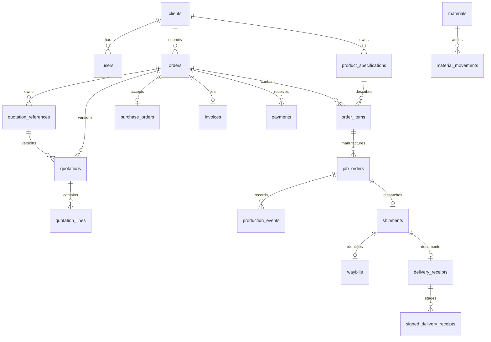

# Proposed schema dictionary

Generated from the ordered SQL definitions. Phase 3 validated these definitions on MariaDB 10.4.32 in enterflow_test_db; enterflow_db remains unmigrated. See PHASE3_VALIDATION.md for evidence and remaining policy/MySQL limits. SQL files remain authoritative. Every table uses InnoDB / utf8mb4 / utf8mb4_unicode_ci. All foreign keys use restrictive deletion/update defaults; no business records cascade away. BIGINT IDs must travel through JavaScript/JSON as strings. NULL means absent/not yet occurred; booleans use MySQL BOOLEAN (TINYINT alias) and must be validated as true/false in the API.

## Core relationships

Cardinalities reflect this draft and require approval for split-order billing. `files` connects through typed link tables or signed_delivery_receipts; the full keys below show those relationships. Quotations may have many revisions; invoice and PO are currently at most one per order; each product can produce multiple JOs and each JO at most one shipment. Split shipments/invoices can be introduced by an approved later design, not inferred silently.

The revised draft retains the original 69 tables and adds quotation_references, for 70 tables. Composite ownership keys bind specifications/items/JOs/finished goods to the same client and invoice/receipt/quotation/stock-response links to the same order. Signed copies use a checked nullable accepted_slot and a unique (DR, slot) key; invoice evidence must reference slot 1. See PHASE2_REVIEW.md for remaining policy decisions and TABLE_REVIEW.md for every table's purpose. Ownership columns repeated in child rows are intentional FK carriers, not independently editable values.

## Normalization and deliberate snapshots

Users/clients, order items, quotation revisions/lines, BOM children, stock response history, production events, file links and notification recipients are separate relational sets. No array-valued JSON or comma-separated foreign keys. Derived balances/progress/recurring-order counts/reports are queried rather than stored independently. Cached stock balances accompany an immutable movement trail and must update in the same transaction. Document totals, material prices/names/units, JO specification/BOM copies and payment instructions are deliberate historical snapshots. Do not update an issued snapshot when a master record changes.

A free-text supplier is the only supplier datum currently modeled; no invented supplier purchasing subsystem. Product dimensions remain typed text columns to preserve the frontend's values until units are specified. Stable workflow enums constrain code-supported choices; roles, modules, filter types, stages, terms, units, categories and delivery methods have seeded lookup tables. Pending states and cross-row limits require service transactions as described in FRONTEND_ANALYSIS.md.

## Tables and columns

### `schema_migrations`

Source: `migrations/001_identity_catalog.sql`

| Column | Definition |
| --- | --- |
| `version` | `VARCHAR(100) NOT NULL PRIMARY KEY` |
| `applied_at` | `DATETIME(3) NOT NULL DEFAULT CURRENT_TIMESTAMP(3)` |

### `roles`

Source: `migrations/001_identity_catalog.sql`

| Column | Definition |
| --- | --- |
| `code` | `VARCHAR(24) NOT NULL PRIMARY KEY` |
| `label` | `VARCHAR(80) NOT NULL` |

### `modules`

Source: `migrations/001_identity_catalog.sql`

| Column | Definition |
| --- | --- |
| `code` | `VARCHAR(40) NOT NULL PRIMARY KEY` |
| `label` | `VARCHAR(80) NOT NULL` |

### `role_modules`

Source: `migrations/001_identity_catalog.sql`

| Column | Definition |
| --- | --- |
| `role_code` | `VARCHAR(24) NOT NULL` |
| `module_code` | `VARCHAR(40) NOT NULL` |

Keys, relationships, indexes and checks:

- `PRIMARY KEY (role_code, module_code)`
- `FOREIGN KEY (role_code) REFERENCES roles(code)`
- `FOREIGN KEY (module_code) REFERENCES modules(code)`

### `payment_terms`

Source: `migrations/001_identity_catalog.sql`

| Column | Definition |
| --- | --- |
| `code` | `VARCHAR(24) NOT NULL PRIMARY KEY` |
| `label` | `VARCHAR(80) NOT NULL` |
| `days_after_receipt` | `SMALLINT UNSIGNED NOT NULL` |

### `clients`

Source: `migrations/001_identity_catalog.sql`

| Column | Definition |
| --- | --- |
| `id` | `BIGINT UNSIGNED NOT NULL AUTO_INCREMENT PRIMARY KEY` |
| `company_name` | `VARCHAR(200) NOT NULL` |
| `industry` | `VARCHAR(120) NULL` |
| `contact_person` | `VARCHAR(160) NULL` |
| `email` | `VARCHAR(254) NULL` |
| `phone` | `VARCHAR(40) NULL` |
| `address_line1` | `VARCHAR(255) NULL` |
| `address_line2` | `VARCHAR(255) NULL` |
| `city_province` | `VARCHAR(160) NULL` |
| `postal_code` | `VARCHAR(20) NULL` |
| `payment_term_code` | `VARCHAR(24) NULL` |
| `internal_notes` | `TEXT NULL` |
| `active` | `BOOLEAN NOT NULL DEFAULT TRUE` |
| `joined_on` | `DATE NULL` |
| `created_at` | `DATETIME(3) NOT NULL DEFAULT CURRENT_TIMESTAMP(3)` |
| `updated_at` | `DATETIME(3) NOT NULL DEFAULT CURRENT_TIMESTAMP(3) ON UPDATE CURRENT_TIMESTAMP(3)` |

Keys, relationships, indexes and checks:

- `UNIQUE KEY uq_client_company (company_name)`
- `FOREIGN KEY (payment_term_code) REFERENCES payment_terms(code)`

### `users`

Source: `migrations/001_identity_catalog.sql`

| Column | Definition |
| --- | --- |
| `id` | `BIGINT UNSIGNED NOT NULL AUTO_INCREMENT PRIMARY KEY` |
| `role_code` | `VARCHAR(24) NOT NULL` |
| `client_id` | `BIGINT UNSIGNED NULL` |
| `account_type` | `ENUM('employee','client') NOT NULL` |
| `display_name` | `VARCHAR(160) NOT NULL` |
| `email` | `VARCHAR(254) NOT NULL` |
| `username` | `VARCHAR(100) NOT NULL` |
| `phone` | `VARCHAR(40) NULL` |
| `password_hash` | `VARCHAR(255) NOT NULL` |
| `employee_number` | `VARCHAR(80) NULL` |
| `department` | `VARCHAR(120) NULL` |
| `job_title` | `VARCHAR(120) NULL` |
| `active` | `BOOLEAN NOT NULL DEFAULT TRUE` |
| `email_alerts` | `BOOLEAN NOT NULL DEFAULT TRUE` |
| `joined_on` | `DATE NULL` |
| `created_at` | `DATETIME(3) NOT NULL DEFAULT CURRENT_TIMESTAMP(3)` |
| `updated_at` | `DATETIME(3) NOT NULL DEFAULT CURRENT_TIMESTAMP(3) ON UPDATE CURRENT_TIMESTAMP(3)` |

Keys, relationships, indexes and checks:

- `UNIQUE KEY uq_user_email (email)`
- `UNIQUE KEY uq_user_username (username)`
- `UNIQUE KEY uq_employee_number (employee_number)`
- `CONSTRAINT ck_user_identity CHECK ( (account_type = 'client' AND role_code = 'client' AND client_id IS NOT NULL AND employee_number IS NULL) OR (account_type = 'employee' AND role_code <> 'client' AND client_id IS NULL) )`
- `FOREIGN KEY (role_code) REFERENCES roles(code)`
- `FOREIGN KEY (client_id) REFERENCES clients(id)`

### `client_applications`

Source: `migrations/001_identity_catalog.sql`

| Column | Definition |
| --- | --- |
| `id` | `BIGINT UNSIGNED NOT NULL AUTO_INCREMENT PRIMARY KEY` |
| `company_name` | `VARCHAR(200) NOT NULL` |
| `contact_person` | `VARCHAR(160) NOT NULL` |
| `email` | `VARCHAR(254) NOT NULL` |
| `username` | `VARCHAR(100) NOT NULL` |
| `phone` | `VARCHAR(40) NULL` |
| `password_hash` | `VARCHAR(255) NOT NULL` |
| `status` | `ENUM('pending','approved','rejected') NOT NULL DEFAULT 'pending'` |
| `submitted_at` | `DATETIME(3) NOT NULL DEFAULT CURRENT_TIMESTAMP(3)` |
| `decided_at` | `DATETIME(3) NULL` |
| `decided_by` | `BIGINT UNSIGNED NULL` |
| `rejection_reason` | `TEXT NULL` |
| `approved_client_id` | `BIGINT UNSIGNED NULL` |

Keys, relationships, indexes and checks:

- `KEY ix_application_review (status, submitted_at)`
- `KEY ix_application_email (email)`
- `KEY ix_application_username (username)`
- `FOREIGN KEY (decided_by) REFERENCES users(id)`
- `FOREIGN KEY (approved_client_id) REFERENCES clients(id)`

### `filter_types`

Source: `migrations/001_identity_catalog.sql`

| Column | Definition |
| --- | --- |
| `code` | `VARCHAR(24) NOT NULL PRIMARY KEY` |
| `label` | `VARCHAR(100) NOT NULL` |
| `template_group` | `VARCHAR(24) NOT NULL` |

### `product_specifications`

Source: `migrations/001_identity_catalog.sql`

| Column | Definition |
| --- | --- |
| `id` | `BIGINT UNSIGNED NOT NULL AUTO_INCREMENT PRIMARY KEY` |
| `client_id` | `BIGINT UNSIGNED NOT NULL` |
| `filter_type_code` | `VARCHAR(24) NOT NULL` |
| `filter_name` | `VARCHAR(200) NOT NULL` |
| `od1` | `VARCHAR(100) NULL` |
| `od2` | `VARCHAR(100) NULL` |
| `id1` | `VARCHAR(100) NULL` |
| `id2` | `VARCHAR(100) NULL` |
| `height` | `VARCHAR(100) NULL` |
| `overall_height` | `VARCHAR(100) NULL` |
| `length` | `VARCHAR(100) NULL` |
| `width` | `VARCHAR(100) NULL` |
| `thickness` | `VARCHAR(100) NULL` |
| `depth` | `VARCHAR(100) NULL` |
| `pocket_count` | `VARCHAR(100) NULL` |
| `diameter` | `VARCHAR(100) NULL` |
| `cloth_cutting_width` | `VARCHAR(100) NULL` |
| `cloth_cutting_length` | `VARCHAR(100) NULL` |
| `spring_plate_center_to_center` | `VARCHAR(100) NULL` |
| `spring_plate_width` | `VARCHAR(100) NULL` |
| `spring_plate_length` | `VARCHAR(100) NULL` |
| `pad_od` | `VARCHAR(100) NULL` |
| `pad_id` | `VARCHAR(100) NULL` |
| `media` | `VARCHAR(255) NULL` |
| `inner_core` | `VARCHAR(255) NULL` |
| `outer_core` | `VARCHAR(255) NULL` |
| `oring` | `VARCHAR(255) NULL` |
| `gasket` | `VARCHAR(255) NULL` |
| `end_cap` | `VARCHAR(255) NULL` |
| `oem_part_number` | `VARCHAR(160) NULL` |
| `brand` | `VARCHAR(160) NULL` |
| `filtration_rating` | `VARCHAR(120) NULL` |
| `others` | `TEXT NULL` |
| `notes` | `TEXT NULL` |
| `created_at` | `DATETIME(3) NOT NULL DEFAULT CURRENT_TIMESTAMP(3)` |

Keys, relationships, indexes and checks:

- `UNIQUE KEY uq_spec_client (id, client_id)`
- `FOREIGN KEY (client_id) REFERENCES clients(id)`
- `FOREIGN KEY (filter_type_code) REFERENCES filter_types(code)`

### `material_categories`

Source: `migrations/001_identity_catalog.sql`

| Column | Definition |
| --- | --- |
| `code` | `VARCHAR(32) NOT NULL PRIMARY KEY` |
| `label` | `VARCHAR(80) NOT NULL` |

### `units`

Source: `migrations/001_identity_catalog.sql`

| Column | Definition |
| --- | --- |
| `code` | `VARCHAR(16) NOT NULL PRIMARY KEY` |
| `label` | `VARCHAR(40) NOT NULL` |

### `materials`

Source: `migrations/001_identity_catalog.sql`

| Column | Definition |
| --- | --- |
| `id` | `BIGINT UNSIGNED NOT NULL AUTO_INCREMENT PRIMARY KEY` |
| `name` | `VARCHAR(200) NOT NULL` |
| `category_code` | `VARCHAR(32) NOT NULL` |
| `unit_code` | `VARCHAR(16) NOT NULL` |
| `unit_price` | `DECIMAL(15,4) NOT NULL DEFAULT 0` |
| `quantity_on_hand` | `DECIMAL(15,4) NOT NULL DEFAULT 0` |
| `reorder_threshold` | `DECIMAL(15,4) NOT NULL DEFAULT 0` |
| `supplier_name` | `VARCHAR(200) NULL` |
| `active` | `BOOLEAN NOT NULL DEFAULT TRUE` |
| `updated_at` | `DATETIME(3) NOT NULL DEFAULT CURRENT_TIMESTAMP(3) ON UPDATE CURRENT_TIMESTAMP(3)` |

Keys, relationships, indexes and checks:

- `CONSTRAINT ck_material_values CHECK (unit_price >= 0 AND quantity_on_hand >= 0 AND reorder_threshold >= 0)`
- `KEY ix_material_category (category_code, name)`
- `FOREIGN KEY (category_code) REFERENCES material_categories(code)`
- `FOREIGN KEY (unit_code) REFERENCES units(code)`

### `bom_templates`

Source: `migrations/001_identity_catalog.sql`

| Column | Definition |
| --- | --- |
| `id` | `BIGINT UNSIGNED NOT NULL AUTO_INCREMENT PRIMARY KEY` |
| `name` | `VARCHAR(200) NOT NULL` |
| `filter_type_code` | `VARCHAR(24) NOT NULL` |
| `size_label` | `VARCHAR(40) NULL` |
| `labor_cost` | `DECIMAL(15,4) NOT NULL DEFAULT 0` |
| `markup_percent` | `DECIMAL(9,4) NOT NULL DEFAULT 0` |
| `discount_percent` | `DECIMAL(7,4) NOT NULL DEFAULT 0` |
| `vat_type` | `ENUM('Exclusive','Inclusive','Zero-Rated') NOT NULL` |
| `vat_rate` | `DECIMAL(7,4) NOT NULL` |
| `include_labor` | `BOOLEAN NOT NULL` |
| `apply_markup` | `BOOLEAN NOT NULL` |
| `apply_vat` | `BOOLEAN NOT NULL` |
| `notes` | `TEXT NULL` |
| `created_by` | `BIGINT UNSIGNED NOT NULL` |
| `created_at` | `DATETIME(3) NOT NULL DEFAULT CURRENT_TIMESTAMP(3)` |

Keys, relationships, indexes and checks:

- `CONSTRAINT ck_template_cost CHECK (labor_cost >= 0 AND markup_percent >= 0 AND discount_percent BETWEEN 0 AND 100 AND vat_rate BETWEEN 0 AND 100)`
- `FOREIGN KEY (filter_type_code) REFERENCES filter_types(code)`
- `FOREIGN KEY (created_by) REFERENCES users(id)`

### `bom_template_lines`

Source: `migrations/001_identity_catalog.sql`

| Column | Definition |
| --- | --- |
| `id` | `BIGINT UNSIGNED NOT NULL AUTO_INCREMENT PRIMARY KEY` |
| `template_id` | `BIGINT UNSIGNED NOT NULL` |
| `line_number` | `SMALLINT UNSIGNED NOT NULL` |
| `material_id` | `BIGINT UNSIGNED NOT NULL` |
| `quantity_per_filter` | `DECIMAL(15,4) NOT NULL` |
| `waste_percent` | `DECIMAL(7,4) NOT NULL DEFAULT 0` |

Keys, relationships, indexes and checks:

- `UNIQUE KEY uq_template_line (template_id, line_number)`
- `CONSTRAINT ck_template_qty CHECK (quantity_per_filter > 0 AND waste_percent BETWEEN 0 AND 100)`
- `FOREIGN KEY (template_id) REFERENCES bom_templates(id)`
- `FOREIGN KEY (material_id) REFERENCES materials(id)`

### `files`

Source: `migrations/001_identity_catalog.sql`

| Column | Definition |
| --- | --- |
| `id` | `BIGINT UNSIGNED NOT NULL AUTO_INCREMENT PRIMARY KEY` |
| `original_filename` | `VARCHAR(255) NOT NULL` |
| `mime_type` | `VARCHAR(120) NOT NULL` |
| `size_bytes` | `BIGINT UNSIGNED NOT NULL` |
| `bucket` | `VARCHAR(63) CHARACTER SET ascii COLLATE ascii_bin NOT NULL` |
| `object_path` | `VARCHAR(700) CHARACTER SET ascii COLLATE ascii_bin NOT NULL` |
| `object_generation` | `VARCHAR(30) CHARACTER SET ascii COLLATE ascii_bin NULL` |
| `sha256` | `CHAR(64) CHARACTER SET ascii COLLATE ascii_bin NULL` |
| `state` | `ENUM('pending','available','failed','deleted') NOT NULL DEFAULT 'pending'` |
| `uploaded_by` | `BIGINT UNSIGNED NOT NULL` |
| `uploaded_at` | `DATETIME(3) NOT NULL DEFAULT CURRENT_TIMESTAMP(3)` |
| `deleted_at` | `DATETIME(3) NULL` |

Keys, relationships, indexes and checks:

- `UNIQUE KEY uq_storage_object (bucket, object_path)`
- `KEY ix_files_cleanup (state, uploaded_at)`
- `FOREIGN KEY (uploaded_by) REFERENCES users(id)`

### `order_stages`

Source: `migrations/002_orders_quotations.sql`

| Column | Definition |
| --- | --- |
| `code` | `VARCHAR(32) NOT NULL PRIMARY KEY` |
| `label` | `VARCHAR(80) NOT NULL` |
| `display_order` | `SMALLINT UNSIGNED NOT NULL` |

### `delivery_methods`

Source: `migrations/002_orders_quotations.sql`

| Column | Definition |
| --- | --- |
| `code` | `VARCHAR(32) NOT NULL PRIMARY KEY` |
| `label` | `VARCHAR(80) NOT NULL` |

### `orders`

Source: `migrations/002_orders_quotations.sql`

| Column | Definition |
| --- | --- |
| `id` | `BIGINT UNSIGNED NOT NULL AUTO_INCREMENT PRIMARY KEY` |
| `reference` | `VARCHAR(60) NOT NULL` |
| `client_id` | `BIGINT UNSIGNED NOT NULL` |
| `contact_person` | `VARCHAR(160) NOT NULL` |
| `stage_code` | `VARCHAR(32) NOT NULL` |
| `payment_term_code` | `VARCHAR(24) NOT NULL` |
| `delivery_method_code` | `VARCHAR(32) NULL` |
| `submitted_at` | `DATETIME(3) NOT NULL DEFAULT CURRENT_TIMESTAMP(3)` |
| `created_by` | `BIGINT UNSIGNED NOT NULL` |
| `general_notes` | `TEXT NULL` |
| `urgent` | `BOOLEAN NOT NULL DEFAULT FALSE` |
| `requested_delivery_date` | `DATE NULL` |
| `reorder_source_id` | `BIGINT UNSIGNED NULL` |
| `archive_reason` | `ENUM('rejected','cancelled') NULL` |
| `archive_note` | `TEXT NULL` |
| `archived_at` | `DATETIME(3) NULL` |
| `archived_by` | `BIGINT UNSIGNED NULL` |
| `fulfillment_completed_at` | `DATETIME(3) NULL` |
| `updated_at` | `DATETIME(3) NOT NULL DEFAULT CURRENT_TIMESTAMP(3) ON UPDATE CURRENT_TIMESTAMP(3)` |

Keys, relationships, indexes and checks:

- `UNIQUE KEY uq_order_reference (reference)`
- `UNIQUE KEY uq_order_client_pair (id, client_id)`
- `KEY ix_order_client (client_id, submitted_at)`
- `KEY ix_order_queue (stage_code, archived_at, urgent, requested_delivery_date)`
- `FOREIGN KEY (client_id) REFERENCES clients(id)`
- `FOREIGN KEY (stage_code) REFERENCES order_stages(code)`
- `FOREIGN KEY (payment_term_code) REFERENCES payment_terms(code)`
- `FOREIGN KEY (delivery_method_code) REFERENCES delivery_methods(code)`
- `FOREIGN KEY (created_by) REFERENCES users(id)`
- `FOREIGN KEY (archived_by) REFERENCES users(id)`
- `FOREIGN KEY (reorder_source_id, client_id) REFERENCES orders(id, client_id)`

### `order_items`

Source: `migrations/002_orders_quotations.sql`

| Column | Definition |
| --- | --- |
| `id` | `BIGINT UNSIGNED NOT NULL AUTO_INCREMENT PRIMARY KEY` |
| `order_id` | `BIGINT UNSIGNED NOT NULL` |
| `client_id` | `BIGINT UNSIGNED NOT NULL` |
| `line_number` | `SMALLINT UNSIGNED NOT NULL` |
| `specification_id` | `BIGINT UNSIGNED NOT NULL` |
| `quantity` | `INT UNSIGNED NOT NULL` |

Keys, relationships, indexes and checks:

- `UNIQUE KEY uq_order_item_line (order_id, line_number)`
- `UNIQUE KEY uq_item_order (id, order_id)`
- `UNIQUE KEY uq_item_client (id, client_id)`
- `UNIQUE KEY uq_item_order_client (id, order_id, client_id)`
- `CONSTRAINT ck_order_item_qty CHECK (quantity >= 10)`
- `FOREIGN KEY (order_id, client_id) REFERENCES orders(id, client_id)`
- `FOREIGN KEY (specification_id, client_id) REFERENCES product_specifications(id, client_id)`

### `quotation_references`

Source: `migrations/002_orders_quotations.sql`

| Column | Definition |
| --- | --- |
| `reference` | `VARCHAR(60) NOT NULL PRIMARY KEY` |
| `order_id` | `BIGINT UNSIGNED NOT NULL` |

Keys, relationships, indexes and checks:

- `UNIQUE KEY uq_quote_reference_owner (reference, order_id)`
- `FOREIGN KEY (order_id) REFERENCES orders(id)`

### `quotations`

Source: `migrations/002_orders_quotations.sql`

| Column | Definition |
| --- | --- |
| `id` | `BIGINT UNSIGNED NOT NULL AUTO_INCREMENT PRIMARY KEY` |
| `order_id` | `BIGINT UNSIGNED NOT NULL` |
| `reference` | `VARCHAR(60) NOT NULL` |
| `revision_number` | `SMALLINT UNSIGNED NOT NULL` |
| `status` | `ENUM('draft','sent','superseded') NOT NULL DEFAULT 'draft'` |
| `issued_on` | `DATE NOT NULL` |
| `valid_until` | `DATE NOT NULL` |
| `payment_term_code` | `VARCHAR(24) NOT NULL` |
| `time_of_delivery` | `VARCHAR(255) NOT NULL` |
| `place_of_delivery` | `TEXT NOT NULL` |
| `note` | `TEXT NULL` |
| `note_highlighted` | `BOOLEAN NOT NULL DEFAULT FALSE` |
| `total_amount` | `DECIMAL(15,2) NOT NULL` |
| `downpayment_percent` | `DECIMAL(7,4) NOT NULL DEFAULT 0` |
| `downpayment_amount` | `DECIMAL(15,2) NOT NULL DEFAULT 0` |
| `stock_checked_at` | `DATETIME(3) NULL` |
| `prepared_by` | `BIGINT UNSIGNED NOT NULL` |
| `sent_by` | `BIGINT UNSIGNED NULL` |
| `sent_at` | `DATETIME(3) NULL` |
| `created_at` | `DATETIME(3) NOT NULL DEFAULT CURRENT_TIMESTAMP(3)` |

Keys, relationships, indexes and checks:

- `UNIQUE KEY uq_quote_revision (order_id, revision_number)`
- `UNIQUE KEY uq_quote_reference_revision (reference, revision_number)`
- `UNIQUE KEY uq_quote_order (id, order_id)`
- `CONSTRAINT ck_quote_amounts CHECK (total_amount >= 0 AND downpayment_percent BETWEEN 0 AND 100 AND downpayment_amount BETWEEN 0 AND total_amount)`
- `CONSTRAINT ck_quote_dates CHECK (valid_until >= issued_on)`
- `FOREIGN KEY (reference, order_id) REFERENCES quotation_references(reference, order_id)`
- `FOREIGN KEY (payment_term_code) REFERENCES payment_terms(code)`
- `FOREIGN KEY (prepared_by) REFERENCES users(id)`
- `FOREIGN KEY (sent_by) REFERENCES users(id)`

### `quotation_lines`

Source: `migrations/002_orders_quotations.sql`

| Column | Definition |
| --- | --- |
| `id` | `BIGINT UNSIGNED NOT NULL AUTO_INCREMENT PRIMARY KEY` |
| `quotation_id` | `BIGINT UNSIGNED NOT NULL` |
| `order_id` | `BIGINT UNSIGNED NOT NULL` |
| `order_item_id` | `BIGINT UNSIGNED NULL` |
| `line_number` | `SMALLINT UNSIGNED NOT NULL` |
| `description` | `VARCHAR(255) NOT NULL` |
| `sub_description` | `TEXT NULL` |
| `quantity` | `DECIMAL(15,4) NOT NULL` |
| `unit_label` | `VARCHAR(40) NOT NULL` |
| `unit_price` | `DECIMAL(15,4) NOT NULL` |

Keys, relationships, indexes and checks:

- `UNIQUE KEY uq_quote_line (quotation_id, line_number)`
- `CONSTRAINT ck_quote_line_values CHECK (quantity > 0 AND unit_price >= 0)`
- `FOREIGN KEY (quotation_id, order_id) REFERENCES quotations(id, order_id)`
- `FOREIGN KEY (order_item_id, order_id) REFERENCES order_items(id, order_id)`

### `quotation_costing`

Source: `migrations/002_orders_quotations.sql`

| Column | Definition |
| --- | --- |
| `id` | `BIGINT UNSIGNED NOT NULL AUTO_INCREMENT PRIMARY KEY` |
| `quotation_id` | `BIGINT UNSIGNED NOT NULL` |
| `order_id` | `BIGINT UNSIGNED NOT NULL` |
| `order_item_id` | `BIGINT UNSIGNED NOT NULL` |
| `labor_cost` | `DECIMAL(15,4) NOT NULL` |
| `markup_percent` | `DECIMAL(9,4) NOT NULL` |
| `discount_percent` | `DECIMAL(7,4) NOT NULL DEFAULT 0` |
| `vat_type` | `ENUM('Exclusive','Inclusive','Zero-Rated') NOT NULL` |
| `vat_rate` | `DECIMAL(7,4) NOT NULL` |
| `include_labor` | `BOOLEAN NOT NULL` |
| `apply_markup` | `BOOLEAN NOT NULL` |
| `apply_vat` | `BOOLEAN NOT NULL` |
| `calculated_unit_price` | `DECIMAL(15,4) NOT NULL` |

Keys, relationships, indexes and checks:

- `UNIQUE KEY uq_costing_item (quotation_id, order_item_id)`
- `UNIQUE KEY uq_costing_source (id, order_item_id, order_id)`
- `CONSTRAINT ck_costing_values CHECK (labor_cost >= 0 AND markup_percent >= 0 AND discount_percent BETWEEN 0 AND 100 AND vat_rate BETWEEN 0 AND 100 AND calculated_unit_price >= 0)`
- `FOREIGN KEY (quotation_id, order_id) REFERENCES quotations(id, order_id)`
- `FOREIGN KEY (order_item_id, order_id) REFERENCES order_items(id, order_id)`

### `quotation_bom_lines`

Source: `migrations/002_orders_quotations.sql`

| Column | Definition |
| --- | --- |
| `id` | `BIGINT UNSIGNED NOT NULL AUTO_INCREMENT PRIMARY KEY` |
| `costing_id` | `BIGINT UNSIGNED NOT NULL` |
| `line_number` | `SMALLINT UNSIGNED NOT NULL` |
| `material_id` | `BIGINT UNSIGNED NOT NULL` |
| `material_name_snapshot` | `VARCHAR(200) NOT NULL` |
| `unit_snapshot` | `VARCHAR(40) NOT NULL` |
| `unit_price_snapshot` | `DECIMAL(15,4) NOT NULL` |
| `quantity_per_filter` | `DECIMAL(15,4) NOT NULL` |
| `waste_percent` | `DECIMAL(7,4) NOT NULL DEFAULT 0` |

Keys, relationships, indexes and checks:

- `UNIQUE KEY uq_costing_bom_line (costing_id, line_number)`
- `CONSTRAINT ck_quote_bom_values CHECK (unit_price_snapshot >= 0 AND quantity_per_filter > 0 AND waste_percent BETWEEN 0 AND 100)`
- `FOREIGN KEY (costing_id) REFERENCES quotation_costing(id)`
- `FOREIGN KEY (material_id) REFERENCES materials(id)`

### `quotation_discounts`

Source: `migrations/002_orders_quotations.sql`

| Column | Definition |
| --- | --- |
| `quotation_id` | `BIGINT UNSIGNED NOT NULL` |
| `line_number` | `SMALLINT UNSIGNED NOT NULL` |
| `label` | `VARCHAR(160) NOT NULL` |
| `percent` | `DECIMAL(7,4) NOT NULL` |

Keys, relationships, indexes and checks:

- `PRIMARY KEY (quotation_id, line_number)`
- `CONSTRAINT ck_quote_discount CHECK (percent BETWEEN 0 AND 100)`
- `FOREIGN KEY (quotation_id) REFERENCES quotations(id)`

### `quotation_addons`

Source: `migrations/002_orders_quotations.sql`

| Column | Definition |
| --- | --- |
| `id` | `BIGINT UNSIGNED NOT NULL AUTO_INCREMENT PRIMARY KEY` |
| `quotation_id` | `BIGINT UNSIGNED NOT NULL` |
| `kind` | `ENUM('packaging','shipping') NOT NULL` |
| `material_id` | `BIGINT UNSIGNED NULL` |
| `label` | `VARCHAR(200) NOT NULL` |
| `quantity` | `DECIMAL(15,4) NOT NULL` |
| `unit_price` | `DECIMAL(15,4) NOT NULL` |
| `include_in_unit_price` | `BOOLEAN NOT NULL` |

Keys, relationships, indexes and checks:

- `UNIQUE KEY uq_quote_addon (quotation_id, kind)`
- `CONSTRAINT ck_addon_values CHECK (quantity > 0 AND unit_price >= 0)`
- `FOREIGN KEY (quotation_id) REFERENCES quotations(id)`
- `FOREIGN KEY (material_id) REFERENCES materials(id)`

### `purchase_orders`

Source: `migrations/002_orders_quotations.sql`

| Column | Definition |
| --- | --- |
| `id` | `BIGINT UNSIGNED NOT NULL AUTO_INCREMENT PRIMARY KEY` |
| `order_id` | `BIGINT UNSIGNED NOT NULL` |
| `accepted_quotation_id` | `BIGINT UNSIGNED NOT NULL` |
| `reference` | `VARCHAR(60) NOT NULL` |
| `client_reference` | `VARCHAR(160) NULL` |
| `uploaded_at` | `DATETIME(3) NOT NULL DEFAULT CURRENT_TIMESTAMP(3)` |
| `uploaded_by` | `BIGINT UNSIGNED NOT NULL` |
| `received_at` | `DATETIME(3) NULL` |
| `received_by` | `BIGINT UNSIGNED NULL` |
| `cleared_at` | `DATETIME(3) NULL` |
| `cleared_by` | `BIGINT UNSIGNED NULL` |

Keys, relationships, indexes and checks:

- `UNIQUE KEY uq_po_order (order_id)`
- `UNIQUE KEY uq_po_reference (reference)`
- `FOREIGN KEY (order_id) REFERENCES orders(id)`
- `FOREIGN KEY (accepted_quotation_id, order_id) REFERENCES quotations(id, order_id)`
- `FOREIGN KEY (uploaded_by) REFERENCES users(id)`
- `FOREIGN KEY (received_by) REFERENCES users(id)`
- `FOREIGN KEY (cleared_by) REFERENCES users(id)`

### `order_requests`

Source: `migrations/002_orders_quotations.sql`

| Column | Definition |
| --- | --- |
| `id` | `BIGINT UNSIGNED NOT NULL AUTO_INCREMENT PRIMARY KEY` |
| `order_id` | `BIGINT UNSIGNED NOT NULL` |
| `kind` | `ENUM('cancellation','quotation_revision','urgent_upgrade') NOT NULL` |
| `reason` | `TEXT NOT NULL` |
| `response` | `TEXT NULL` |
| `requested_by` | `BIGINT UNSIGNED NOT NULL` |
| `requested_at` | `DATETIME(3) NOT NULL DEFAULT CURRENT_TIMESTAMP(3)` |
| `status` | `ENUM('pending','approved','declined','completed') NOT NULL DEFAULT 'pending'` |
| `decided_by` | `BIGINT UNSIGNED NULL` |
| `decided_at` | `DATETIME(3) NULL` |

Keys, relationships, indexes and checks:

- `KEY ix_order_request_queue (status, kind, requested_at)`
- `FOREIGN KEY (order_id) REFERENCES orders(id)`
- `FOREIGN KEY (requested_by) REFERENCES users(id)`
- `FOREIGN KEY (decided_by) REFERENCES users(id)`

### `document_sequences`

Source: `migrations/002_orders_quotations.sql`

| Column | Definition |
| --- | --- |
| `document_type` | `VARCHAR(16) NOT NULL` |
| `document_year` | `SMALLINT UNSIGNED NOT NULL` |
| `last_value` | `BIGINT UNSIGNED NOT NULL DEFAULT 0` |

Keys, relationships, indexes and checks:

- `PRIMARY KEY (document_type, document_year)`

### `production_stages`

Source: `migrations/003_operations_billing.sql`

| Column | Definition |
| --- | --- |
| `position` | `SMALLINT UNSIGNED NOT NULL PRIMARY KEY` |
| `label` | `VARCHAR(120) NOT NULL` |

Keys, relationships, indexes and checks:

- `CONSTRAINT ck_production_position CHECK (position BETWEEN 0 AND 8)`

### `replacement_requests`

Source: `migrations/003_operations_billing.sql`

| Column | Definition |
| --- | --- |
| `id` | `BIGINT UNSIGNED NOT NULL AUTO_INCREMENT PRIMARY KEY` |
| `order_id` | `BIGINT UNSIGNED NOT NULL` |
| `reason` | `TEXT NOT NULL` |
| `defect_description` | `TEXT NOT NULL` |
| `quantity` | `INT UNSIGNED NOT NULL` |
| `status` | `ENUM('pending','processing','resolved') NOT NULL DEFAULT 'pending'` |
| `requested_at` | `DATETIME(3) NOT NULL DEFAULT CURRENT_TIMESTAMP(3)` |
| `requested_by` | `BIGINT UNSIGNED NOT NULL` |
| `resolved_at` | `DATETIME(3) NULL` |
| `resolved_by` | `BIGINT UNSIGNED NULL` |

Keys, relationships, indexes and checks:

- `UNIQUE KEY uq_replacement_order_pair (id, order_id)`
- `CONSTRAINT ck_replacement_qty CHECK (quantity > 0)`
- `FOREIGN KEY (order_id) REFERENCES orders(id)`
- `FOREIGN KEY (requested_by) REFERENCES users(id)`
- `FOREIGN KEY (resolved_by) REFERENCES users(id)`

### `job_orders`

Source: `migrations/003_operations_billing.sql`

| Column | Definition |
| --- | --- |
| `id` | `BIGINT UNSIGNED NOT NULL AUTO_INCREMENT PRIMARY KEY` |
| `reference` | `VARCHAR(60) NOT NULL` |
| `order_id` | `BIGINT UNSIGNED NOT NULL` |
| `client_id` | `BIGINT UNSIGNED NOT NULL` |
| `order_item_id` | `BIGINT UNSIGNED NOT NULL` |
| `specification_id` | `BIGINT UNSIGNED NOT NULL` |
| `replacement_request_id` | `BIGINT UNSIGNED NULL` |
| `costing_id` | `BIGINT UNSIGNED NULL` |
| `quantity` | `INT UNSIGNED NOT NULL` |
| `production_due_date` | `DATE NOT NULL` |
| `current_stage_cursor` | `SMALLINT UNSIGNED NOT NULL DEFAULT 0` |
| `status` | `ENUM('jo','in_production','quality_inspection','ready_for_dispatch','cancelled') NOT NULL DEFAULT 'jo'` |
| `paused` | `BOOLEAN NOT NULL DEFAULT FALSE` |
| `pause_reason` | `TEXT NULL` |
| `materials_deducted_at` | `DATETIME(3) NULL` |
| `completed_at` | `DATETIME(3) NULL` |
| `created_at` | `DATETIME(3) NOT NULL DEFAULT CURRENT_TIMESTAMP(3)` |
| `created_by` | `BIGINT UNSIGNED NOT NULL` |

Keys, relationships, indexes and checks:

- `UNIQUE KEY uq_jo_reference (reference)`
- `UNIQUE KEY uq_job_order_pair (id, order_id)`
- `UNIQUE KEY uq_job_client_pair (id, client_id)`
- `KEY ix_jo_queue (status, paused, production_due_date)`
- `CONSTRAINT ck_jo_values CHECK (quantity > 0 AND current_stage_cursor BETWEEN 0 AND 9)`
- `FOREIGN KEY (order_item_id, order_id, client_id) REFERENCES order_items(id, order_id, client_id)`
- `FOREIGN KEY (specification_id, client_id) REFERENCES product_specifications(id, client_id)`
- `FOREIGN KEY (replacement_request_id, order_id) REFERENCES replacement_requests(id, order_id)`
- `FOREIGN KEY (costing_id, order_item_id, order_id) REFERENCES quotation_costing(id, order_item_id, order_id)`
- `FOREIGN KEY (created_by) REFERENCES users(id)`

### `job_bom_lines`

Source: `migrations/003_operations_billing.sql`

| Column | Definition |
| --- | --- |
| `id` | `BIGINT UNSIGNED NOT NULL AUTO_INCREMENT PRIMARY KEY` |
| `job_order_id` | `BIGINT UNSIGNED NOT NULL` |
| `line_number` | `SMALLINT UNSIGNED NOT NULL` |
| `material_id` | `BIGINT UNSIGNED NOT NULL` |
| `material_name_snapshot` | `VARCHAR(200) NOT NULL` |
| `unit_snapshot` | `VARCHAR(40) NOT NULL` |
| `unit_price_snapshot` | `DECIMAL(15,4) NOT NULL` |
| `quantity_per_filter` | `DECIMAL(15,4) NOT NULL` |
| `waste_percent` | `DECIMAL(7,4) NOT NULL DEFAULT 0` |

Keys, relationships, indexes and checks:

- `UNIQUE KEY uq_job_bom_line (job_order_id, line_number)`
- `CONSTRAINT ck_job_bom_values CHECK (unit_price_snapshot >= 0 AND quantity_per_filter > 0 AND waste_percent BETWEEN 0 AND 100)`
- `FOREIGN KEY (job_order_id) REFERENCES job_orders(id)`
- `FOREIGN KEY (material_id) REFERENCES materials(id)`

### `production_events`

Source: `migrations/003_operations_billing.sql`

| Column | Definition |
| --- | --- |
| `id` | `BIGINT UNSIGNED NOT NULL AUTO_INCREMENT PRIMARY KEY` |
| `job_order_id` | `BIGINT UNSIGNED NOT NULL` |
| `stage_position` | `SMALLINT UNSIGNED NULL` |
| `action` | `ENUM('done','reverted','paused','resumed','completed','cancelled') NOT NULL` |
| `reason` | `TEXT NULL` |
| `performed_by` | `BIGINT UNSIGNED NOT NULL` |
| `occurred_at` | `DATETIME(3) NOT NULL DEFAULT CURRENT_TIMESTAMP(3)` |

Keys, relationships, indexes and checks:

- `KEY ix_production_history (job_order_id, occurred_at)`
- `FOREIGN KEY (job_order_id) REFERENCES job_orders(id)`
- `FOREIGN KEY (stage_position) REFERENCES production_stages(position)`
- `FOREIGN KEY (performed_by) REFERENCES users(id)`

### `material_movements`

Source: `migrations/003_operations_billing.sql`

| Column | Definition |
| --- | --- |
| `id` | `BIGINT UNSIGNED NOT NULL AUTO_INCREMENT PRIMARY KEY` |
| `material_id` | `BIGINT UNSIGNED NOT NULL` |
| `job_order_id` | `BIGINT UNSIGNED NULL` |
| `kind` | `ENUM('opening','adjustment','receipt','jo_deduction','jo_restoration') NOT NULL` |
| `quantity_delta` | `DECIMAL(15,4) NOT NULL` |
| `quantity_before` | `DECIMAL(15,4) NOT NULL` |
| `quantity_after` | `DECIMAL(15,4) NOT NULL` |
| `reason` | `TEXT NOT NULL` |
| `reference_text` | `VARCHAR(160) NULL` |
| `idempotency_key` | `VARCHAR(120) CHARACTER SET ascii COLLATE ascii_bin NOT NULL` |
| `performed_by` | `BIGINT UNSIGNED NOT NULL` |
| `occurred_at` | `DATETIME(3) NOT NULL DEFAULT CURRENT_TIMESTAMP(3)` |

Keys, relationships, indexes and checks:

- `UNIQUE KEY uq_material_operation (idempotency_key)`
- `KEY ix_material_history (material_id, occurred_at)`
- `CONSTRAINT ck_material_movement CHECK (quantity_before >= 0 AND quantity_after >= 0 AND quantity_after = quantity_before + quantity_delta)`
- `FOREIGN KEY (material_id) REFERENCES materials(id)`
- `FOREIGN KEY (job_order_id) REFERENCES job_orders(id)`
- `FOREIGN KEY (performed_by) REFERENCES users(id)`

### `material_changes`

Source: `migrations/003_operations_billing.sql`

| Column | Definition |
| --- | --- |
| `id` | `BIGINT UNSIGNED NOT NULL AUTO_INCREMENT PRIMARY KEY` |
| `material_id` | `BIGINT UNSIGNED NOT NULL` |
| `field_name` | `VARCHAR(80) NOT NULL` |
| `old_value` | `TEXT NULL` |
| `new_value` | `TEXT NULL` |
| `reason` | `TEXT NOT NULL` |
| `performed_by` | `BIGINT UNSIGNED NOT NULL` |
| `occurred_at` | `DATETIME(3) NOT NULL DEFAULT CURRENT_TIMESTAMP(3)` |

Keys, relationships, indexes and checks:

- `KEY ix_material_change_history (material_id, occurred_at)`
- `FOREIGN KEY (material_id) REFERENCES materials(id)`
- `FOREIGN KEY (performed_by) REFERENCES users(id)`

### `finished_goods`

Source: `migrations/003_operations_billing.sql`

| Column | Definition |
| --- | --- |
| `id` | `BIGINT UNSIGNED NOT NULL AUTO_INCREMENT PRIMARY KEY` |
| `client_id` | `BIGINT UNSIGNED NOT NULL` |
| `item_code` | `VARCHAR(80) NOT NULL` |
| `enterfil_part_number` | `VARCHAR(160) NOT NULL` |
| `specification_id` | `BIGINT UNSIGNED NOT NULL` |
| `quantity_on_hand` | `INT UNSIGNED NOT NULL DEFAULT 0` |
| `buffer_minimum` | `INT UNSIGNED NOT NULL DEFAULT 0` |
| `demand` | `ENUM('HIGH DEMAND','MONITOR','STABLE') NOT NULL DEFAULT 'STABLE'` |
| `updated_by` | `BIGINT UNSIGNED NOT NULL` |
| `updated_at` | `DATETIME(3) NOT NULL DEFAULT CURRENT_TIMESTAMP(3) ON UPDATE CURRENT_TIMESTAMP(3)` |

Keys, relationships, indexes and checks:

- `UNIQUE KEY uq_finished_item_code (item_code)`
- `UNIQUE KEY uq_finished_client_pair (id, client_id)`
- `KEY ix_finished_client_part (client_id, enterfil_part_number)`
- `FOREIGN KEY (client_id) REFERENCES clients(id)`
- `FOREIGN KEY (specification_id, client_id) REFERENCES product_specifications(id, client_id)`
- `FOREIGN KEY (updated_by) REFERENCES users(id)`

### `finished_good_movements`

Source: `migrations/003_operations_billing.sql`

| Column | Definition |
| --- | --- |
| `id` | `BIGINT UNSIGNED NOT NULL AUTO_INCREMENT PRIMARY KEY` |
| `finished_good_id` | `BIGINT UNSIGNED NOT NULL` |
| `client_id` | `BIGINT UNSIGNED NOT NULL` |
| `job_order_id` | `BIGINT UNSIGNED NULL` |
| `quantity_before` | `INT UNSIGNED NOT NULL` |
| `quantity_after` | `INT UNSIGNED NOT NULL` |
| `reason` | `TEXT NOT NULL` |
| `performed_by` | `BIGINT UNSIGNED NOT NULL` |
| `occurred_at` | `DATETIME(3) NOT NULL DEFAULT CURRENT_TIMESTAMP(3)` |

Keys, relationships, indexes and checks:

- `KEY ix_finished_history (finished_good_id, occurred_at)`
- `FOREIGN KEY (finished_good_id, client_id) REFERENCES finished_goods(id, client_id)`
- `FOREIGN KEY (job_order_id, client_id) REFERENCES job_orders(id, client_id)`
- `FOREIGN KEY (performed_by) REFERENCES users(id)`

### `finished_good_order_items`

Source: `migrations/003_operations_billing.sql`

| Column | Definition |
| --- | --- |
| `finished_good_id` | `BIGINT UNSIGNED NOT NULL` |
| `order_item_id` | `BIGINT UNSIGNED NOT NULL` |
| `client_id` | `BIGINT UNSIGNED NOT NULL` |

Keys, relationships, indexes and checks:

- `PRIMARY KEY (finished_good_id, order_item_id)`
- `FOREIGN KEY (finished_good_id, client_id) REFERENCES finished_goods(id, client_id)`
- `FOREIGN KEY (order_item_id, client_id) REFERENCES order_items(id, client_id)`

### `stock_requests`

Source: `migrations/003_operations_billing.sql`

| Column | Definition |
| --- | --- |
| `id` | `BIGINT UNSIGNED NOT NULL AUTO_INCREMENT PRIMARY KEY` |
| `reference` | `VARCHAR(60) NOT NULL` |
| `order_id` | `BIGINT UNSIGNED NOT NULL` |
| `client_reference` | `VARCHAR(160) NULL` |
| `status` | `ENUM('pending','responded','update_requested','updated') NOT NULL DEFAULT 'pending'` |
| `requested_by` | `BIGINT UNSIGNED NOT NULL` |
| `created_at` | `DATETIME(3) NOT NULL DEFAULT CURRENT_TIMESTAMP(3)` |
| `update_requested_at` | `DATETIME(3) NULL` |
| `update_reason` | `TEXT NULL` |

Keys, relationships, indexes and checks:

- `UNIQUE KEY uq_stock_request_reference (reference)`
- `UNIQUE KEY uq_stock_request_order (id, order_id)`
- `KEY ix_stock_request_queue (status, created_at)`
- `FOREIGN KEY (order_id) REFERENCES orders(id)`
- `FOREIGN KEY (requested_by) REFERENCES users(id)`

### `stock_request_lines`

Source: `migrations/003_operations_billing.sql`

| Column | Definition |
| --- | --- |
| `id` | `BIGINT UNSIGNED NOT NULL AUTO_INCREMENT PRIMARY KEY` |
| `stock_request_id` | `BIGINT UNSIGNED NOT NULL` |
| `material_id` | `BIGINT UNSIGNED NOT NULL` |
| `material_name_snapshot` | `VARCHAR(200) NOT NULL` |
| `unit_snapshot` | `VARCHAR(40) NOT NULL` |
| `required_quantity` | `DECIMAL(15,4) NOT NULL` |
| `stock_at_request` | `DECIMAL(15,4) NULL` |
| `shortage_at_request` | `DECIMAL(15,4) NULL` |

Keys, relationships, indexes and checks:

- `UNIQUE KEY uq_request_material (stock_request_id, material_id)`
- `UNIQUE KEY uq_request_line_pair (id, stock_request_id)`
- `CONSTRAINT ck_stock_request_values CHECK (required_quantity > 0 AND (stock_at_request IS NULL OR stock_at_request >= 0) AND (shortage_at_request IS NULL OR shortage_at_request >= 0))`
- `FOREIGN KEY (stock_request_id) REFERENCES stock_requests(id)`
- `FOREIGN KEY (material_id) REFERENCES materials(id)`

### `stock_responses`

Source: `migrations/003_operations_billing.sql`

| Column | Definition |
| --- | --- |
| `id` | `BIGINT UNSIGNED NOT NULL AUTO_INCREMENT PRIMARY KEY` |
| `stock_request_id` | `BIGINT UNSIGNED NOT NULL` |
| `order_id` | `BIGINT UNSIGNED NOT NULL` |
| `kind` | `ENUM('initial','updated') NOT NULL` |
| `responded_by` | `BIGINT UNSIGNED NOT NULL` |
| `responded_at` | `DATETIME(3) NOT NULL DEFAULT CURRENT_TIMESTAMP(3)` |

Keys, relationships, indexes and checks:

- `UNIQUE KEY uq_response_request_pair (id, stock_request_id)`
- `UNIQUE KEY uq_response_order_pair (id, order_id)`
- `KEY ix_stock_responses (stock_request_id, responded_at)`
- `FOREIGN KEY (stock_request_id, order_id) REFERENCES stock_requests(id, order_id)`
- `FOREIGN KEY (responded_by) REFERENCES users(id)`

### `stock_response_lines`

Source: `migrations/003_operations_billing.sql`

| Column | Definition |
| --- | --- |
| `stock_response_id` | `BIGINT UNSIGNED NOT NULL` |
| `stock_request_line_id` | `BIGINT UNSIGNED NOT NULL` |
| `stock_request_id` | `BIGINT UNSIGNED NOT NULL` |
| `current_quantity` | `DECIMAL(15,4) NOT NULL` |
| `shortage_quantity` | `DECIMAL(15,4) NOT NULL` |
| `status` | `ENUM('sufficient','shortage') NOT NULL` |

Keys, relationships, indexes and checks:

- `PRIMARY KEY (stock_response_id, stock_request_line_id)`
- `CONSTRAINT ck_stock_response_values CHECK (current_quantity >= 0 AND shortage_quantity >= 0)`
- `FOREIGN KEY (stock_response_id, stock_request_id) REFERENCES stock_responses(id, stock_request_id)`
- `FOREIGN KEY (stock_request_line_id, stock_request_id) REFERENCES stock_request_lines(id, stock_request_id)`

### `quotation_stock_responses`

Source: `migrations/003_operations_billing.sql`

| Column | Definition |
| --- | --- |
| `quotation_id` | `BIGINT UNSIGNED NOT NULL PRIMARY KEY` |
| `stock_response_id` | `BIGINT UNSIGNED NOT NULL` |
| `order_id` | `BIGINT UNSIGNED NOT NULL` |

Keys, relationships, indexes and checks:

- `FOREIGN KEY (quotation_id, order_id) REFERENCES quotations(id, order_id)`
- `FOREIGN KEY (stock_response_id, order_id) REFERENCES stock_responses(id, order_id)`

### `shipments`

Source: `migrations/003_operations_billing.sql`

| Column | Definition |
| --- | --- |
| `id` | `BIGINT UNSIGNED NOT NULL AUTO_INCREMENT PRIMARY KEY` |
| `job_order_id` | `BIGINT UNSIGNED NOT NULL` |
| `order_id` | `BIGINT UNSIGNED NOT NULL` |
| `delivery_method_code` | `VARCHAR(32) NOT NULL` |
| `status` | `ENUM('pending','in_transit','delivered','picked_up') NOT NULL DEFAULT 'pending'` |
| `tracking_reference` | `VARCHAR(160) NULL` |
| `tracking_link` | `VARCHAR(2048) NULL` |
| `recipient_name` | `VARCHAR(160) NULL` |
| `recipient_phone` | `VARCHAR(40) NULL` |
| `recipient_email` | `VARCHAR(254) NULL` |
| `delivery_address` | `TEXT NULL` |
| `driver_name` | `VARCHAR(160) NULL` |
| `driver_phone` | `VARCHAR(40) NULL` |
| `vehicle_plate` | `VARCHAR(40) NULL` |
| `pickup_person` | `VARCHAR(160) NULL` |
| `pickup_phone` | `VARCHAR(40) NULL` |
| `pickup_email` | `VARCHAR(254) NULL` |
| `pickup_vehicle_plate` | `VARCHAR(40) NULL` |
| `pickup_id_required` | `BOOLEAN NULL` |
| `office_contact` | `VARCHAR(160) NULL` |
| `estimated_delivery_date` | `DATE NULL` |
| `expected_pickup_date` | `DATE NULL` |
| `dispatched_at` | `DATETIME(3) NULL` |
| `delivered_at` | `DATETIME(3) NULL` |
| `fulfillment_completed_at` | `DATETIME(3) NULL` |
| `updated_by` | `BIGINT UNSIGNED NOT NULL` |
| `updated_at` | `DATETIME(3) NOT NULL DEFAULT CURRENT_TIMESTAMP(3) ON UPDATE CURRENT_TIMESTAMP(3)` |

Keys, relationships, indexes and checks:

- `UNIQUE KEY uq_shipment_job (job_order_id)`
- `UNIQUE KEY uq_shipment_order (id, order_id)`
- `KEY ix_shipment_queue (status, estimated_delivery_date)`
- `FOREIGN KEY (job_order_id, order_id) REFERENCES job_orders(id, order_id)`
- `FOREIGN KEY (delivery_method_code) REFERENCES delivery_methods(code)`
- `FOREIGN KEY (updated_by) REFERENCES users(id)`

### `waybills`

Source: `migrations/003_operations_billing.sql`

| Column | Definition |
| --- | --- |
| `id` | `BIGINT UNSIGNED NOT NULL AUTO_INCREMENT PRIMARY KEY` |
| `shipment_id` | `BIGINT UNSIGNED NOT NULL` |
| `reference` | `VARCHAR(80) NOT NULL` |
| `qr_identifier` | `VARCHAR(120) CHARACTER SET ascii COLLATE ascii_bin NOT NULL` |
| `printed_at` | `DATETIME(3) NULL` |
| `printed_by` | `BIGINT UNSIGNED NULL` |

Keys, relationships, indexes and checks:

- `UNIQUE KEY uq_waybill_shipment (shipment_id)`
- `UNIQUE KEY uq_waybill_reference (reference)`
- `UNIQUE KEY uq_waybill_qr (qr_identifier)`
- `FOREIGN KEY (shipment_id) REFERENCES shipments(id)`
- `FOREIGN KEY (printed_by) REFERENCES users(id)`

### `shipment_events`

Source: `migrations/003_operations_billing.sql`

| Column | Definition |
| --- | --- |
| `id` | `BIGINT UNSIGNED NOT NULL AUTO_INCREMENT PRIMARY KEY` |
| `shipment_id` | `BIGINT UNSIGNED NOT NULL` |
| `status` | `VARCHAR(80) NOT NULL` |
| `note` | `TEXT NULL` |
| `performed_by` | `BIGINT UNSIGNED NOT NULL` |
| `occurred_at` | `DATETIME(3) NOT NULL DEFAULT CURRENT_TIMESTAMP(3)` |

Keys, relationships, indexes and checks:

- `KEY ix_shipment_events (shipment_id, occurred_at)`
- `FOREIGN KEY (shipment_id) REFERENCES shipments(id)`
- `FOREIGN KEY (performed_by) REFERENCES users(id)`

### `delivery_receipts`

Source: `migrations/003_operations_billing.sql`

| Column | Definition |
| --- | --- |
| `id` | `BIGINT UNSIGNED NOT NULL AUTO_INCREMENT PRIMARY KEY` |
| `shipment_id` | `BIGINT UNSIGNED NOT NULL` |
| `order_id` | `BIGINT UNSIGNED NOT NULL` |
| `reference` | `VARCHAR(60) NOT NULL` |
| `generated_at` | `DATETIME(3) NOT NULL DEFAULT CURRENT_TIMESTAMP(3)` |
| `generated_by` | `BIGINT UNSIGNED NOT NULL` |
| `sent_to_logistics_at` | `DATETIME(3) NULL` |
| `sent_to_logistics_by` | `BIGINT UNSIGNED NULL` |
| `sent_to_client_at` | `DATETIME(3) NULL` |
| `sent_to_client_by` | `BIGINT UNSIGNED NULL` |

Keys, relationships, indexes and checks:

- `UNIQUE KEY uq_dr_shipment (shipment_id)`
- `UNIQUE KEY uq_dr_reference (reference)`
- `UNIQUE KEY uq_dr_order_pair (id, order_id)`
- `FOREIGN KEY (shipment_id, order_id) REFERENCES shipments(id, order_id)`
- `FOREIGN KEY (generated_by) REFERENCES users(id)`
- `FOREIGN KEY (sent_to_logistics_by) REFERENCES users(id)`
- `FOREIGN KEY (sent_to_client_by) REFERENCES users(id)`

### `signed_delivery_receipts`

Source: `migrations/003_operations_billing.sql`

| Column | Definition |
| --- | --- |
| `id` | `BIGINT UNSIGNED NOT NULL AUTO_INCREMENT PRIMARY KEY` |
| `delivery_receipt_id` | `BIGINT UNSIGNED NOT NULL` |
| `order_id` | `BIGINT UNSIGNED NOT NULL` |
| `file_id` | `BIGINT UNSIGNED NOT NULL` |
| `submitted_by` | `BIGINT UNSIGNED NOT NULL` |
| `uploaded_at` | `DATETIME(3) NOT NULL DEFAULT CURRENT_TIMESTAMP(3)` |
| `received_at` | `DATETIME(3) NULL` |
| `accepted_slot` | `SMALLINT UNSIGNED NULL` |
| `discarded_at` | `DATETIME(3) NULL` |

Keys, relationships, indexes and checks:

- `CONSTRAINT ck_signed_dr_state CHECK ( (received_at IS NULL AND accepted_slot IS NULL) OR (received_at IS NOT NULL AND discarded_at IS NULL AND accepted_slot IS NOT NULL AND accepted_slot = 1) )`
- `UNIQUE KEY uq_one_accepted_signed_dr (delivery_receipt_id, accepted_slot)`
- `UNIQUE KEY uq_signed_receipt_order_state (id, order_id, accepted_slot)`
- `UNIQUE KEY uq_signed_dr_file (file_id)`
- `KEY ix_signed_dr_state (delivery_receipt_id, received_at, discarded_at)`
- `FOREIGN KEY (delivery_receipt_id, order_id) REFERENCES delivery_receipts(id, order_id)`
- `FOREIGN KEY (file_id) REFERENCES files(id)`
- `FOREIGN KEY (submitted_by) REFERENCES users(id)`

### `invoices`

Source: `migrations/003_operations_billing.sql`

| Column | Definition |
| --- | --- |
| `id` | `BIGINT UNSIGNED NOT NULL AUTO_INCREMENT PRIMARY KEY` |
| `order_id` | `BIGINT UNSIGNED NOT NULL` |
| `reference` | `VARCHAR(60) NOT NULL` |
| `issued_on` | `DATE NOT NULL` |
| `amount` | `DECIMAL(15,2) NOT NULL` |
| `payment_term_code` | `VARCHAR(24) NOT NULL` |
| `required_downpayment` | `DECIMAL(15,2) NOT NULL DEFAULT 0` |
| `payment_cycle_started_at` | `DATETIME(3) NULL` |
| `due_on` | `DATE NULL` |
| `created_by` | `BIGINT UNSIGNED NOT NULL` |
| `sent_at` | `DATETIME(3) NULL` |
| `sent_by` | `BIGINT UNSIGNED NULL` |

Keys, relationships, indexes and checks:

- `UNIQUE KEY uq_invoice_order (order_id)`
- `UNIQUE KEY uq_invoice_reference (reference)`
- `UNIQUE KEY uq_invoice_order_pair (id, order_id)`
- `KEY ix_invoice_due (due_on, sent_at)`
- `CONSTRAINT ck_invoice_amount CHECK (amount >= 0 AND required_downpayment BETWEEN 0 AND amount)`
- `FOREIGN KEY (order_id) REFERENCES orders(id)`
- `FOREIGN KEY (payment_term_code) REFERENCES payment_terms(code)`
- `FOREIGN KEY (created_by) REFERENCES users(id)`
- `FOREIGN KEY (sent_by) REFERENCES users(id)`

### `invoice_delivery_receipts`

Source: `migrations/003_operations_billing.sql`

| Column | Definition |
| --- | --- |
| `invoice_id` | `BIGINT UNSIGNED NOT NULL` |
| `signed_delivery_receipt_id` | `BIGINT UNSIGNED NOT NULL` |
| `order_id` | `BIGINT UNSIGNED NOT NULL` |
| `accepted_slot` | `SMALLINT UNSIGNED NOT NULL DEFAULT 1` |

Keys, relationships, indexes and checks:

- `PRIMARY KEY (invoice_id, signed_delivery_receipt_id)`
- `CONSTRAINT ck_invoice_receipt_accepted CHECK (accepted_slot = 1)`
- `FOREIGN KEY (invoice_id, order_id) REFERENCES invoices(id, order_id)`
- `FOREIGN KEY (signed_delivery_receipt_id, order_id, accepted_slot) REFERENCES signed_delivery_receipts(id, order_id, accepted_slot)`

### `payments`

Source: `migrations/003_operations_billing.sql`

| Column | Definition |
| --- | --- |
| `id` | `BIGINT UNSIGNED NOT NULL AUTO_INCREMENT PRIMARY KEY` |
| `order_id` | `BIGINT UNSIGNED NOT NULL` |
| `invoice_id` | `BIGINT UNSIGNED NULL` |
| `payment_type` | `ENUM('DOWNPAYMENT','BALANCE_PAYMENT','FULL_PAYMENT') NOT NULL` |
| `submitted_amount` | `DECIMAL(15,2) NOT NULL` |
| `verified_amount` | `DECIMAL(15,2) NULL` |
| `method` | `VARCHAR(80) NULL` |
| `reference_number` | `VARCHAR(160) NULL` |
| `paid_on` | `DATE NOT NULL` |
| `note` | `TEXT NULL` |
| `verification_status` | `ENUM('pending','verified','rejected') NOT NULL DEFAULT 'pending'` |
| `submitted_by` | `BIGINT UNSIGNED NOT NULL` |
| `submitted_at` | `DATETIME(3) NOT NULL DEFAULT CURRENT_TIMESTAMP(3)` |
| `reviewed_by` | `BIGINT UNSIGNED NULL` |
| `reviewed_at` | `DATETIME(3) NULL` |
| `idempotency_key` | `VARCHAR(120) CHARACTER SET ascii COLLATE ascii_bin NOT NULL` |

Keys, relationships, indexes and checks:

- `UNIQUE KEY uq_payment_operation (idempotency_key)`
- `KEY ix_payment_review (verification_status, submitted_at)`
- `KEY ix_payment_order (order_id, verification_status)`
- `CONSTRAINT ck_payment_amount CHECK (submitted_amount > 0 AND (verified_amount IS NULL OR verified_amount > 0))`
- `CONSTRAINT ck_payment_review CHECK ( (verification_status = 'pending' AND verified_amount IS NULL AND reviewed_by IS NULL AND reviewed_at IS NULL) OR (verification_status = 'verified' AND verified_amount IS NOT NULL AND reviewed_by IS NOT NULL AND reviewed_at IS NOT NULL) OR (verification_status = 'rejected' AND verified_amount IS NULL AND reviewed_by IS NOT NULL AND reviewed_at IS NOT NULL) )`
- `FOREIGN KEY (order_id) REFERENCES orders(id)`
- `FOREIGN KEY (invoice_id, order_id) REFERENCES invoices(id, order_id)`
- `FOREIGN KEY (submitted_by) REFERENCES users(id)`
- `FOREIGN KEY (reviewed_by) REFERENCES users(id)`

### `payment_instructions`

Source: `migrations/003_operations_billing.sql`

| Column | Definition |
| --- | --- |
| `id` | `BIGINT UNSIGNED NOT NULL AUTO_INCREMENT PRIMARY KEY` |
| `order_id` | `BIGINT UNSIGNED NOT NULL` |
| `method` | `VARCHAR(80) NOT NULL` |
| `account_name` | `VARCHAR(160) NULL` |
| `account_number` | `VARCHAR(100) NULL` |
| `bank_name` | `VARCHAR(160) NULL` |
| `note` | `TEXT NULL` |
| `sent_at` | `DATETIME(3) NOT NULL DEFAULT CURRENT_TIMESTAMP(3)` |
| `sent_by` | `BIGINT UNSIGNED NOT NULL` |

Keys, relationships, indexes and checks:

- `FOREIGN KEY (order_id) REFERENCES orders(id)`
- `FOREIGN KEY (sent_by) REFERENCES users(id)`

### `company_settings`

Source: `migrations/003_operations_billing.sql`

| Column | Definition |
| --- | --- |
| `id` | `SMALLINT UNSIGNED NOT NULL PRIMARY KEY` |
| `company_name` | `VARCHAR(200) NOT NULL` |
| `address_line1` | `VARCHAR(255) NULL` |
| `address_line2` | `VARCHAR(255) NULL` |
| `city_province` | `VARCHAR(160) NULL` |
| `postal_code` | `VARCHAR(20) NULL` |
| `main_phone` | `VARCHAR(40) NULL` |
| `secondary_phone` | `VARCHAR(40) NULL` |
| `email` | `VARCHAR(254) NULL` |
| `office_hours` | `VARCHAR(160) NULL` |
| `default_vehicle_plate` | `VARCHAR(40) NULL` |
| `default_driver` | `VARCHAR(160) NULL` |
| `default_driver_contact` | `VARCHAR(40) NULL` |
| `document_footer` | `TEXT NULL` |
| `bank_name` | `VARCHAR(160) NULL` |
| `bank_account_name` | `VARCHAR(160) NULL` |
| `bank_account_number` | `VARCHAR(100) NULL` |
| `updated_by` | `BIGINT UNSIGNED NOT NULL` |
| `updated_at` | `DATETIME(3) NOT NULL DEFAULT CURRENT_TIMESTAMP(3) ON UPDATE CURRENT_TIMESTAMP(3)` |

Keys, relationships, indexes and checks:

- `CONSTRAINT ck_company_singleton CHECK (id = 1)`
- `FOREIGN KEY (updated_by) REFERENCES users(id)`

### `company_payment_methods`

Source: `migrations/003_operations_billing.sql`

| Column | Definition |
| --- | --- |
| `id` | `BIGINT UNSIGNED NOT NULL AUTO_INCREMENT PRIMARY KEY` |
| `company_settings_id` | `SMALLINT UNSIGNED NOT NULL` |
| `label` | `VARCHAR(120) NOT NULL` |
| `type` | `ENUM('bank_transfer','gcash','cash','check','other') NOT NULL` |
| `details` | `TEXT NOT NULL` |

Keys, relationships, indexes and checks:

- `FOREIGN KEY (company_settings_id) REFERENCES company_settings(id)`

### `notifications`

Source: `migrations/003_operations_billing.sql`

| Column | Definition |
| --- | --- |
| `id` | `BIGINT UNSIGNED NOT NULL AUTO_INCREMENT PRIMARY KEY` |
| `department` | `ENUM('sales','production','logistics','payments','system') NOT NULL` |
| `title` | `VARCHAR(200) NOT NULL` |
| `body` | `TEXT NOT NULL` |
| `module_code` | `VARCHAR(40) NULL` |
| `order_id` | `BIGINT UNSIGNED NULL` |
| `client_id` | `BIGINT UNSIGNED NULL` |
| `reply_to_id` | `BIGINT UNSIGNED NULL` |
| `created_by` | `BIGINT UNSIGNED NULL` |
| `created_at` | `DATETIME(3) NOT NULL DEFAULT CURRENT_TIMESTAMP(3)` |

Keys, relationships, indexes and checks:

- `FOREIGN KEY (module_code) REFERENCES modules(code)`
- `CONSTRAINT ck_notification_order_scope CHECK (order_id IS NULL OR client_id IS NOT NULL)`
- `FOREIGN KEY (order_id, client_id) REFERENCES orders(id, client_id)`
- `FOREIGN KEY (client_id) REFERENCES clients(id)`
- `FOREIGN KEY (reply_to_id) REFERENCES notifications(id)`
- `FOREIGN KEY (created_by) REFERENCES users(id)`

### `notification_roles`

Source: `migrations/003_operations_billing.sql`

| Column | Definition |
| --- | --- |
| `notification_id` | `BIGINT UNSIGNED NOT NULL` |
| `role_code` | `VARCHAR(24) NOT NULL` |

Keys, relationships, indexes and checks:

- `PRIMARY KEY (notification_id, role_code)`
- `FOREIGN KEY (notification_id) REFERENCES notifications(id)`
- `FOREIGN KEY (role_code) REFERENCES roles(code)`

### `notification_recipients`

Source: `migrations/003_operations_billing.sql`

| Column | Definition |
| --- | --- |
| `notification_id` | `BIGINT UNSIGNED NOT NULL` |
| `user_id` | `BIGINT UNSIGNED NOT NULL` |
| `read_at` | `DATETIME(3) NULL` |
| `dismissed_at` | `DATETIME(3) NULL` |

Keys, relationships, indexes and checks:

- `PRIMARY KEY (notification_id, user_id)`
- `KEY ix_user_notifications (user_id, dismissed_at, read_at)`
- `FOREIGN KEY (notification_id) REFERENCES notifications(id)`
- `FOREIGN KEY (user_id) REFERENCES users(id)`

### `order_files`

Source: `migrations/004_attachments_audit.sql`

| Column | Definition |
| --- | --- |
| `order_id` | `BIGINT UNSIGNED NOT NULL` |
| `file_id` | `BIGINT UNSIGNED NOT NULL` |
| `purpose` | `ENUM('inquiry_sketch','supporting_document') NOT NULL` |

Keys, relationships, indexes and checks:

- `PRIMARY KEY (order_id, file_id)`
- `FOREIGN KEY (order_id) REFERENCES orders(id)`
- `FOREIGN KEY (file_id) REFERENCES files(id)`

### `specification_files`

Source: `migrations/004_attachments_audit.sql`

| Column | Definition |
| --- | --- |
| `specification_id` | `BIGINT UNSIGNED NOT NULL` |
| `file_id` | `BIGINT UNSIGNED NOT NULL` |
| `purpose` | `ENUM('sketch','product_image') NOT NULL` |

Keys, relationships, indexes and checks:

- `PRIMARY KEY (specification_id, file_id)`
- `FOREIGN KEY (specification_id) REFERENCES product_specifications(id)`
- `FOREIGN KEY (file_id) REFERENCES files(id)`

### `quotation_files`

Source: `migrations/004_attachments_audit.sql`

| Column | Definition |
| --- | --- |
| `quotation_id` | `BIGINT UNSIGNED NOT NULL` |
| `file_id` | `BIGINT UNSIGNED NOT NULL` |
| `purpose` | `ENUM('generated_document','signed_quotation') NOT NULL` |

Keys, relationships, indexes and checks:

- `PRIMARY KEY (quotation_id, file_id)`
- `FOREIGN KEY (quotation_id) REFERENCES quotations(id)`
- `FOREIGN KEY (file_id) REFERENCES files(id)`

### `purchase_order_files`

Source: `migrations/004_attachments_audit.sql`

| Column | Definition |
| --- | --- |
| `purchase_order_id` | `BIGINT UNSIGNED NOT NULL` |
| `file_id` | `BIGINT UNSIGNED NOT NULL` |
| `purpose` | `ENUM('client_document') NOT NULL` |

Keys, relationships, indexes and checks:

- `PRIMARY KEY (purchase_order_id, file_id)`
- `FOREIGN KEY (purchase_order_id) REFERENCES purchase_orders(id)`
- `FOREIGN KEY (file_id) REFERENCES files(id)`

### `job_order_files`

Source: `migrations/004_attachments_audit.sql`

| Column | Definition |
| --- | --- |
| `job_order_id` | `BIGINT UNSIGNED NOT NULL` |
| `file_id` | `BIGINT UNSIGNED NOT NULL` |
| `purpose` | `ENUM('sketch','signed_quotation','generated_document') NOT NULL` |

Keys, relationships, indexes and checks:

- `PRIMARY KEY (job_order_id, file_id)`
- `FOREIGN KEY (job_order_id) REFERENCES job_orders(id)`
- `FOREIGN KEY (file_id) REFERENCES files(id)`

### `payment_files`

Source: `migrations/004_attachments_audit.sql`

| Column | Definition |
| --- | --- |
| `payment_id` | `BIGINT UNSIGNED NOT NULL` |
| `file_id` | `BIGINT UNSIGNED NOT NULL` |
| `purpose` | `ENUM('proof_of_payment','receipt') NOT NULL` |

Keys, relationships, indexes and checks:

- `PRIMARY KEY (payment_id, file_id)`
- `FOREIGN KEY (payment_id) REFERENCES payments(id)`
- `FOREIGN KEY (file_id) REFERENCES files(id)`

### `invoice_files`

Source: `migrations/004_attachments_audit.sql`

| Column | Definition |
| --- | --- |
| `invoice_id` | `BIGINT UNSIGNED NOT NULL` |
| `file_id` | `BIGINT UNSIGNED NOT NULL` |
| `purpose` | `ENUM('generated_document') NOT NULL` |

Keys, relationships, indexes and checks:

- `PRIMARY KEY (invoice_id, file_id)`
- `FOREIGN KEY (invoice_id) REFERENCES invoices(id)`
- `FOREIGN KEY (file_id) REFERENCES files(id)`

### `waybill_files`

Source: `migrations/004_attachments_audit.sql`

| Column | Definition |
| --- | --- |
| `waybill_id` | `BIGINT UNSIGNED NOT NULL` |
| `file_id` | `BIGINT UNSIGNED NOT NULL` |
| `purpose` | `ENUM('generated_document') NOT NULL` |

Keys, relationships, indexes and checks:

- `PRIMARY KEY (waybill_id, file_id)`
- `FOREIGN KEY (waybill_id) REFERENCES waybills(id)`
- `FOREIGN KEY (file_id) REFERENCES files(id)`

### `delivery_receipt_files`

Source: `migrations/004_attachments_audit.sql`

| Column | Definition |
| --- | --- |
| `delivery_receipt_id` | `BIGINT UNSIGNED NOT NULL` |
| `file_id` | `BIGINT UNSIGNED NOT NULL` |
| `purpose` | `ENUM('generated_document') NOT NULL` |

Keys, relationships, indexes and checks:

- `PRIMARY KEY (delivery_receipt_id, file_id)`
- `FOREIGN KEY (delivery_receipt_id) REFERENCES delivery_receipts(id)`
- `FOREIGN KEY (file_id) REFERENCES files(id)`

### `replacement_request_files`

Source: `migrations/004_attachments_audit.sql`

| Column | Definition |
| --- | --- |
| `replacement_request_id` | `BIGINT UNSIGNED NOT NULL` |
| `file_id` | `BIGINT UNSIGNED NOT NULL` |
| `purpose` | `ENUM('defect_proof') NOT NULL` |

Keys, relationships, indexes and checks:

- `PRIMARY KEY (replacement_request_id, file_id)`
- `FOREIGN KEY (replacement_request_id) REFERENCES replacement_requests(id)`
- `FOREIGN KEY (file_id) REFERENCES files(id)`

### `audit_events`

Source: `migrations/004_attachments_audit.sql`

| Column | Definition |
| --- | --- |
| `id` | `BIGINT UNSIGNED NOT NULL AUTO_INCREMENT PRIMARY KEY` |
| `actor_id` | `BIGINT UNSIGNED NULL` |
| `action` | `VARCHAR(100) NOT NULL` |
| `subject_type` | `VARCHAR(60) NOT NULL` |
| `subject_identifier` | `VARCHAR(100) NOT NULL` |
| `field_name` | `VARCHAR(80) NULL` |
| `old_value` | `TEXT NULL` |
| `new_value` | `TEXT NULL` |
| `reason` | `TEXT NULL` |
| `request_id` | `VARCHAR(120) CHARACTER SET ascii COLLATE ascii_bin NULL` |
| `occurred_at` | `DATETIME(3) NOT NULL DEFAULT CURRENT_TIMESTAMP(3)` |

Keys, relationships, indexes and checks:

- `KEY ix_audit_subject (subject_type, subject_identifier, occurred_at)`
- `KEY ix_audit_actor (actor_id, occurred_at)`
- `FOREIGN KEY (actor_id) REFERENCES users(id)`

## Seed counts

| Table | Rows |
| --- | --- |
| `schema_migrations` | 5 |
| `roles` | 9 |
| `modules` | 18 |
| `role_modules` | 40 |
| `payment_terms` | 2 |
| `filter_types` | 16 |
| `material_categories` | 8 |
| `units` | 8 |
| `delivery_methods` | 5 |
| `order_stages` | 11 |
| `production_stages` | 9 |

No accounts, clients, bank details, balances or operational records are seeded.
