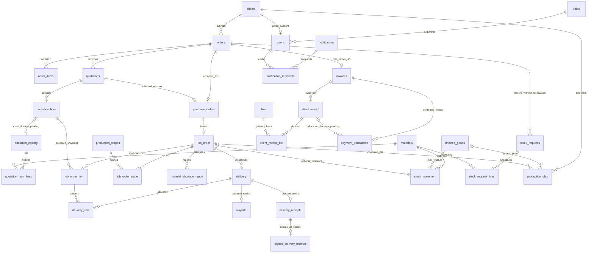

# Phase 2 corrected ERD and staged physical model

## Actual Phase 2 target — created 2026-11-22

The current isolated target is **`enterflow_phase2_db` / `enterflow-phase2-mysql` / `127.0.0.1:62286`**, MySQL 8.4.13. The complete current physical ERD—all tables, attributes, PK/FK definitions, unique/CHECK constraints and explicit indexes—is the successfully executed [P2B001 bootstrap SQL](../database/phase2-bootstrap/P2B001_corrected_database_bootstrap.sql), with [exact table manifest](../database/phase2-bootstrap/P2B001_tables.txt). Actual server-generated FK names, normalized CREATE clauses and supporting indexes are retained in [SHOW CREATE TABLE evidence](../database/phase2-execution/2026-11-22-bootstrap/actual-show-create-tables.txt) and [actual metadata](../database/phase2-execution/2026-11-22-bootstrap/after-metadata.json).

There are **71 tables, 71 PKs, 153 FKs, 76 unique constraints, 47 enforced CHECKs and 294 total indexes**. All 71 tables are empty. The actual table set and key inventories match the bootstrap; [execution results and limitations](PHASE_2_DATABASE_MIGRATION_REPORT.md) supersede the staged projection below.

Current-model differences from the earlier projection: legacy entities/history carriers and migration ledgers are absent; JO BOM/files reference items; waybill/DR/event relationships reference delivery directly; costing-to-quote-line is mandatory; new request provenance is mandatory; both raw and finished quantities/thresholds permit unknown with independent provenance; invoice explicitly references PO before JO; receipt-backed transactions require the same-owner verified receipt; quotation current-sent slot uniqueness and exact 20%/50% downpayment checks are present. Reference seeds/stage names are absent, and multi-row writer/authorization invariants are not claimed enforced by FKs alone. The diagram and declarations below remain dated comparison evidence, **not** the current target's deployment manifest.

## Historical staged ERD projection — 2026-11-21

Date: 2026-11-21, Asia/Singapore. **Proposed staged correction, not deployed metadata.** No SQL or runtime verification was executed. Read the [correction report](PHASE_2_DATABASE_ERD_CORRECTION_REPORT.md) and [migration report](PHASE_2_DATABASE_MIGRATION_REPORT.md) for evidence, approvals, data reconciliation and compatibility gates.

Physical equivalents from the revised ERD are retained. The inventory below contains all 71 known source declaration bodies with the documented materials overlay and E01/E02 additions, plus 11 new E03 definitions. Retiring legacy structures are explicitly labelled and remain only for controlled transition/history; they are not an additional permanent business model. Definitions marked RETAIN/REWIRE still show existing carriers until the separately approved contract migration replaces them. They must not be deployed as a parallel active model.

These declarations are a documentation projection, not a bootstrap script: table dependency order, actual deployed drift and pending contract transformations prevent executing this document. Canonical executable candidates are the three explicitly named SQL files. All supplied CREATE candidates use InnoDB, utf8mb4/utf8mb4_unicode_ci; ASCII/binary and other column overrides remain as declared. Omitted FK actions in candidates use MySQL RESTRICT/NO ACTION semantics, never cascading business-history deletion. Live FK actions must still be reconciled.

Generated columns are not introduced. Derived totals/display aliases from the conceptual drawing need not be new stored facts: line totals derive from frozen quantity/price, clients/PO/invoices derive through owner chains, and notification read state belongs to recipients. No new lookup, report table, credentials store, invented prices/BOM or population is introduced.

## Corrected business relationships



The diagram shows the **intended** target after cutover; waybill/DR rewiring is not in E03. Exactly one raw/finished FK per stock movement is enforced by CHECK, not by the two optional diagram edges. Receipt allocation cardinality awaits approval; existing one-PO-per-inquiry and accepted-reference revision semantics remain. Ten-stage definition/sequencing, atomic ledger/balance consistency and immutable snapshots are pending activation gates, not guarantees created by this diagram.

## Complete declared FK cardinalities

Parent-to-child upper bounds derive from child unique/primary keys. Parent lower bound is zero at the database level: a FK alone does not force a parent to have a child. Child-to-parent optionality reflects nullable carriers. Workflow requirements for at least one item, exactly ten valid stage definitions, complete snapshots and sequence ordering need coordinated transaction validation. No assertion of actual row occupancy is made. Legacy rows are labelled in the entity definitions; their current FKs are not the final intended contract.

| Parent | Child FK carrier | Parent → child | Child → parent | Referenced columns |
| --- | --- | --- | --- | --- |
| `roles` | `role_modules(role_code)` | 0..M | 1 | `code` |
| `modules` | `role_modules(module_code)` | 0..M | 1 | `code` |
| `payment_terms` | `clients(payment_term_code)` | 0..M | 0..1 | `code` |
| `roles` | `users(role_code)` | 0..M | 1 | `code` |
| `clients` | `users(client_id)` | 0..M | 0..1 | `id` |
| `users` | `client_applications(decided_by)` | 0..M | 0..1 | `id` |
| `clients` | `client_applications(approved_client_id)` | 0..M | 0..1 | `id` |
| `clients` | `product_specifications(client_id)` | 0..M | 1 | `id` |
| `filter_types` | `product_specifications(filter_type_code)` | 0..M | 1 | `code` |
| `material_categories` | `materials(category_code)` | 0..M | 0..1 | `code` |
| `units` | `materials(unit_code)` | 0..M | 1 | `code` |
| `users` | `materials(costing_price_approved_by)` | 0..M | 0..1 | `id` |
| `filter_types` | `bom_templates(filter_type_code)` | 0..M | 1 | `code` |
| `users` | `bom_templates(created_by)` | 0..M | 1 | `id` |
| `bom_templates` | `bom_template_lines(template_id)` | 0..M | 1 | `id` |
| `materials` | `bom_template_lines(material_id)` | 0..M | 1 | `id` |
| `users` | `files(uploaded_by)` | 0..M | 1 | `id` |
| `clients` | `orders(client_id)` | 0..M | 1 | `id` |
| `order_stages` | `orders(stage_code)` | 0..M | 1 | `code` |
| `payment_terms` | `orders(payment_term_code)` | 0..M | 1 | `code` |
| `delivery_methods` | `orders(delivery_method_code)` | 0..M | 0..1 | `code` |
| `users` | `orders(created_by)` | 0..M | 1 | `id` |
| `users` | `orders(archived_by)` | 0..M | 0..1 | `id` |
| `orders` | `orders(reorder_source_id, client_id)` | 0..M | 0..1 | `id, client_id` |
| `orders` | `order_items(order_id, client_id)` | 0..M | 1 | `id, client_id` |
| `product_specifications` | `order_items(specification_id, client_id)` | 0..M | 1 | `id, client_id` |
| `orders` | `quotation_references(order_id)` | 0..M | 1 | `id` |
| `quotation_references` | `quotations(reference, order_id)` | 0..M | 1 | `reference, order_id` |
| `payment_terms` | `quotations(payment_term_code)` | 0..M | 1 | `code` |
| `users` | `quotations(prepared_by)` | 0..M | 1 | `id` |
| `users` | `quotations(sent_by)` | 0..M | 0..1 | `id` |
| `quotations` | `quotation_lines(quotation_id, order_id)` | 0..M | 1 | `id, order_id` |
| `order_items` | `quotation_lines(order_item_id, order_id)` | 0..M | 0..1 | `id, order_id` |
| `quotations` | `quotation_costing(quotation_id, order_id)` | 0..M | 1 | `id, order_id` |
| `order_items` | `quotation_costing(order_item_id, order_id)` | 0..M | 1 | `id, order_id` |
| `quotation_lines` | `quotation_costing(quotation_line_id, quotation_id, order_id, order_item_id)` | 0..1 | 0..1 | `id, quotation_id, order_id, order_item_id` |
| `quotation_costing` | `quotation_bom_lines(costing_id)` | 0..M | 1 | `id` |
| `materials` | `quotation_bom_lines(material_id)` | 0..M | 1 | `id` |
| `quotations` | `quotation_discounts(quotation_id)` | 0..M | 1 | `id` |
| `quotations` | `quotation_addons(quotation_id)` | 0..M | 1 | `id` |
| `materials` | `quotation_addons(material_id)` | 0..M | 0..1 | `id` |
| `orders` | `purchase_orders(order_id)` | 0..1 | 1 | `id` |
| `quotations` | `purchase_orders(accepted_quotation_id, order_id)` | 0..1 | 1 | `id, order_id` |
| `users` | `purchase_orders(uploaded_by)` | 0..M | 1 | `id` |
| `users` | `purchase_orders(received_by)` | 0..M | 0..1 | `id` |
| `users` | `purchase_orders(cleared_by)` | 0..M | 0..1 | `id` |
| `orders` | `order_requests(order_id)` | 0..M | 1 | `id` |
| `users` | `order_requests(requested_by)` | 0..M | 1 | `id` |
| `users` | `order_requests(decided_by)` | 0..M | 0..1 | `id` |
| `orders` | `replacement_requests(order_id)` | 0..M | 1 | `id` |
| `users` | `replacement_requests(requested_by)` | 0..M | 1 | `id` |
| `users` | `replacement_requests(resolved_by)` | 0..M | 0..1 | `id` |
| `order_items` | `job_orders(order_item_id, order_id, client_id)` | 0..M | 1 | `id, order_id, client_id` |
| `product_specifications` | `job_orders(specification_id, client_id)` | 0..M | 1 | `id, client_id` |
| `replacement_requests` | `job_orders(replacement_request_id, order_id)` | 0..M | 0..1 | `id, order_id` |
| `quotation_costing` | `job_orders(costing_id, order_item_id, order_id)` | 0..M | 0..1 | `id, order_item_id, order_id` |
| `users` | `job_orders(created_by)` | 0..M | 1 | `id` |
| `job_orders` | `job_bom_lines(job_order_id)` | 0..M | 1 | `id` |
| `materials` | `job_bom_lines(material_id)` | 0..M | 1 | `id` |
| `job_orders` | `production_events(job_order_id)` | 0..M | 1 | `id` |
| `production_stages` | `production_events(stage_position)` | 0..M | 0..1 | `position` |
| `users` | `production_events(performed_by)` | 0..M | 1 | `id` |
| `materials` | `material_movements(material_id)` | 0..M | 1 | `id` |
| `job_orders` | `material_movements(job_order_id)` | 0..M | 0..1 | `id` |
| `users` | `material_movements(performed_by)` | 0..M | 1 | `id` |
| `materials` | `material_changes(material_id)` | 0..M | 1 | `id` |
| `users` | `material_changes(performed_by)` | 0..M | 1 | `id` |
| `clients` | `finished_goods(client_id)` | 0..M | 1 | `id` |
| `product_specifications` | `finished_goods(specification_id, client_id)` | 0..M | 1 | `id, client_id` |
| `users` | `finished_goods(updated_by)` | 0..M | 1 | `id` |
| `finished_goods` | `finished_good_movements(finished_good_id, client_id)` | 0..M | 1 | `id, client_id` |
| `job_orders` | `finished_good_movements(job_order_id, client_id)` | 0..M | 0..1 | `id, client_id` |
| `users` | `finished_good_movements(performed_by)` | 0..M | 1 | `id` |
| `finished_goods` | `finished_good_order_items(finished_good_id, client_id)` | 0..M | 1 | `id, client_id` |
| `order_items` | `finished_good_order_items(order_item_id, client_id)` | 0..M | 1 | `id, client_id` |
| `orders` | `stock_requests(order_id)` | 0..M | 1 | `id` |
| `users` | `stock_requests(requested_by)` | 0..M | 1 | `id` |
| `stock_requests` | `stock_request_lines(stock_request_id)` | 0..M | 1 | `id` |
| `materials` | `stock_request_lines(material_id)` | 0..M | 1 | `id` |
| `stock_requests` | `stock_responses(stock_request_id, order_id)` | 0..M | 1 | `id, order_id` |
| `users` | `stock_responses(responded_by)` | 0..M | 1 | `id` |
| `stock_responses` | `stock_response_lines(stock_response_id, stock_request_id)` | 0..M | 1 | `id, stock_request_id` |
| `stock_request_lines` | `stock_response_lines(stock_request_line_id, stock_request_id)` | 0..M | 1 | `id, stock_request_id` |
| `quotations` | `quotation_stock_responses(quotation_id, order_id)` | 0..1 | 1 | `id, order_id` |
| `stock_responses` | `quotation_stock_responses(stock_response_id, order_id)` | 0..M | 1 | `id, order_id` |
| `job_orders` | `shipments(job_order_id, order_id)` | 0..1 | 1 | `id, order_id` |
| `delivery_methods` | `shipments(delivery_method_code)` | 0..M | 1 | `code` |
| `users` | `shipments(updated_by)` | 0..M | 1 | `id` |
| `shipments` | `waybills(shipment_id)` | 0..1 | 1 | `id` |
| `users` | `waybills(printed_by)` | 0..M | 0..1 | `id` |
| `shipments` | `shipment_events(shipment_id)` | 0..M | 1 | `id` |
| `users` | `shipment_events(performed_by)` | 0..M | 1 | `id` |
| `shipments` | `delivery_receipts(shipment_id, order_id)` | 0..1 | 1 | `id, order_id` |
| `users` | `delivery_receipts(generated_by)` | 0..M | 1 | `id` |
| `users` | `delivery_receipts(sent_to_logistics_by)` | 0..M | 0..1 | `id` |
| `users` | `delivery_receipts(sent_to_client_by)` | 0..M | 0..1 | `id` |
| `delivery_receipts` | `signed_delivery_receipts(delivery_receipt_id, order_id)` | 0..M | 1 | `id, order_id` |
| `files` | `signed_delivery_receipts(file_id)` | 0..1 | 1 | `id` |
| `users` | `signed_delivery_receipts(submitted_by)` | 0..M | 1 | `id` |
| `orders` | `invoices(order_id)` | 0..1 | 1 | `id` |
| `payment_terms` | `invoices(payment_term_code)` | 0..M | 1 | `code` |
| `users` | `invoices(created_by)` | 0..M | 1 | `id` |
| `users` | `invoices(sent_by)` | 0..M | 0..1 | `id` |
| `invoices` | `invoice_delivery_receipts(invoice_id, order_id)` | 0..M | 1 | `id, order_id` |
| `signed_delivery_receipts` | `invoice_delivery_receipts(signed_delivery_receipt_id, order_id, accepted_slot)` | 0..M | 1 | `id, order_id, accepted_slot` |
| `orders` | `payments(order_id)` | 0..M | 1 | `id` |
| `invoices` | `payments(invoice_id, order_id)` | 0..M | 0..1 | `id, order_id` |
| `users` | `payments(submitted_by)` | 0..M | 1 | `id` |
| `users` | `payments(reviewed_by)` | 0..M | 0..1 | `id` |
| `orders` | `payment_instructions(order_id)` | 0..M | 1 | `id` |
| `users` | `payment_instructions(sent_by)` | 0..M | 1 | `id` |
| `users` | `company_settings(updated_by)` | 0..M | 1 | `id` |
| `company_settings` | `company_payment_methods(company_settings_id)` | 0..M | 1 | `id` |
| `modules` | `notifications(module_code)` | 0..M | 0..1 | `code` |
| `orders` | `notifications(order_id, client_id)` | 0..M | 0..1 | `id, client_id` |
| `clients` | `notifications(client_id)` | 0..M | 0..1 | `id` |
| `notifications` | `notifications(reply_to_id)` | 0..M | 0..1 | `id` |
| `users` | `notifications(created_by)` | 0..M | 0..1 | `id` |
| `notifications` | `notification_roles(notification_id)` | 0..M | 1 | `id` |
| `roles` | `notification_roles(role_code)` | 0..M | 1 | `code` |
| `notifications` | `notification_recipients(notification_id)` | 0..M | 1 | `id` |
| `users` | `notification_recipients(user_id)` | 0..M | 1 | `id` |
| `orders` | `order_files(order_id)` | 0..M | 1 | `id` |
| `files` | `order_files(file_id)` | 0..M | 1 | `id` |
| `product_specifications` | `specification_files(specification_id)` | 0..M | 1 | `id` |
| `files` | `specification_files(file_id)` | 0..M | 1 | `id` |
| `quotations` | `quotation_files(quotation_id)` | 0..M | 1 | `id` |
| `files` | `quotation_files(file_id)` | 0..M | 1 | `id` |
| `purchase_orders` | `purchase_order_files(purchase_order_id)` | 0..M | 1 | `id` |
| `files` | `purchase_order_files(file_id)` | 0..M | 1 | `id` |
| `job_orders` | `job_order_files(job_order_id)` | 0..M | 1 | `id` |
| `files` | `job_order_files(file_id)` | 0..M | 1 | `id` |
| `payments` | `payment_files(payment_id)` | 0..M | 1 | `id` |
| `files` | `payment_files(file_id)` | 0..M | 1 | `id` |
| `invoices` | `invoice_files(invoice_id)` | 0..M | 1 | `id` |
| `files` | `invoice_files(file_id)` | 0..M | 1 | `id` |
| `waybills` | `waybill_files(waybill_id)` | 0..M | 1 | `id` |
| `files` | `waybill_files(file_id)` | 0..M | 1 | `id` |
| `delivery_receipts` | `delivery_receipt_files(delivery_receipt_id)` | 0..M | 1 | `id` |
| `files` | `delivery_receipt_files(file_id)` | 0..M | 1 | `id` |
| `replacement_requests` | `replacement_request_files(replacement_request_id)` | 0..M | 1 | `id` |
| `files` | `replacement_request_files(file_id)` | 0..M | 1 | `id` |
| `users` | `audit_events(actor_id)` | 0..M | 0..1 | `id` |
| `materials` | `material_import_review(resolved_material_id)` | 0..M | 0..1 | `id` |
| `purchase_orders` | `job_order(purchase_order_id, order_id, accepted_quotation_id)` | 0..1 | 1 | `id, order_id, accepted_quotation_id` |
| `orders` | `job_order(order_id, client_id)` | 0..M | 1 | `id, client_id` |
| `users` | `job_order(prepared_by)` | 0..M | 1 | `id` |
| `users` | `job_order(approved_by)` | 0..M | 0..1 | `id` |
| `job_order` | `job_order_item(job_order_id, quotation_id, order_id, client_id)` | 0..M | 1 | `id, accepted_quotation_id, order_id, client_id` |
| `quotation_lines` | `job_order_item(quotation_line_id, quotation_id, order_id, order_item_id)` | 0..M | 1 | `id, quotation_id, order_id, order_item_id` |
| `order_items` | `job_order_item(order_item_id, order_id, client_id)` | 0..M | 1 | `id, order_id, client_id` |
| `filter_types` | `job_order_item(filter_type_code)` | 0..M | 1 | `code` |
| `files` | `job_order_item(final_sketch_file_id)` | 0..M | 0..1 | `id` |
| `job_order` | `job_order_stage(job_order_id)` | 0..M | 1 | `id` |
| `production_stages` | `job_order_stage(stage_position)` | 0..M | 1 | `position` |
| `users` | `job_order_stage(marked_by)` | 0..M | 0..1 | `id` |
| `job_order` | `material_shortage_report(job_order_id)` | 0..M | 1 | `id` |
| `job_order_stage` | `material_shortage_report(job_order_stage_id, job_order_id)` | 0..M | 0..1 | `id, job_order_id` |
| `materials` | `material_shortage_report(material_id)` | 0..M | 1 | `id` |
| `users` | `material_shortage_report(reported_by)` | 0..M | 1 | `id` |
| `clients` | `production_plan(client_id)` | 0..M | 1 | `id` |
| `finished_goods` | `production_plan(finished_good_id, client_id)` | 0..M | 0..1 | `id, client_id` |
| `job_order` | `production_plan(job_order_id, client_id)` | 0..M | 0..1 | `id, client_id` |
| `users` | `production_plan(created_by)` | 0..M | 1 | `id` |
| `invoices` | `client_receipt(invoice_id, order_id)` | 0..M | 1 | `id, order_id` |
| `orders` | `client_receipt(order_id, client_id)` | 0..M | 1 | `id, client_id` |
| `users` | `client_receipt(submitted_by, client_id)` | 0..M | 1 | `id, client_id` |
| `users` | `client_receipt(reviewed_by)` | 0..M | 0..1 | `id` |
| `client_receipt` | `client_receipt_file(client_receipt_id)` | 0..M | 1 | `id` |
| `files` | `client_receipt_file(file_id)` | 0..M | 1 | `id` |
| `invoices` | `payment_transaction(invoice_id, order_id)` | 0..M | 1 | `id, order_id` |
| `orders` | `payment_transaction(order_id, client_id)` | 0..M | 1 | `id, client_id` |
| `client_receipt` | `payment_transaction(client_receipt_id, invoice_id, order_id, client_id)` | 0..M | 0..1 | `id, invoice_id, order_id, client_id` |
| `users` | `payment_transaction(recorded_by)` | 0..M | 1 | `id` |
| `users` | `payment_transaction(approved_by)` | 0..M | 1 | `id` |
| `materials` | `stock_movement(material_id, unit_code)` | 0..M | 0..1 | `id, unit_code` |
| `clients` | `stock_movement(client_id)` | 0..M | 0..1 | `id` |
| `finished_goods` | `stock_movement(finished_good_id, client_id)` | 0..M | 0..1 | `id, client_id` |
| `job_order` | `stock_movement(job_order_id, client_id)` | 0..M | 0..1 | `id, client_id` |
| `users` | `stock_movement(performed_by)` | 0..M | 1 | `id` |
| `job_order` | `delivery(job_order_id, order_id)` | 0..M | 1 | `id, order_id` |
| `delivery_methods` | `delivery(delivery_method_code)` | 0..M | 1 | `code` |
| `users` | `delivery(updated_by)` | 0..M | 1 | `id` |
| `delivery` | `delivery_item(delivery_id, job_order_id)` | 0..M | 1 | `id, job_order_id` |
| `job_order_item` | `delivery_item(job_order_item_id, job_order_id)` | 0..M | 1 | `id, job_order_id` |

## Every known table and attribute

### schema_migrations

RETAIN; additive E01/E02 overlay included where applicable.

```sql
CREATE TABLE schema_migrations (
  version VARCHAR(100) NOT NULL PRIMARY KEY,
  applied_at DATETIME(3) NOT NULL DEFAULT CURRENT_TIMESTAMP(3)
);
```

### roles

RETAIN; additive E01/E02 overlay included where applicable.

```sql
CREATE TABLE roles (
  code VARCHAR(24) NOT NULL PRIMARY KEY,
  label VARCHAR(80) NOT NULL
);
```

### modules

RETAIN; additive E01/E02 overlay included where applicable.

```sql
CREATE TABLE modules (
  code VARCHAR(40) NOT NULL PRIMARY KEY,
  label VARCHAR(80) NOT NULL
);
```

### role_modules

RETAIN; additive E01/E02 overlay included where applicable.

```sql
CREATE TABLE role_modules (
  role_code VARCHAR(24) NOT NULL,
  module_code VARCHAR(40) NOT NULL,
  PRIMARY KEY (role_code, module_code),
  FOREIGN KEY (role_code) REFERENCES roles(code),
  FOREIGN KEY (module_code) REFERENCES modules(code)
);
```

### payment_terms

RETAIN; additive E01/E02 overlay included where applicable.

```sql
CREATE TABLE payment_terms (
  code VARCHAR(24) NOT NULL PRIMARY KEY,
  label VARCHAR(80) NOT NULL,
  days_after_receipt SMALLINT UNSIGNED NOT NULL
);
```

### clients

RETAIN; additive E01/E02 overlay included where applicable.

```sql
CREATE TABLE clients (
  id BIGINT UNSIGNED NOT NULL AUTO_INCREMENT PRIMARY KEY,
  company_name VARCHAR(200) NOT NULL,
  industry VARCHAR(120) NULL,
  contact_person VARCHAR(160) NULL,
  email VARCHAR(254) NULL,
  phone VARCHAR(40) NULL,
  address_line1 VARCHAR(255) NULL,
  address_line2 VARCHAR(255) NULL,
  city_province VARCHAR(160) NULL,
  postal_code VARCHAR(20) NULL,
  payment_term_code VARCHAR(24) NULL,
  internal_notes TEXT NULL,
  active BOOLEAN NOT NULL DEFAULT TRUE,
  joined_on DATE NULL,
  created_at DATETIME(3) NOT NULL DEFAULT CURRENT_TIMESTAMP(3),
  updated_at DATETIME(3) NOT NULL DEFAULT CURRENT_TIMESTAMP(3) ON UPDATE CURRENT_TIMESTAMP(3),
  UNIQUE KEY uq_client_company (company_name),
  FOREIGN KEY (payment_term_code) REFERENCES payment_terms(code)
);
```

### users

RETAIN; additive E01/E02 overlay included where applicable.

```sql
CREATE TABLE users (
  id BIGINT UNSIGNED NOT NULL AUTO_INCREMENT PRIMARY KEY,
  role_code VARCHAR(24) NOT NULL,
  client_id BIGINT UNSIGNED NULL,
  account_type ENUM('employee','client') NOT NULL,
  display_name VARCHAR(160) NOT NULL,
  email VARCHAR(254) NOT NULL,
  username VARCHAR(100) NOT NULL,
  phone VARCHAR(40) NULL,
  password_hash VARCHAR(255) NOT NULL,
  employee_number VARCHAR(80) NULL,
  department VARCHAR(120) NULL,
  job_title VARCHAR(120) NULL,
  active BOOLEAN NOT NULL DEFAULT TRUE,
  email_alerts BOOLEAN NOT NULL DEFAULT TRUE,
  joined_on DATE NULL,
  created_at DATETIME(3) NOT NULL DEFAULT CURRENT_TIMESTAMP(3),
  updated_at DATETIME(3) NOT NULL DEFAULT CURRENT_TIMESTAMP(3) ON UPDATE CURRENT_TIMESTAMP(3),
  UNIQUE KEY uq_user_email (email),
  UNIQUE KEY uq_user_username (username),
  UNIQUE KEY uq_employee_number (employee_number),
  CONSTRAINT ck_user_identity CHECK (
    (account_type = 'client' AND role_code = 'client' AND client_id IS NOT NULL AND employee_number IS NULL)
    OR (account_type = 'employee' AND role_code <> 'client' AND client_id IS NULL)
  ),
  FOREIGN KEY (role_code) REFERENCES roles(code),
  FOREIGN KEY (client_id) REFERENCES clients(id),
  UNIQUE KEY uq_erd_user_client (id, client_id)
);
```

### client_applications

RETAIN; additive E01/E02 overlay included where applicable.

```sql
CREATE TABLE client_applications (
  id BIGINT UNSIGNED NOT NULL AUTO_INCREMENT PRIMARY KEY,
  company_name VARCHAR(200) NOT NULL,
  contact_person VARCHAR(160) NOT NULL,
  email VARCHAR(254) NOT NULL,
  username VARCHAR(100) NOT NULL,
  phone VARCHAR(40) NULL,
  password_hash VARCHAR(255) NOT NULL,
  status ENUM('pending','approved','rejected') NOT NULL DEFAULT 'pending',
  submitted_at DATETIME(3) NOT NULL DEFAULT CURRENT_TIMESTAMP(3),
  decided_at DATETIME(3) NULL,
  decided_by BIGINT UNSIGNED NULL,
  rejection_reason TEXT NULL,
  approved_client_id BIGINT UNSIGNED NULL,
  KEY ix_application_review (status, submitted_at),
  KEY ix_application_email (email),
  KEY ix_application_username (username),
  FOREIGN KEY (decided_by) REFERENCES users(id),
  FOREIGN KEY (approved_client_id) REFERENCES clients(id)
);
```

### filter_types

RETAIN; additive E01/E02 overlay included where applicable.

```sql
CREATE TABLE filter_types (
  code VARCHAR(24) NOT NULL PRIMARY KEY,
  label VARCHAR(100) NOT NULL,
  template_group VARCHAR(24) NOT NULL
);
```

### product_specifications

RETAIN; additive E01/E02 overlay included where applicable.

```sql
CREATE TABLE product_specifications (
  id BIGINT UNSIGNED NOT NULL AUTO_INCREMENT PRIMARY KEY,
  client_id BIGINT UNSIGNED NOT NULL,
  filter_type_code VARCHAR(24) NOT NULL,
  filter_name VARCHAR(200) NOT NULL,
  od1 VARCHAR(100) NULL,
  od2 VARCHAR(100) NULL,
  id1 VARCHAR(100) NULL,
  id2 VARCHAR(100) NULL,
  height VARCHAR(100) NULL,
  overall_height VARCHAR(100) NULL,
  length VARCHAR(100) NULL,
  width VARCHAR(100) NULL,
  thickness VARCHAR(100) NULL,
  depth VARCHAR(100) NULL,
  pocket_count VARCHAR(100) NULL,
  diameter VARCHAR(100) NULL,
  cloth_cutting_width VARCHAR(100) NULL,
  cloth_cutting_length VARCHAR(100) NULL,
  spring_plate_center_to_center VARCHAR(100) NULL,
  spring_plate_width VARCHAR(100) NULL,
  spring_plate_length VARCHAR(100) NULL,
  pad_od VARCHAR(100) NULL,
  pad_id VARCHAR(100) NULL,
  media VARCHAR(255) NULL,
  inner_core VARCHAR(255) NULL,
  outer_core VARCHAR(255) NULL,
  oring VARCHAR(255) NULL,
  gasket VARCHAR(255) NULL,
  end_cap VARCHAR(255) NULL,
  oem_part_number VARCHAR(160) NULL,
  brand VARCHAR(160) NULL,
  filtration_rating VARCHAR(120) NULL,
  others TEXT NULL,
  notes TEXT NULL,
  created_at DATETIME(3) NOT NULL DEFAULT CURRENT_TIMESTAMP(3),
  UNIQUE KEY uq_spec_client (id, client_id),
  FOREIGN KEY (client_id) REFERENCES clients(id),
  FOREIGN KEY (filter_type_code) REFERENCES filter_types(code)
);
```

### material_categories

RETAIN; additive E01/E02 overlay included where applicable.

```sql
CREATE TABLE material_categories (
  code VARCHAR(32) NOT NULL PRIMARY KEY,
  label VARCHAR(80) NOT NULL
);
```

### units

RETAIN; additive E01/E02 overlay included where applicable.

```sql
CREATE TABLE units (
  code VARCHAR(16) NOT NULL PRIMARY KEY,
  label VARCHAR(40) NOT NULL
);
```

### materials

RETAIN; additive E01/E02 overlay included where applicable.

```sql
CREATE TABLE materials (
  id BIGINT UNSIGNED NOT NULL AUTO_INCREMENT PRIMARY KEY,
  name VARCHAR(200) NOT NULL,
  category_code VARCHAR(32) NULL,
  unit_code VARCHAR(16) NOT NULL,
  unit_price DECIMAL(15,4) NOT NULL DEFAULT 0,
  quantity_on_hand DECIMAL(15,4) NULL DEFAULT NULL,
  reorder_threshold DECIMAL(15,4) NULL DEFAULT NULL,
  supplier_name VARCHAR(200) NULL,
  active BOOLEAN NOT NULL DEFAULT TRUE,
  updated_at DATETIME(3) NOT NULL DEFAULT CURRENT_TIMESTAMP(3) ON UPDATE CURRENT_TIMESTAMP(3),
  KEY ix_material_category (category_code, name),
  FOREIGN KEY (category_code) REFERENCES material_categories(code),
  FOREIGN KEY (unit_code) REFERENCES units(code),
  item_code VARCHAR(80) CHARACTER SET utf8mb4 COLLATE utf8mb4_bin NULL,
  source_unit VARCHAR(32) CHARACTER SET utf8mb4 COLLATE utf8mb4_bin NULL,
  reference_unit_price DECIMAL(15,4) NULL,
  reference_price_text VARCHAR(32) NULL,
  reference_price_source VARCHAR(255) NULL,
  reference_price_source_sha256 CHAR(64) CHARACTER SET ascii COLLATE ascii_bin NULL,
  reference_price_page SMALLINT UNSIGNED NULL,
  reference_price_row SMALLINT UNSIGNED NULL,
  reference_price_status ENUM('unreviewed','needs_review','reviewed') NOT NULL DEFAULT 'unreviewed',
  approved_costing_price DECIMAL(15,4) NULL,
  costing_price_approved_by BIGINT UNSIGNED NULL,
  costing_price_approved_at DATETIME(3) NULL,
  quantity_status ENUM('unknown','provisional_sample','verified') NOT NULL DEFAULT 'unknown',
  threshold_status ENUM('unknown','provisional_sample','verified') NOT NULL DEFAULT 'unknown',
  created_at DATETIME(3) NOT NULL DEFAULT CURRENT_TIMESTAMP(3),
  UNIQUE KEY uq_material_item_code (item_code),
  UNIQUE KEY uq_material_source_row (reference_price_source_sha256,reference_price_page,reference_price_row),
  CONSTRAINT ck_material_values CHECK (
    unit_price >= 0
    AND (reference_unit_price IS NULL OR reference_unit_price >= 0)
    AND (approved_costing_price IS NULL OR approved_costing_price >= 0)
    AND (quantity_on_hand IS NULL OR quantity_on_hand >= 0)
    AND (reorder_threshold IS NULL OR reorder_threshold >= 0)
    AND (
      (approved_costing_price IS NULL AND costing_price_approved_by IS NULL AND costing_price_approved_at IS NULL)
      OR (approved_costing_price IS NOT NULL AND costing_price_approved_by IS NOT NULL AND costing_price_approved_at IS NOT NULL)
    )
  ),
  CONSTRAINT ck_material_stock_provenance CHECK (
    (
      (quantity_on_hand IS NULL AND quantity_status='unknown')
      OR (quantity_on_hand IS NOT NULL AND quantity_status IN ('provisional_sample','verified'))
    )
    AND (
      (reorder_threshold IS NULL AND threshold_status='unknown')
      OR (reorder_threshold IS NOT NULL AND threshold_status IN ('provisional_sample','verified'))
    )
  ),
  CONSTRAINT fk_material_costing_price_approver FOREIGN KEY (costing_price_approved_by) REFERENCES users(id),
  UNIQUE KEY uq_erd_material_unit (id, unit_code)
);
```

### bom_templates

RETAIN; additive E01/E02 overlay included where applicable.

```sql
CREATE TABLE bom_templates (
  id BIGINT UNSIGNED NOT NULL AUTO_INCREMENT PRIMARY KEY,
  name VARCHAR(200) NOT NULL,
  filter_type_code VARCHAR(24) NOT NULL,
  size_label VARCHAR(40) NULL,
  labor_cost DECIMAL(15,4) NOT NULL DEFAULT 0,
  markup_percent DECIMAL(9,4) NOT NULL DEFAULT 0,
  discount_percent DECIMAL(7,4) NOT NULL DEFAULT 0,
  vat_type ENUM('Exclusive','Inclusive','Zero-Rated') NOT NULL,
  vat_rate DECIMAL(7,4) NOT NULL,
  include_labor BOOLEAN NOT NULL,
  apply_markup BOOLEAN NOT NULL,
  apply_vat BOOLEAN NOT NULL,
  notes TEXT NULL,
  created_by BIGINT UNSIGNED NOT NULL,
  created_at DATETIME(3) NOT NULL DEFAULT CURRENT_TIMESTAMP(3),
  CONSTRAINT ck_template_cost CHECK (labor_cost >= 0 AND markup_percent >= 0 AND discount_percent BETWEEN 0 AND 100 AND vat_rate BETWEEN 0 AND 100),
  FOREIGN KEY (filter_type_code) REFERENCES filter_types(code),
  FOREIGN KEY (created_by) REFERENCES users(id)
);
```

### bom_template_lines

RETAIN; additive E01/E02 overlay included where applicable.

```sql
CREATE TABLE bom_template_lines (
  id BIGINT UNSIGNED NOT NULL AUTO_INCREMENT PRIMARY KEY,
  template_id BIGINT UNSIGNED NOT NULL,
  line_number SMALLINT UNSIGNED NOT NULL,
  material_id BIGINT UNSIGNED NOT NULL,
  quantity_per_filter DECIMAL(15,4) NOT NULL,
  waste_percent DECIMAL(7,4) NOT NULL DEFAULT 0,
  UNIQUE KEY uq_template_line (template_id, line_number),
  CONSTRAINT ck_template_qty CHECK (quantity_per_filter > 0 AND waste_percent BETWEEN 0 AND 100),
  FOREIGN KEY (template_id) REFERENCES bom_templates(id),
  FOREIGN KEY (material_id) REFERENCES materials(id)
);
```

### files

RETAIN; additive E01/E02 overlay included where applicable.

```sql
CREATE TABLE files (
  id BIGINT UNSIGNED NOT NULL AUTO_INCREMENT PRIMARY KEY,
  original_filename VARCHAR(255) NOT NULL,
  mime_type VARCHAR(120) NOT NULL,
  size_bytes BIGINT UNSIGNED NOT NULL,
  bucket VARCHAR(63) CHARACTER SET ascii COLLATE ascii_bin NOT NULL,
  object_path VARCHAR(700) CHARACTER SET ascii COLLATE ascii_bin NOT NULL,
  object_generation VARCHAR(30) CHARACTER SET ascii COLLATE ascii_bin NULL,
  sha256 CHAR(64) CHARACTER SET ascii COLLATE ascii_bin NULL,
  state ENUM('pending','available','failed','deleted') NOT NULL DEFAULT 'pending',
  uploaded_by BIGINT UNSIGNED NOT NULL,
  uploaded_at DATETIME(3) NOT NULL DEFAULT CURRENT_TIMESTAMP(3),
  deleted_at DATETIME(3) NULL,
  UNIQUE KEY uq_storage_object (bucket, object_path),
  KEY ix_files_cleanup (state, uploaded_at),
  FOREIGN KEY (uploaded_by) REFERENCES users(id)
);
```

### order_stages

RETAIN; additive E01/E02 overlay included where applicable.

```sql
CREATE TABLE order_stages (
  code VARCHAR(32) NOT NULL PRIMARY KEY,
  label VARCHAR(80) NOT NULL,
  display_order SMALLINT UNSIGNED NOT NULL
);
```

### delivery_methods

RETAIN; additive E01/E02 overlay included where applicable.

```sql
CREATE TABLE delivery_methods (
  code VARCHAR(32) NOT NULL PRIMARY KEY,
  label VARCHAR(80) NOT NULL
);
```

### orders

RETAIN; additive E01/E02 overlay included where applicable.

```sql
CREATE TABLE orders (
  id BIGINT UNSIGNED NOT NULL AUTO_INCREMENT PRIMARY KEY,
  reference VARCHAR(60) NOT NULL,
  client_id BIGINT UNSIGNED NOT NULL,
  contact_person VARCHAR(160) NOT NULL,
  stage_code VARCHAR(32) NOT NULL,
  payment_term_code VARCHAR(24) NOT NULL,
  delivery_method_code VARCHAR(32) NULL,
  submitted_at DATETIME(3) NOT NULL DEFAULT CURRENT_TIMESTAMP(3),
  created_by BIGINT UNSIGNED NOT NULL,
  general_notes TEXT NULL,
  urgent BOOLEAN NOT NULL DEFAULT FALSE,
  requested_delivery_date DATE NULL,
  reorder_source_id BIGINT UNSIGNED NULL,
  archive_reason ENUM('rejected','cancelled') NULL,
  archive_note TEXT NULL,
  archived_at DATETIME(3) NULL,
  archived_by BIGINT UNSIGNED NULL,
  fulfillment_completed_at DATETIME(3) NULL,
  updated_at DATETIME(3) NOT NULL DEFAULT CURRENT_TIMESTAMP(3) ON UPDATE CURRENT_TIMESTAMP(3),
  UNIQUE KEY uq_order_reference (reference),
  UNIQUE KEY uq_order_client_pair (id, client_id),
  KEY ix_order_client (client_id, submitted_at),
  KEY ix_order_queue (stage_code, archived_at, urgent, requested_delivery_date),
  FOREIGN KEY (client_id) REFERENCES clients(id),
  FOREIGN KEY (stage_code) REFERENCES order_stages(code),
  FOREIGN KEY (payment_term_code) REFERENCES payment_terms(code),
  FOREIGN KEY (delivery_method_code) REFERENCES delivery_methods(code),
  FOREIGN KEY (created_by) REFERENCES users(id),
  FOREIGN KEY (archived_by) REFERENCES users(id),
  FOREIGN KEY (reorder_source_id, client_id) REFERENCES orders(id, client_id)
);
```

### order_items

RETAIN; additive E01/E02 overlay included where applicable.

```sql
CREATE TABLE order_items (
  id BIGINT UNSIGNED NOT NULL AUTO_INCREMENT PRIMARY KEY,
  order_id BIGINT UNSIGNED NOT NULL,
  client_id BIGINT UNSIGNED NOT NULL,
  line_number SMALLINT UNSIGNED NOT NULL,
  specification_id BIGINT UNSIGNED NOT NULL,
  quantity INT UNSIGNED NOT NULL,
  UNIQUE KEY uq_order_item_line (order_id, line_number),
  UNIQUE KEY uq_item_order (id, order_id),
  UNIQUE KEY uq_item_client (id, client_id),
  UNIQUE KEY uq_item_order_client (id, order_id, client_id),
  CONSTRAINT ck_order_item_qty CHECK (quantity >= 10),
  FOREIGN KEY (order_id, client_id) REFERENCES orders(id, client_id),
  FOREIGN KEY (specification_id, client_id) REFERENCES product_specifications(id, client_id)
);
```

### quotation_references

RETAIN; additive E01/E02 overlay included where applicable.

```sql
CREATE TABLE quotation_references (
  reference VARCHAR(60) NOT NULL PRIMARY KEY,
  order_id BIGINT UNSIGNED NOT NULL,
  UNIQUE KEY uq_quote_reference_owner (reference, order_id),
  FOREIGN KEY (order_id) REFERENCES orders(id)
);
```

### quotations

RETAIN; additive E01/E02 overlay included where applicable.

```sql
CREATE TABLE quotations (
  id BIGINT UNSIGNED NOT NULL AUTO_INCREMENT PRIMARY KEY,
  order_id BIGINT UNSIGNED NOT NULL,
  reference VARCHAR(60) NOT NULL,
  revision_number SMALLINT UNSIGNED NOT NULL,
  status ENUM('draft','sent','superseded') NOT NULL DEFAULT 'draft',
  issued_on DATE NOT NULL,
  valid_until DATE NOT NULL,
  payment_term_code VARCHAR(24) NOT NULL,
  time_of_delivery VARCHAR(255) NOT NULL,
  place_of_delivery TEXT NOT NULL,
  note TEXT NULL,
  note_highlighted BOOLEAN NOT NULL DEFAULT FALSE,
  total_amount DECIMAL(15,2) NOT NULL,
  downpayment_percent DECIMAL(7,4) NOT NULL DEFAULT 0,
  downpayment_amount DECIMAL(15,2) NOT NULL DEFAULT 0,
  stock_checked_at DATETIME(3) NULL,
  prepared_by BIGINT UNSIGNED NOT NULL,
  sent_by BIGINT UNSIGNED NULL,
  sent_at DATETIME(3) NULL,
  created_at DATETIME(3) NOT NULL DEFAULT CURRENT_TIMESTAMP(3),
  UNIQUE KEY uq_quote_revision (order_id, revision_number),
  UNIQUE KEY uq_quote_reference_revision (reference, revision_number),
  UNIQUE KEY uq_quote_order (id, order_id),
  CONSTRAINT ck_quote_amounts CHECK (total_amount >= 0 AND downpayment_percent BETWEEN 0 AND 100 AND downpayment_amount BETWEEN 0 AND total_amount),
  CONSTRAINT ck_quote_dates CHECK (valid_until >= issued_on),
  FOREIGN KEY (reference, order_id) REFERENCES quotation_references(reference, order_id),
  FOREIGN KEY (payment_term_code) REFERENCES payment_terms(code),
  FOREIGN KEY (prepared_by) REFERENCES users(id),
  FOREIGN KEY (sent_by) REFERENCES users(id)
);
```

### quotation_lines

RETAIN; additive E01/E02 overlay included where applicable.

```sql
CREATE TABLE quotation_lines (
  id BIGINT UNSIGNED NOT NULL AUTO_INCREMENT PRIMARY KEY,
  quotation_id BIGINT UNSIGNED NOT NULL,
  order_id BIGINT UNSIGNED NOT NULL,
  order_item_id BIGINT UNSIGNED NULL,
  line_number SMALLINT UNSIGNED NOT NULL,
  description VARCHAR(255) NOT NULL,
  sub_description TEXT NULL,
  quantity DECIMAL(15,4) NOT NULL,
  unit_label VARCHAR(40) NOT NULL,
  unit_price DECIMAL(15,4) NOT NULL,
  UNIQUE KEY uq_quote_line (quotation_id, line_number),
  CONSTRAINT ck_quote_line_values CHECK (quantity > 0 AND unit_price >= 0),
  FOREIGN KEY (quotation_id, order_id) REFERENCES quotations(id, order_id),
  FOREIGN KEY (order_item_id, order_id) REFERENCES order_items(id, order_id),
  UNIQUE KEY uq_erd_quote_line_owner
    (id, quotation_id, order_id, order_item_id)
);
```

### quotation_costing

RETAIN; additive E01/E02 overlay included where applicable.

```sql
CREATE TABLE quotation_costing (
  id BIGINT UNSIGNED NOT NULL AUTO_INCREMENT PRIMARY KEY,
  quotation_id BIGINT UNSIGNED NOT NULL,
  order_id BIGINT UNSIGNED NOT NULL,
  order_item_id BIGINT UNSIGNED NOT NULL,
  labor_cost DECIMAL(15,4) NOT NULL,
  markup_percent DECIMAL(9,4) NOT NULL,
  discount_percent DECIMAL(7,4) NOT NULL DEFAULT 0,
  vat_type ENUM('Exclusive','Inclusive','Zero-Rated') NOT NULL,
  vat_rate DECIMAL(7,4) NOT NULL,
  include_labor BOOLEAN NOT NULL,
  apply_markup BOOLEAN NOT NULL,
  apply_vat BOOLEAN NOT NULL,
  calculated_unit_price DECIMAL(15,4) NOT NULL,
  UNIQUE KEY uq_costing_item (quotation_id, order_item_id),
  UNIQUE KEY uq_costing_source (id, order_item_id, order_id),
  CONSTRAINT ck_costing_values CHECK (labor_cost >= 0 AND markup_percent >= 0 AND discount_percent BETWEEN 0 AND 100 AND vat_rate BETWEEN 0 AND 100 AND calculated_unit_price >= 0),
  FOREIGN KEY (quotation_id, order_id) REFERENCES quotations(id, order_id),
  FOREIGN KEY (order_item_id, order_id) REFERENCES order_items(id, order_id),
  quotation_line_id BIGINT UNSIGNED NULL DEFAULT NULL,
  UNIQUE KEY uq_erd_costing_line (quotation_line_id),
  CONSTRAINT fk_erd_costing_line
    FOREIGN KEY (quotation_line_id, quotation_id, order_id, order_item_id)
    REFERENCES quotation_lines(id, quotation_id, order_id, order_item_id)
);
```

### quotation_bom_lines

RETAIN; additive E01/E02 overlay included where applicable.

```sql
CREATE TABLE quotation_bom_lines (
  id BIGINT UNSIGNED NOT NULL AUTO_INCREMENT PRIMARY KEY,
  costing_id BIGINT UNSIGNED NOT NULL,
  line_number SMALLINT UNSIGNED NOT NULL,
  material_id BIGINT UNSIGNED NOT NULL,
  material_name_snapshot VARCHAR(200) NOT NULL,
  unit_snapshot VARCHAR(40) NOT NULL,
  unit_price_snapshot DECIMAL(15,4) NOT NULL,
  quantity_per_filter DECIMAL(15,4) NOT NULL,
  waste_percent DECIMAL(7,4) NOT NULL DEFAULT 0,
  UNIQUE KEY uq_costing_bom_line (costing_id, line_number),
  CONSTRAINT ck_quote_bom_values CHECK (unit_price_snapshot >= 0 AND quantity_per_filter > 0 AND waste_percent BETWEEN 0 AND 100),
  FOREIGN KEY (costing_id) REFERENCES quotation_costing(id),
  FOREIGN KEY (material_id) REFERENCES materials(id)
);
```

### quotation_discounts

RETAIN; additive E01/E02 overlay included where applicable.

```sql
CREATE TABLE quotation_discounts (
  quotation_id BIGINT UNSIGNED NOT NULL,
  line_number SMALLINT UNSIGNED NOT NULL,
  label VARCHAR(160) NOT NULL,
  percent DECIMAL(7,4) NOT NULL,
  PRIMARY KEY (quotation_id, line_number),
  CONSTRAINT ck_quote_discount CHECK (percent BETWEEN 0 AND 100),
  FOREIGN KEY (quotation_id) REFERENCES quotations(id)
);
```

### quotation_addons

RETAIN; additive E01/E02 overlay included where applicable.

```sql
CREATE TABLE quotation_addons (
  id BIGINT UNSIGNED NOT NULL AUTO_INCREMENT PRIMARY KEY,
  quotation_id BIGINT UNSIGNED NOT NULL,
  kind ENUM('packaging','shipping') NOT NULL,
  material_id BIGINT UNSIGNED NULL,
  label VARCHAR(200) NOT NULL,
  quantity DECIMAL(15,4) NOT NULL,
  unit_price DECIMAL(15,4) NOT NULL,
  include_in_unit_price BOOLEAN NOT NULL,
  UNIQUE KEY uq_quote_addon (quotation_id, kind),
  CONSTRAINT ck_addon_values CHECK (quantity > 0 AND unit_price >= 0),
  FOREIGN KEY (quotation_id) REFERENCES quotations(id),
  FOREIGN KEY (material_id) REFERENCES materials(id)
);
```

### purchase_orders

RETAIN; additive E01/E02 overlay included where applicable.

```sql
CREATE TABLE purchase_orders (
  id BIGINT UNSIGNED NOT NULL AUTO_INCREMENT PRIMARY KEY,
  order_id BIGINT UNSIGNED NOT NULL,
  accepted_quotation_id BIGINT UNSIGNED NOT NULL,
  reference VARCHAR(60) NOT NULL,
  client_reference VARCHAR(160) NULL,
  uploaded_at DATETIME(3) NOT NULL DEFAULT CURRENT_TIMESTAMP(3),
  uploaded_by BIGINT UNSIGNED NOT NULL,
  received_at DATETIME(3) NULL,
  received_by BIGINT UNSIGNED NULL,
  cleared_at DATETIME(3) NULL,
  cleared_by BIGINT UNSIGNED NULL,
  UNIQUE KEY uq_po_order (order_id),
  UNIQUE KEY uq_po_reference (reference),
  FOREIGN KEY (order_id) REFERENCES orders(id),
  FOREIGN KEY (accepted_quotation_id, order_id) REFERENCES quotations(id, order_id),
  FOREIGN KEY (uploaded_by) REFERENCES users(id),
  FOREIGN KEY (received_by) REFERENCES users(id),
  FOREIGN KEY (cleared_by) REFERENCES users(id),
  UNIQUE KEY uq_erd_po_quote (id, order_id, accepted_quotation_id)
);
```

### order_requests

RETAIN; additive E01/E02 overlay included where applicable.

```sql
CREATE TABLE order_requests (
  id BIGINT UNSIGNED NOT NULL AUTO_INCREMENT PRIMARY KEY,
  order_id BIGINT UNSIGNED NOT NULL,
  kind ENUM('cancellation','quotation_revision','urgent_upgrade') NOT NULL,
  reason TEXT NOT NULL,
  response TEXT NULL,
  requested_by BIGINT UNSIGNED NOT NULL,
  requested_at DATETIME(3) NOT NULL DEFAULT CURRENT_TIMESTAMP(3),
  status ENUM('pending','approved','declined','completed') NOT NULL DEFAULT 'pending',
  decided_by BIGINT UNSIGNED NULL,
  decided_at DATETIME(3) NULL,
  KEY ix_order_request_queue (status, kind, requested_at),
  FOREIGN KEY (order_id) REFERENCES orders(id),
  FOREIGN KEY (requested_by) REFERENCES users(id),
  FOREIGN KEY (decided_by) REFERENCES users(id)
);
```

### document_sequences

RETAIN; additive E01/E02 overlay included where applicable.

```sql
CREATE TABLE document_sequences (
  document_type VARCHAR(16) NOT NULL,
  document_year SMALLINT UNSIGNED NOT NULL,
  `last_value` BIGINT UNSIGNED NOT NULL DEFAULT 0,
  PRIMARY KEY (document_type, document_year)
);
```

### production_stages

RETAIN; additive E01/E02 overlay included where applicable.

```sql
CREATE TABLE production_stages (
  position SMALLINT UNSIGNED NOT NULL PRIMARY KEY,
  label VARCHAR(120) NOT NULL,
  CONSTRAINT ck_production_position CHECK (position BETWEEN 0 AND 8)
);
```

### replacement_requests

RETAIN; additive E01/E02 overlay included where applicable.

```sql
CREATE TABLE replacement_requests (
  id BIGINT UNSIGNED NOT NULL AUTO_INCREMENT PRIMARY KEY,
  order_id BIGINT UNSIGNED NOT NULL,
  reason TEXT NOT NULL,
  defect_description TEXT NOT NULL,
  quantity INT UNSIGNED NOT NULL,
  status ENUM('pending','processing','resolved') NOT NULL DEFAULT 'pending',
  requested_at DATETIME(3) NOT NULL DEFAULT CURRENT_TIMESTAMP(3),
  requested_by BIGINT UNSIGNED NOT NULL,
  resolved_at DATETIME(3) NULL,
  resolved_by BIGINT UNSIGNED NULL,
  UNIQUE KEY uq_replacement_order_pair (id, order_id),
  CONSTRAINT ck_replacement_qty CHECK (quantity > 0),
  FOREIGN KEY (order_id) REFERENCES orders(id),
  FOREIGN KEY (requested_by) REFERENCES users(id),
  FOREIGN KEY (resolved_by) REFERENCES users(id)
);
```

### job_orders

LEGACY PRODUCT ROWS; map to target items, not active target JO headers.

```sql
CREATE TABLE job_orders (
  id BIGINT UNSIGNED NOT NULL AUTO_INCREMENT PRIMARY KEY,
  reference VARCHAR(60) NOT NULL,
  order_id BIGINT UNSIGNED NOT NULL,
  client_id BIGINT UNSIGNED NOT NULL,
  order_item_id BIGINT UNSIGNED NOT NULL,
  specification_id BIGINT UNSIGNED NOT NULL,
  replacement_request_id BIGINT UNSIGNED NULL,
  costing_id BIGINT UNSIGNED NULL,
  quantity INT UNSIGNED NOT NULL,
  production_due_date DATE NOT NULL,
  current_stage_cursor SMALLINT UNSIGNED NOT NULL DEFAULT 0,
  status ENUM('jo','in_production','quality_inspection','ready_for_dispatch','cancelled') NOT NULL DEFAULT 'jo',
  paused BOOLEAN NOT NULL DEFAULT FALSE,
  pause_reason TEXT NULL,
  materials_deducted_at DATETIME(3) NULL,
  completed_at DATETIME(3) NULL,
  created_at DATETIME(3) NOT NULL DEFAULT CURRENT_TIMESTAMP(3),
  created_by BIGINT UNSIGNED NOT NULL,
  UNIQUE KEY uq_jo_reference (reference),
  UNIQUE KEY uq_job_order_pair (id, order_id),
  UNIQUE KEY uq_job_client_pair (id, client_id),
  KEY ix_jo_queue (status, paused, production_due_date),
  CONSTRAINT ck_jo_values CHECK (quantity > 0 AND current_stage_cursor BETWEEN 0 AND 9),
  FOREIGN KEY (order_item_id, order_id, client_id) REFERENCES order_items(id, order_id, client_id),
  FOREIGN KEY (specification_id, client_id) REFERENCES product_specifications(id, client_id),
  FOREIGN KEY (replacement_request_id, order_id) REFERENCES replacement_requests(id, order_id),
  FOREIGN KEY (costing_id, order_item_id, order_id) REFERENCES quotation_costing(id, order_item_id, order_id),
  FOREIGN KEY (created_by) REFERENCES users(id)
);
```

### job_bom_lines

RETAIN with later approved JO-item/stage or delivery FK cutover; current carrier shown below.

```sql
CREATE TABLE job_bom_lines (
  id BIGINT UNSIGNED NOT NULL AUTO_INCREMENT PRIMARY KEY,
  job_order_id BIGINT UNSIGNED NOT NULL,
  line_number SMALLINT UNSIGNED NOT NULL,
  material_id BIGINT UNSIGNED NOT NULL,
  material_name_snapshot VARCHAR(200) NOT NULL,
  unit_snapshot VARCHAR(40) NOT NULL,
  unit_price_snapshot DECIMAL(15,4) NOT NULL,
  quantity_per_filter DECIMAL(15,4) NOT NULL,
  waste_percent DECIMAL(7,4) NOT NULL DEFAULT 0,
  UNIQUE KEY uq_job_bom_line (job_order_id, line_number),
  CONSTRAINT ck_job_bom_values CHECK (unit_price_snapshot >= 0 AND quantity_per_filter > 0 AND waste_percent BETWEEN 0 AND 100),
  FOREIGN KEY (job_order_id) REFERENCES job_orders(id),
  FOREIGN KEY (material_id) REFERENCES materials(id)
);
```

### production_events

RETAIN with later approved JO-item/stage or delivery FK cutover; current carrier shown below.

```sql
CREATE TABLE production_events (
  id BIGINT UNSIGNED NOT NULL AUTO_INCREMENT PRIMARY KEY,
  job_order_id BIGINT UNSIGNED NOT NULL,
  stage_position SMALLINT UNSIGNED NULL,
  action ENUM('done','reverted','paused','resumed','completed','cancelled') NOT NULL,
  reason TEXT NULL,
  performed_by BIGINT UNSIGNED NOT NULL,
  occurred_at DATETIME(3) NOT NULL DEFAULT CURRENT_TIMESTAMP(3),
  KEY ix_production_history (job_order_id, occurred_at),
  FOREIGN KEY (job_order_id) REFERENCES job_orders(id),
  FOREIGN KEY (stage_position) REFERENCES production_stages(position),
  FOREIGN KEY (performed_by) REFERENCES users(id)
);
```

### material_movements

LEGACY RAW MOVEMENT HISTORY; incomplete, not a trustworthy opening balance source.

```sql
CREATE TABLE material_movements (
  id BIGINT UNSIGNED NOT NULL AUTO_INCREMENT PRIMARY KEY,
  material_id BIGINT UNSIGNED NOT NULL,
  job_order_id BIGINT UNSIGNED NULL,
  kind ENUM('opening','adjustment','receipt','jo_deduction','jo_restoration') NOT NULL,
  quantity_delta DECIMAL(15,4) NOT NULL,
  quantity_before DECIMAL(15,4) NOT NULL,
  quantity_after DECIMAL(15,4) NOT NULL,
  reason TEXT NOT NULL,
  reference_text VARCHAR(160) NULL,
  idempotency_key VARCHAR(120) CHARACTER SET ascii COLLATE ascii_bin NOT NULL,
  performed_by BIGINT UNSIGNED NOT NULL,
  occurred_at DATETIME(3) NOT NULL DEFAULT CURRENT_TIMESTAMP(3),
  UNIQUE KEY uq_material_operation (idempotency_key),
  KEY ix_material_history (material_id, occurred_at),
  CONSTRAINT ck_material_movement CHECK (quantity_before >= 0 AND quantity_after >= 0 AND quantity_after = quantity_before + quantity_delta),
  FOREIGN KEY (material_id) REFERENCES materials(id),
  FOREIGN KEY (job_order_id) REFERENCES job_orders(id),
  FOREIGN KEY (performed_by) REFERENCES users(id)
);
```

### material_changes

RETAIN; additive E01/E02 overlay included where applicable.

```sql
CREATE TABLE material_changes (
  id BIGINT UNSIGNED NOT NULL AUTO_INCREMENT PRIMARY KEY,
  material_id BIGINT UNSIGNED NOT NULL,
  field_name VARCHAR(80) NOT NULL,
  old_value TEXT NULL,
  new_value TEXT NULL,
  reason TEXT NOT NULL,
  performed_by BIGINT UNSIGNED NOT NULL,
  occurred_at DATETIME(3) NOT NULL DEFAULT CURRENT_TIMESTAMP(3),
  KEY ix_material_change_history (material_id, occurred_at),
  FOREIGN KEY (material_id) REFERENCES materials(id),
  FOREIGN KEY (performed_by) REFERENCES users(id)
);
```

### finished_goods

RETAIN; additive E01/E02 overlay included where applicable.

```sql
CREATE TABLE finished_goods (
  id BIGINT UNSIGNED NOT NULL AUTO_INCREMENT PRIMARY KEY,
  client_id BIGINT UNSIGNED NOT NULL,
  item_code VARCHAR(80) NOT NULL,
  enterfil_part_number VARCHAR(160) NOT NULL,
  specification_id BIGINT UNSIGNED NOT NULL,
  quantity_on_hand INT UNSIGNED NOT NULL DEFAULT 0,
  buffer_minimum INT UNSIGNED NOT NULL DEFAULT 0,
  demand ENUM('HIGH DEMAND','MONITOR','STABLE') NOT NULL DEFAULT 'STABLE',
  updated_by BIGINT UNSIGNED NOT NULL,
  updated_at DATETIME(3) NOT NULL DEFAULT CURRENT_TIMESTAMP(3) ON UPDATE CURRENT_TIMESTAMP(3),
  UNIQUE KEY uq_finished_item_code (item_code),
  UNIQUE KEY uq_finished_client_pair (id, client_id),
  KEY ix_finished_client_part (client_id, enterfil_part_number),
  FOREIGN KEY (client_id) REFERENCES clients(id),
  FOREIGN KEY (specification_id, client_id) REFERENCES product_specifications(id, client_id),
  FOREIGN KEY (updated_by) REFERENCES users(id)
);
```

### finished_good_movements

LEGACY FG HISTORY; preserve independently until reconciled target activation.

```sql
CREATE TABLE finished_good_movements (
  id BIGINT UNSIGNED NOT NULL AUTO_INCREMENT PRIMARY KEY,
  finished_good_id BIGINT UNSIGNED NOT NULL,
  client_id BIGINT UNSIGNED NOT NULL,
  job_order_id BIGINT UNSIGNED NULL,
  quantity_before INT UNSIGNED NOT NULL,
  quantity_after INT UNSIGNED NOT NULL,
  reason TEXT NOT NULL,
  performed_by BIGINT UNSIGNED NOT NULL,
  occurred_at DATETIME(3) NOT NULL DEFAULT CURRENT_TIMESTAMP(3),
  KEY ix_finished_history (finished_good_id, occurred_at),
  FOREIGN KEY (finished_good_id, client_id) REFERENCES finished_goods(id, client_id),
  FOREIGN KEY (job_order_id, client_id) REFERENCES job_orders(id, client_id),
  FOREIGN KEY (performed_by) REFERENCES users(id)
);
```

### finished_good_order_items

RETAIN; additive E01/E02 overlay included where applicable.

```sql
CREATE TABLE finished_good_order_items (
  finished_good_id BIGINT UNSIGNED NOT NULL,
  order_item_id BIGINT UNSIGNED NOT NULL,
  client_id BIGINT UNSIGNED NOT NULL,
  PRIMARY KEY (finished_good_id, order_item_id),
  FOREIGN KEY (finished_good_id, client_id) REFERENCES finished_goods(id, client_id),
  FOREIGN KEY (order_item_id, client_id) REFERENCES order_items(id, client_id)
);
```

### stock_requests

RETAIN; additive E01/E02 overlay included where applicable.

```sql
CREATE TABLE stock_requests (
  id BIGINT UNSIGNED NOT NULL AUTO_INCREMENT PRIMARY KEY,
  reference VARCHAR(60) NOT NULL,
  order_id BIGINT UNSIGNED NOT NULL,
  client_reference VARCHAR(160) NULL,
  status ENUM('pending','responded','update_requested','updated') NOT NULL DEFAULT 'pending',
  requested_by BIGINT UNSIGNED NOT NULL,
  created_at DATETIME(3) NOT NULL DEFAULT CURRENT_TIMESTAMP(3),
  update_requested_at DATETIME(3) NULL,
  update_reason TEXT NULL,
  UNIQUE KEY uq_stock_request_reference (reference),
  UNIQUE KEY uq_stock_request_order (id, order_id),
  KEY ix_stock_request_queue (status, created_at),
  FOREIGN KEY (order_id) REFERENCES orders(id),
  FOREIGN KEY (requested_by) REFERENCES users(id)
);
```

### stock_request_lines

RETAIN; additive E01/E02 overlay included where applicable.

```sql
CREATE TABLE stock_request_lines (
  id BIGINT UNSIGNED NOT NULL AUTO_INCREMENT PRIMARY KEY,
  stock_request_id BIGINT UNSIGNED NOT NULL,
  material_id BIGINT UNSIGNED NOT NULL,
  material_name_snapshot VARCHAR(200) NOT NULL,
  unit_snapshot VARCHAR(40) NOT NULL,
  required_quantity DECIMAL(15,4) NOT NULL,
  stock_at_request DECIMAL(15,4) NULL,
  shortage_at_request DECIMAL(15,4) NULL,
  UNIQUE KEY uq_request_material (stock_request_id, material_id),
  UNIQUE KEY uq_request_line_pair (id, stock_request_id),
  CONSTRAINT ck_stock_request_values CHECK (required_quantity > 0 AND (stock_at_request IS NULL OR stock_at_request >= 0) AND (shortage_at_request IS NULL OR shortage_at_request >= 0)),
  FOREIGN KEY (stock_request_id) REFERENCES stock_requests(id),
  FOREIGN KEY (material_id) REFERENCES materials(id),
  quantity_status_at_request
    ENUM('unknown','provisional_sample','verified') NULL DEFAULT NULL,
  CONSTRAINT ck_request_provenance CHECK (
    quantity_status_at_request IS NULL
    OR (quantity_status_at_request = 'verified'
        AND stock_at_request IS NOT NULL AND shortage_at_request IS NOT NULL
        AND shortage_at_request = GREATEST(required_quantity - stock_at_request, 0))
    OR (quantity_status_at_request IN ('unknown','provisional_sample')
        AND stock_at_request IS NULL AND shortage_at_request IS NULL)
  )
);
```

### stock_responses

RETAIN; additive E01/E02 overlay included where applicable.

```sql
CREATE TABLE stock_responses (
  id BIGINT UNSIGNED NOT NULL AUTO_INCREMENT PRIMARY KEY,
  stock_request_id BIGINT UNSIGNED NOT NULL,
  order_id BIGINT UNSIGNED NOT NULL,
  kind ENUM('initial','updated') NOT NULL,
  responded_by BIGINT UNSIGNED NOT NULL,
  responded_at DATETIME(3) NOT NULL DEFAULT CURRENT_TIMESTAMP(3),
  UNIQUE KEY uq_response_request_pair (id, stock_request_id),
  UNIQUE KEY uq_response_order_pair (id, order_id),
  KEY ix_stock_responses (stock_request_id, responded_at),
  FOREIGN KEY (stock_request_id, order_id) REFERENCES stock_requests(id, order_id),
  FOREIGN KEY (responded_by) REFERENCES users(id)
);
```

### stock_response_lines

RETAIN; additive E01/E02 overlay included where applicable.

```sql
CREATE TABLE stock_response_lines (
  stock_response_id BIGINT UNSIGNED NOT NULL,
  stock_request_line_id BIGINT UNSIGNED NOT NULL,
  stock_request_id BIGINT UNSIGNED NOT NULL,
  current_quantity DECIMAL(15,4) NOT NULL,
  shortage_quantity DECIMAL(15,4) NOT NULL,
  status ENUM('sufficient','shortage') NOT NULL,
  PRIMARY KEY (stock_response_id, stock_request_line_id),
  CONSTRAINT ck_stock_response_values CHECK (current_quantity >= 0 AND shortage_quantity >= 0),
  FOREIGN KEY (stock_response_id, stock_request_id) REFERENCES stock_responses(id, stock_request_id),
  FOREIGN KEY (stock_request_line_id, stock_request_id) REFERENCES stock_request_lines(id, stock_request_id)
);
```

### quotation_stock_responses

RETAIN; additive E01/E02 overlay included where applicable.

```sql
CREATE TABLE quotation_stock_responses (
  quotation_id BIGINT UNSIGNED NOT NULL PRIMARY KEY,
  stock_response_id BIGINT UNSIGNED NOT NULL,
  order_id BIGINT UNSIGNED NOT NULL,
  FOREIGN KEY (quotation_id, order_id) REFERENCES quotations(id, order_id),
  FOREIGN KEY (stock_response_id, order_id) REFERENCES stock_responses(id, order_id)
);
```

### shipments

RETIRE after full delivery/item transfer, child FK cutover and approval.

```sql
CREATE TABLE shipments (
  id BIGINT UNSIGNED NOT NULL AUTO_INCREMENT PRIMARY KEY,
  job_order_id BIGINT UNSIGNED NOT NULL,
  order_id BIGINT UNSIGNED NOT NULL,
  delivery_method_code VARCHAR(32) NOT NULL,
  status ENUM('pending','in_transit','delivered','picked_up') NOT NULL DEFAULT 'pending',
  tracking_reference VARCHAR(160) NULL,
  tracking_link VARCHAR(2048) NULL,
  recipient_name VARCHAR(160) NULL,
  recipient_phone VARCHAR(40) NULL,
  recipient_email VARCHAR(254) NULL,
  delivery_address TEXT NULL,
  driver_name VARCHAR(160) NULL,
  driver_phone VARCHAR(40) NULL,
  vehicle_plate VARCHAR(40) NULL,
  pickup_person VARCHAR(160) NULL,
  pickup_phone VARCHAR(40) NULL,
  pickup_email VARCHAR(254) NULL,
  pickup_vehicle_plate VARCHAR(40) NULL,
  pickup_id_required BOOLEAN NULL,
  office_contact VARCHAR(160) NULL,
  estimated_delivery_date DATE NULL,
  expected_pickup_date DATE NULL,
  dispatched_at DATETIME(3) NULL,
  delivered_at DATETIME(3) NULL,
  fulfillment_completed_at DATETIME(3) NULL,
  updated_by BIGINT UNSIGNED NOT NULL,
  updated_at DATETIME(3) NOT NULL DEFAULT CURRENT_TIMESTAMP(3) ON UPDATE CURRENT_TIMESTAMP(3),
  UNIQUE KEY uq_shipment_job (job_order_id),
  UNIQUE KEY uq_shipment_order (id, order_id),
  KEY ix_shipment_queue (status, estimated_delivery_date),
  FOREIGN KEY (job_order_id, order_id) REFERENCES job_orders(id, order_id),
  FOREIGN KEY (delivery_method_code) REFERENCES delivery_methods(code),
  FOREIGN KEY (updated_by) REFERENCES users(id)
);
```

### waybills

RETAIN with later approved JO-item/stage or delivery FK cutover; current carrier shown below.

```sql
CREATE TABLE waybills (
  id BIGINT UNSIGNED NOT NULL AUTO_INCREMENT PRIMARY KEY,
  shipment_id BIGINT UNSIGNED NOT NULL,
  reference VARCHAR(80) NOT NULL,
  qr_identifier VARCHAR(120) CHARACTER SET ascii COLLATE ascii_bin NOT NULL,
  printed_at DATETIME(3) NULL,
  printed_by BIGINT UNSIGNED NULL,
  UNIQUE KEY uq_waybill_shipment (shipment_id),
  UNIQUE KEY uq_waybill_reference (reference),
  UNIQUE KEY uq_waybill_qr (qr_identifier),
  FOREIGN KEY (shipment_id) REFERENCES shipments(id),
  FOREIGN KEY (printed_by) REFERENCES users(id)
);
```

### shipment_events

REWIRE/RENAME as delivery event history; preserve IDs and all events.

```sql
CREATE TABLE shipment_events (
  id BIGINT UNSIGNED NOT NULL AUTO_INCREMENT PRIMARY KEY,
  shipment_id BIGINT UNSIGNED NOT NULL,
  status VARCHAR(80) NOT NULL,
  note TEXT NULL,
  performed_by BIGINT UNSIGNED NOT NULL,
  occurred_at DATETIME(3) NOT NULL DEFAULT CURRENT_TIMESTAMP(3),
  KEY ix_shipment_events (shipment_id, occurred_at),
  FOREIGN KEY (shipment_id) REFERENCES shipments(id),
  FOREIGN KEY (performed_by) REFERENCES users(id)
);
```

### delivery_receipts

RETAIN with later approved JO-item/stage or delivery FK cutover; current carrier shown below.

```sql
CREATE TABLE delivery_receipts (
  id BIGINT UNSIGNED NOT NULL AUTO_INCREMENT PRIMARY KEY,
  shipment_id BIGINT UNSIGNED NOT NULL,
  order_id BIGINT UNSIGNED NOT NULL,
  reference VARCHAR(60) NOT NULL,
  generated_at DATETIME(3) NOT NULL DEFAULT CURRENT_TIMESTAMP(3),
  generated_by BIGINT UNSIGNED NOT NULL,
  sent_to_logistics_at DATETIME(3) NULL,
  sent_to_logistics_by BIGINT UNSIGNED NULL,
  sent_to_client_at DATETIME(3) NULL,
  sent_to_client_by BIGINT UNSIGNED NULL,
  UNIQUE KEY uq_dr_shipment (shipment_id),
  UNIQUE KEY uq_dr_reference (reference),
  UNIQUE KEY uq_dr_order_pair (id, order_id),
  FOREIGN KEY (shipment_id, order_id) REFERENCES shipments(id, order_id),
  FOREIGN KEY (generated_by) REFERENCES users(id),
  FOREIGN KEY (sent_to_logistics_by) REFERENCES users(id),
  FOREIGN KEY (sent_to_client_by) REFERENCES users(id)
);
```

### signed_delivery_receipts

RETAIN; additive E01/E02 overlay included where applicable.

```sql
CREATE TABLE signed_delivery_receipts (
  id BIGINT UNSIGNED NOT NULL AUTO_INCREMENT PRIMARY KEY,
  delivery_receipt_id BIGINT UNSIGNED NOT NULL,
  order_id BIGINT UNSIGNED NOT NULL,
  file_id BIGINT UNSIGNED NOT NULL,
  submitted_by BIGINT UNSIGNED NOT NULL,
  uploaded_at DATETIME(3) NOT NULL DEFAULT CURRENT_TIMESTAMP(3),
  received_at DATETIME(3) NULL,
  accepted_slot SMALLINT UNSIGNED NULL,
  discarded_at DATETIME(3) NULL,
  CONSTRAINT ck_signed_dr_state CHECK (
    (received_at IS NULL AND accepted_slot IS NULL)
    OR (received_at IS NOT NULL AND discarded_at IS NULL
        AND accepted_slot IS NOT NULL AND accepted_slot = 1)
  ),
  UNIQUE KEY uq_one_accepted_signed_dr (delivery_receipt_id, accepted_slot),
  UNIQUE KEY uq_signed_receipt_order_state (id, order_id, accepted_slot),
  UNIQUE KEY uq_signed_dr_file (file_id),
  KEY ix_signed_dr_state (delivery_receipt_id, received_at, discarded_at),
  FOREIGN KEY (delivery_receipt_id, order_id) REFERENCES delivery_receipts(id, order_id),
  FOREIGN KEY (file_id) REFERENCES files(id),
  FOREIGN KEY (submitted_by) REFERENCES users(id)
);
```

### invoices

RETAIN; additive E01/E02 overlay included where applicable.

```sql
CREATE TABLE invoices (
  id BIGINT UNSIGNED NOT NULL AUTO_INCREMENT PRIMARY KEY,
  order_id BIGINT UNSIGNED NOT NULL,
  reference VARCHAR(60) NOT NULL,
  issued_on DATE NOT NULL,
  amount DECIMAL(15,2) NOT NULL,
  payment_term_code VARCHAR(24) NOT NULL,
  required_downpayment DECIMAL(15,2) NOT NULL DEFAULT 0,
  payment_cycle_started_at DATETIME(3) NULL,
  due_on DATE NULL,
  created_by BIGINT UNSIGNED NOT NULL,
  sent_at DATETIME(3) NULL,
  sent_by BIGINT UNSIGNED NULL,
  UNIQUE KEY uq_invoice_order (order_id),
  UNIQUE KEY uq_invoice_reference (reference),
  UNIQUE KEY uq_invoice_order_pair (id, order_id),
  KEY ix_invoice_due (due_on, sent_at),
  CONSTRAINT ck_invoice_amount CHECK (amount >= 0 AND required_downpayment BETWEEN 0 AND amount),
  FOREIGN KEY (order_id) REFERENCES orders(id),
  FOREIGN KEY (payment_term_code) REFERENCES payment_terms(code),
  FOREIGN KEY (created_by) REFERENCES users(id),
  FOREIGN KEY (sent_by) REFERENCES users(id)
);
```

### invoice_delivery_receipts

RETAIN; additive E01/E02 overlay included where applicable.

```sql
CREATE TABLE invoice_delivery_receipts (
  invoice_id BIGINT UNSIGNED NOT NULL,
  signed_delivery_receipt_id BIGINT UNSIGNED NOT NULL,
  order_id BIGINT UNSIGNED NOT NULL,
  accepted_slot SMALLINT UNSIGNED NOT NULL DEFAULT 1,
  PRIMARY KEY (invoice_id, signed_delivery_receipt_id),
  CONSTRAINT ck_invoice_receipt_accepted CHECK (accepted_slot = 1),
  FOREIGN KEY (invoice_id, order_id) REFERENCES invoices(id, order_id),
  FOREIGN KEY (signed_delivery_receipt_id, order_id, accepted_slot)
    REFERENCES signed_delivery_receipts(id, order_id, accepted_slot)
);
```

### payments

LEGACY SUBMISSION/MONEY EVIDENCE; split only through approved identity mapping.

```sql
CREATE TABLE payments (
  id BIGINT UNSIGNED NOT NULL AUTO_INCREMENT PRIMARY KEY,
  order_id BIGINT UNSIGNED NOT NULL,
  invoice_id BIGINT UNSIGNED NULL,
  payment_type ENUM('DOWNPAYMENT','BALANCE_PAYMENT','FULL_PAYMENT') NOT NULL,
  submitted_amount DECIMAL(15,2) NOT NULL,
  verified_amount DECIMAL(15,2) NULL,
  method VARCHAR(80) NULL,
  reference_number VARCHAR(160) NULL,
  paid_on DATE NOT NULL,
  note TEXT NULL,
  verification_status ENUM('pending','verified','rejected') NOT NULL DEFAULT 'pending',
  submitted_by BIGINT UNSIGNED NOT NULL,
  submitted_at DATETIME(3) NOT NULL DEFAULT CURRENT_TIMESTAMP(3),
  reviewed_by BIGINT UNSIGNED NULL,
  reviewed_at DATETIME(3) NULL,
  idempotency_key VARCHAR(120) CHARACTER SET ascii COLLATE ascii_bin NOT NULL,
  UNIQUE KEY uq_payment_operation (idempotency_key),
  KEY ix_payment_review (verification_status, submitted_at),
  KEY ix_payment_order (order_id, verification_status),
  CONSTRAINT ck_payment_amount CHECK (submitted_amount > 0 AND (verified_amount IS NULL OR verified_amount > 0)),
  CONSTRAINT ck_payment_review CHECK (
    (verification_status = 'pending' AND verified_amount IS NULL AND reviewed_by IS NULL AND reviewed_at IS NULL)
    OR (verification_status = 'verified' AND verified_amount IS NOT NULL AND reviewed_by IS NOT NULL AND reviewed_at IS NOT NULL)
    OR (verification_status = 'rejected' AND verified_amount IS NULL AND reviewed_by IS NOT NULL AND reviewed_at IS NOT NULL)
  ),
  FOREIGN KEY (order_id) REFERENCES orders(id),
  FOREIGN KEY (invoice_id, order_id) REFERENCES invoices(id, order_id),
  FOREIGN KEY (submitted_by) REFERENCES users(id),
  FOREIGN KEY (reviewed_by) REFERENCES users(id)
);
```

### payment_instructions

RETAIN; additive E01/E02 overlay included where applicable.

```sql
CREATE TABLE payment_instructions (
  id BIGINT UNSIGNED NOT NULL AUTO_INCREMENT PRIMARY KEY,
  order_id BIGINT UNSIGNED NOT NULL,
  method VARCHAR(80) NOT NULL,
  account_name VARCHAR(160) NULL,
  account_number VARCHAR(100) NULL,
  bank_name VARCHAR(160) NULL,
  note TEXT NULL,
  sent_at DATETIME(3) NOT NULL DEFAULT CURRENT_TIMESTAMP(3),
  sent_by BIGINT UNSIGNED NOT NULL,
  FOREIGN KEY (order_id) REFERENCES orders(id),
  FOREIGN KEY (sent_by) REFERENCES users(id)
);
```

### company_settings

RETAIN; additive E01/E02 overlay included where applicable.

```sql
CREATE TABLE company_settings (
  id SMALLINT UNSIGNED NOT NULL PRIMARY KEY,
  company_name VARCHAR(200) NOT NULL,
  address_line1 VARCHAR(255) NULL,
  address_line2 VARCHAR(255) NULL,
  city_province VARCHAR(160) NULL,
  postal_code VARCHAR(20) NULL,
  main_phone VARCHAR(40) NULL,
  secondary_phone VARCHAR(40) NULL,
  email VARCHAR(254) NULL,
  office_hours VARCHAR(160) NULL,
  default_vehicle_plate VARCHAR(40) NULL,
  default_driver VARCHAR(160) NULL,
  default_driver_contact VARCHAR(40) NULL,
  document_footer TEXT NULL,
  bank_name VARCHAR(160) NULL,
  bank_account_name VARCHAR(160) NULL,
  bank_account_number VARCHAR(100) NULL,
  updated_by BIGINT UNSIGNED NOT NULL,
  updated_at DATETIME(3) NOT NULL DEFAULT CURRENT_TIMESTAMP(3) ON UPDATE CURRENT_TIMESTAMP(3),
  CONSTRAINT ck_company_singleton CHECK (id = 1),
  FOREIGN KEY (updated_by) REFERENCES users(id)
);
```

### company_payment_methods

RETAIN; additive E01/E02 overlay included where applicable.

```sql
CREATE TABLE company_payment_methods (
  id BIGINT UNSIGNED NOT NULL AUTO_INCREMENT PRIMARY KEY,
  company_settings_id SMALLINT UNSIGNED NOT NULL,
  label VARCHAR(120) NOT NULL,
  type ENUM('bank_transfer','gcash','cash','check','other') NOT NULL,
  details TEXT NOT NULL,
  FOREIGN KEY (company_settings_id) REFERENCES company_settings(id)
);
```

### notifications

RETAIN; additive E01/E02 overlay included where applicable.

```sql
CREATE TABLE notifications (
  id BIGINT UNSIGNED NOT NULL AUTO_INCREMENT PRIMARY KEY,
  department ENUM('sales','production','logistics','payments','system') NOT NULL,
  title VARCHAR(200) NOT NULL,
  body TEXT NOT NULL,
  module_code VARCHAR(40) NULL,
  order_id BIGINT UNSIGNED NULL,
  client_id BIGINT UNSIGNED NULL,
  reply_to_id BIGINT UNSIGNED NULL,
  created_by BIGINT UNSIGNED NULL,
  created_at DATETIME(3) NOT NULL DEFAULT CURRENT_TIMESTAMP(3),
  FOREIGN KEY (module_code) REFERENCES modules(code),
  CONSTRAINT ck_notification_order_scope CHECK (order_id IS NULL OR client_id IS NOT NULL),
  FOREIGN KEY (order_id, client_id) REFERENCES orders(id, client_id),
  FOREIGN KEY (client_id) REFERENCES clients(id),
  FOREIGN KEY (reply_to_id) REFERENCES notifications(id),
  FOREIGN KEY (created_by) REFERENCES users(id)
);
```

### notification_roles

RETAIN; additive E01/E02 overlay included where applicable.

```sql
CREATE TABLE notification_roles (
  notification_id BIGINT UNSIGNED NOT NULL,
  role_code VARCHAR(24) NOT NULL,
  PRIMARY KEY (notification_id, role_code),
  FOREIGN KEY (notification_id) REFERENCES notifications(id),
  FOREIGN KEY (role_code) REFERENCES roles(code)
);
```

### notification_recipients

RETAIN; additive E01/E02 overlay included where applicable.

```sql
CREATE TABLE notification_recipients (
  notification_id BIGINT UNSIGNED NOT NULL,
  user_id BIGINT UNSIGNED NOT NULL,
  read_at DATETIME(3) NULL,
  dismissed_at DATETIME(3) NULL,
  PRIMARY KEY (notification_id, user_id),
  KEY ix_user_notifications (user_id, dismissed_at, read_at),
  FOREIGN KEY (notification_id) REFERENCES notifications(id),
  FOREIGN KEY (user_id) REFERENCES users(id)
);
```

### order_files

RETAIN; additive E01/E02 overlay included where applicable.

```sql
CREATE TABLE order_files (
  order_id BIGINT UNSIGNED NOT NULL,
  file_id BIGINT UNSIGNED NOT NULL,
  purpose ENUM('inquiry_sketch','supporting_document') NOT NULL,
  PRIMARY KEY (order_id, file_id),
  FOREIGN KEY (order_id) REFERENCES orders(id),
  FOREIGN KEY (file_id) REFERENCES files(id)
);
```

### specification_files

RETAIN; additive E01/E02 overlay included where applicable.

```sql
CREATE TABLE specification_files (
  specification_id BIGINT UNSIGNED NOT NULL,
  file_id BIGINT UNSIGNED NOT NULL,
  purpose ENUM('sketch','product_image') NOT NULL,
  PRIMARY KEY (specification_id, file_id),
  FOREIGN KEY (specification_id) REFERENCES product_specifications(id),
  FOREIGN KEY (file_id) REFERENCES files(id)
);
```

### quotation_files

RETAIN; additive E01/E02 overlay included where applicable.

```sql
CREATE TABLE quotation_files (
  quotation_id BIGINT UNSIGNED NOT NULL,
  file_id BIGINT UNSIGNED NOT NULL,
  purpose ENUM('generated_document','signed_quotation') NOT NULL,
  PRIMARY KEY (quotation_id, file_id),
  FOREIGN KEY (quotation_id) REFERENCES quotations(id),
  FOREIGN KEY (file_id) REFERENCES files(id)
);
```

### purchase_order_files

RETAIN; additive E01/E02 overlay included where applicable.

```sql
CREATE TABLE purchase_order_files (
  purchase_order_id BIGINT UNSIGNED NOT NULL,
  file_id BIGINT UNSIGNED NOT NULL,
  purpose ENUM('client_document') NOT NULL,
  PRIMARY KEY (purchase_order_id, file_id),
  FOREIGN KEY (purchase_order_id) REFERENCES purchase_orders(id),
  FOREIGN KEY (file_id) REFERENCES files(id)
);
```

### job_order_files

RETAIN with later approved JO-item/stage or delivery FK cutover; current carrier shown below.

```sql
CREATE TABLE job_order_files (
  job_order_id BIGINT UNSIGNED NOT NULL,
  file_id BIGINT UNSIGNED NOT NULL,
  purpose ENUM('sketch','signed_quotation','generated_document') NOT NULL,
  PRIMARY KEY (job_order_id, file_id),
  FOREIGN KEY (job_order_id) REFERENCES job_orders(id),
  FOREIGN KEY (file_id) REFERENCES files(id)
);
```

### payment_files

LEGACY FILE PURPOSE EVIDENCE; proof/official-receipt mapping must complete first.

```sql
CREATE TABLE payment_files (
  payment_id BIGINT UNSIGNED NOT NULL,
  file_id BIGINT UNSIGNED NOT NULL,
  purpose ENUM('proof_of_payment','receipt') NOT NULL,
  PRIMARY KEY (payment_id, file_id),
  FOREIGN KEY (payment_id) REFERENCES payments(id),
  FOREIGN KEY (file_id) REFERENCES files(id)
);
```

### invoice_files

RETAIN; additive E01/E02 overlay included where applicable.

```sql
CREATE TABLE invoice_files (
  invoice_id BIGINT UNSIGNED NOT NULL,
  file_id BIGINT UNSIGNED NOT NULL,
  purpose ENUM('generated_document') NOT NULL,
  PRIMARY KEY (invoice_id, file_id),
  FOREIGN KEY (invoice_id) REFERENCES invoices(id),
  FOREIGN KEY (file_id) REFERENCES files(id)
);
```

### waybill_files

RETAIN; additive E01/E02 overlay included where applicable.

```sql
CREATE TABLE waybill_files (
  waybill_id BIGINT UNSIGNED NOT NULL,
  file_id BIGINT UNSIGNED NOT NULL,
  purpose ENUM('generated_document') NOT NULL,
  PRIMARY KEY (waybill_id, file_id),
  FOREIGN KEY (waybill_id) REFERENCES waybills(id),
  FOREIGN KEY (file_id) REFERENCES files(id)
);
```

### delivery_receipt_files

RETAIN; additive E01/E02 overlay included where applicable.

```sql
CREATE TABLE delivery_receipt_files (
  delivery_receipt_id BIGINT UNSIGNED NOT NULL,
  file_id BIGINT UNSIGNED NOT NULL,
  purpose ENUM('generated_document') NOT NULL,
  PRIMARY KEY (delivery_receipt_id, file_id),
  FOREIGN KEY (delivery_receipt_id) REFERENCES delivery_receipts(id),
  FOREIGN KEY (file_id) REFERENCES files(id)
);
```

### replacement_request_files

RETAIN; additive E01/E02 overlay included where applicable.

```sql
CREATE TABLE replacement_request_files (
  replacement_request_id BIGINT UNSIGNED NOT NULL,
  file_id BIGINT UNSIGNED NOT NULL,
  purpose ENUM('defect_proof') NOT NULL,
  PRIMARY KEY (replacement_request_id, file_id),
  FOREIGN KEY (replacement_request_id) REFERENCES replacement_requests(id),
  FOREIGN KEY (file_id) REFERENCES files(id)
);
```

### audit_events

RETAIN; additive E01/E02 overlay included where applicable.

```sql
CREATE TABLE audit_events (
  id BIGINT UNSIGNED NOT NULL AUTO_INCREMENT PRIMARY KEY,
  actor_id BIGINT UNSIGNED NULL,
  action VARCHAR(100) NOT NULL,
  subject_type VARCHAR(60) NOT NULL,
  subject_identifier VARCHAR(100) NOT NULL,
  field_name VARCHAR(80) NULL,
  old_value TEXT NULL,
  new_value TEXT NULL,
  reason TEXT NULL,
  request_id VARCHAR(120) CHARACTER SET ascii COLLATE ascii_bin NULL,
  occurred_at DATETIME(3) NOT NULL DEFAULT CURRENT_TIMESTAMP(3),
  KEY ix_audit_subject (subject_type, subject_identifier, occurred_at),
  KEY ix_audit_actor (actor_id, occurred_at),
  FOREIGN KEY (actor_id) REFERENCES users(id)
);
```

### material_import_review

RETAIN; additive E01/E02 overlay included where applicable.

```sql
CREATE TABLE material_import_review (
  id BIGINT UNSIGNED NOT NULL AUTO_INCREMENT PRIMARY KEY,
  source_document VARCHAR(255) NOT NULL,
  source_sha256 CHAR(64) CHARACTER SET ascii COLLATE ascii_bin NOT NULL,
  source_page SMALLINT UNSIGNED NOT NULL,
  source_row SMALLINT UNSIGNED NOT NULL,
  source_item_code VARCHAR(80) CHARACTER SET utf8mb4 COLLATE utf8mb4_bin NULL,
  source_description VARCHAR(200) NULL,
  source_unit VARCHAR(32) CHARACTER SET utf8mb4 COLLATE utf8mb4_bin NULL,
  source_reference_price DECIMAL(15,4) NULL,
  source_reference_price_text VARCHAR(32) NULL,
  review_reasons JSON NOT NULL,
  review_status ENUM('needs_review','resolved','excluded') NOT NULL DEFAULT 'needs_review',
  resolved_material_id BIGINT UNSIGNED NULL,
  resolution_note TEXT NULL,
  created_at DATETIME(3) NOT NULL DEFAULT CURRENT_TIMESTAMP(3),
  updated_at DATETIME(3) NOT NULL DEFAULT CURRENT_TIMESTAMP(3) ON UPDATE CURRENT_TIMESTAMP(3),
  UNIQUE KEY uq_material_import_source_row (source_sha256, source_page, source_row),
  KEY ix_material_import_review_status (review_status, source_page, source_row),
  FOREIGN KEY (resolved_material_id) REFERENCES materials(id)
);
```

### job_order

NEW EMPTY TARGET CANDIDATE; inactive until approved compatibility/cutover.

```sql
CREATE TABLE job_order (
  id BIGINT UNSIGNED NOT NULL AUTO_INCREMENT PRIMARY KEY,
  reference VARCHAR(60) NOT NULL,
  purchase_order_id BIGINT UNSIGNED NOT NULL,
  order_id BIGINT UNSIGNED NOT NULL,
  client_id BIGINT UNSIGNED NOT NULL,
  accepted_quotation_id BIGINT UNSIGNED NOT NULL,
  jo_date DATE NOT NULL,
  due_date DATE NOT NULL,
  status ENUM('jo','in_production','quality_inspection','ready_for_dispatch','cancelled') NOT NULL DEFAULT 'jo',
  paused BOOLEAN NOT NULL DEFAULT FALSE,
  pause_reason TEXT NULL,
  prepared_by BIGINT UNSIGNED NOT NULL,
  approved_by BIGINT UNSIGNED NULL,
  cancellation_reason TEXT NULL,
  completed_at DATETIME(3) NULL,
  archived_at DATETIME(3) NULL,
  created_at DATETIME(3) NOT NULL DEFAULT CURRENT_TIMESTAMP(3),
  UNIQUE KEY uq_erd_jo_reference (reference),
  UNIQUE KEY uq_erd_jo_po (purchase_order_id),
  UNIQUE KEY uq_erd_jo_order (id, order_id),
  UNIQUE KEY uq_erd_jo_client (id, client_id),
  UNIQUE KEY uq_erd_jo_source (id, accepted_quotation_id, order_id, client_id),
  KEY ix_erd_jo_queue (status, paused, due_date),
  CONSTRAINT fk_erd_jo_po FOREIGN KEY (purchase_order_id, order_id, accepted_quotation_id)
    REFERENCES purchase_orders(id, order_id, accepted_quotation_id),
  CONSTRAINT fk_erd_jo_order FOREIGN KEY (order_id, client_id) REFERENCES orders(id, client_id),
  FOREIGN KEY (prepared_by) REFERENCES users(id),
  FOREIGN KEY (approved_by) REFERENCES users(id),
  CONSTRAINT ck_erd_jo_pause CHECK (paused = 0 OR (pause_reason IS NOT NULL AND CHAR_LENGTH(TRIM(pause_reason)) > 0)),
  CONSTRAINT ck_erd_jo_cancel CHECK (status <> 'cancelled' OR (cancellation_reason IS NOT NULL AND CHAR_LENGTH(TRIM(cancellation_reason)) > 0))
);
```

### job_order_item

NEW EMPTY TARGET CANDIDATE; inactive until approved compatibility/cutover.

```sql
CREATE TABLE job_order_item (
  id BIGINT UNSIGNED NOT NULL AUTO_INCREMENT PRIMARY KEY,
  job_order_id BIGINT UNSIGNED NOT NULL,
  quotation_id BIGINT UNSIGNED NOT NULL,
  quotation_line_id BIGINT UNSIGNED NOT NULL,
  order_id BIGINT UNSIGNED NOT NULL,
  client_id BIGINT UNSIGNED NOT NULL,
  order_item_id BIGINT UNSIGNED NOT NULL,
  line_number SMALLINT UNSIGNED NOT NULL,
  legacy_job_order_id BIGINT UNSIGNED NULL,
  item_code VARCHAR(80) NULL,
  enterfil_part_number VARCHAR(160) NULL,
  item_name VARCHAR(200) NOT NULL,
  quantity INT UNSIGNED NOT NULL,
  filter_type_code VARCHAR(24) NOT NULL,
  od1 VARCHAR(100) NULL,
  od2 VARCHAR(100) NULL,
  id1 VARCHAR(100) NULL,
  id2 VARCHAR(100) NULL,
  height VARCHAR(100) NULL,
  overall_height VARCHAR(100) NULL,
  length VARCHAR(100) NULL,
  width VARCHAR(100) NULL,
  thickness VARCHAR(100) NULL,
  depth VARCHAR(100) NULL,
  pocket_count VARCHAR(100) NULL,
  diameter VARCHAR(100) NULL,
  cloth_cutting_width VARCHAR(100) NULL,
  cloth_cutting_length VARCHAR(100) NULL,
  spring_plate_center_to_center VARCHAR(100) NULL,
  spring_plate_width VARCHAR(100) NULL,
  spring_plate_length VARCHAR(100) NULL,
  pad_od VARCHAR(100) NULL,
  pad_id VARCHAR(100) NULL,
  media VARCHAR(255) NULL,
  inner_core VARCHAR(255) NULL,
  outer_core VARCHAR(255) NULL,
  oring VARCHAR(255) NULL,
  gasket VARCHAR(255) NULL,
  end_cap VARCHAR(255) NULL,
  oem_part_number VARCHAR(160) NULL,
  brand VARCHAR(160) NULL,
  filtration_rating VARCHAR(120) NULL,
  others TEXT NULL,
  notes TEXT NULL,
  final_sketch_file_id BIGINT UNSIGNED NULL,
  created_at DATETIME(3) NOT NULL DEFAULT CURRENT_TIMESTAMP(3),
  UNIQUE KEY uq_erd_jo_item_line (job_order_id, line_number),
  UNIQUE KEY uq_erd_jo_item_pair (id, job_order_id),
  UNIQUE KEY uq_erd_legacy_jo_item (legacy_job_order_id),
  FOREIGN KEY (job_order_id, quotation_id, order_id, client_id)
    REFERENCES job_order(id, accepted_quotation_id, order_id, client_id),
  FOREIGN KEY (quotation_line_id, quotation_id, order_id, order_item_id)
    REFERENCES quotation_lines(id, quotation_id, order_id, order_item_id),
  FOREIGN KEY (order_item_id, order_id, client_id) REFERENCES order_items(id, order_id, client_id),
  FOREIGN KEY (filter_type_code) REFERENCES filter_types(code),
  FOREIGN KEY (final_sketch_file_id) REFERENCES files(id),
  CONSTRAINT ck_erd_jo_item CHECK (quantity > 0 AND line_number > 0)
);
```

### job_order_stage

NEW EMPTY TARGET CANDIDATE; inactive until approved compatibility/cutover.

```sql
CREATE TABLE job_order_stage (
  id BIGINT UNSIGNED NOT NULL AUTO_INCREMENT PRIMARY KEY,
  job_order_id BIGINT UNSIGNED NOT NULL,
  stage_position SMALLINT UNSIGNED NOT NULL,
  status ENUM('pending','in_progress','completed') NOT NULL DEFAULT 'pending',
  started_at DATETIME(3) NULL,
  completed_at DATETIME(3) NULL,
  marked_by BIGINT UNSIGNED NULL,
  remarks TEXT NULL,
  reverted_count INT UNSIGNED NOT NULL DEFAULT 0,
  UNIQUE KEY uq_erd_jo_stage (job_order_id, stage_position),
  UNIQUE KEY uq_erd_stage_owner (id, job_order_id),
  FOREIGN KEY (job_order_id) REFERENCES job_order(id),
  FOREIGN KEY (stage_position) REFERENCES production_stages(position),
  FOREIGN KEY (marked_by) REFERENCES users(id),
  CONSTRAINT ck_erd_stage_state CHECK (
    (status = 'pending' AND started_at IS NULL AND completed_at IS NULL)
    OR (status = 'in_progress' AND started_at IS NOT NULL AND completed_at IS NULL AND marked_by IS NOT NULL)
    OR (status = 'completed' AND started_at IS NOT NULL AND completed_at IS NOT NULL
        AND completed_at >= started_at AND marked_by IS NOT NULL))
);
```

### material_shortage_report

NEW EMPTY TARGET CANDIDATE; inactive until approved compatibility/cutover.

```sql
CREATE TABLE material_shortage_report (
  id BIGINT UNSIGNED NOT NULL AUTO_INCREMENT PRIMARY KEY,
  job_order_id BIGINT UNSIGNED NOT NULL,
  job_order_stage_id BIGINT UNSIGNED NULL,
  material_id BIGINT UNSIGNED NOT NULL,
  quantity_needed DECIMAL(15,4) NOT NULL,
  description TEXT NOT NULL,
  status ENUM('pending','resolved') NOT NULL DEFAULT 'pending',
  reported_by BIGINT UNSIGNED NOT NULL,
  reported_at DATETIME(3) NOT NULL DEFAULT CURRENT_TIMESTAMP(3),
  resolved_at DATETIME(3) NULL,
  KEY ix_erd_shortage_queue (status, reported_at),
  FOREIGN KEY (job_order_id) REFERENCES job_order(id),
  FOREIGN KEY (job_order_stage_id, job_order_id) REFERENCES job_order_stage(id, job_order_id),
  FOREIGN KEY (material_id) REFERENCES materials(id),
  FOREIGN KEY (reported_by) REFERENCES users(id),
  CONSTRAINT ck_erd_shortage CHECK (quantity_needed > 0 AND
    ((status = 'pending' AND resolved_at IS NULL) OR
     (status = 'resolved' AND resolved_at IS NOT NULL AND resolved_at >= reported_at)))
);
```

### production_plan

NEW EMPTY TARGET CANDIDATE; inactive until approved compatibility/cutover.

```sql
CREATE TABLE production_plan (
  id BIGINT UNSIGNED NOT NULL AUTO_INCREMENT PRIMARY KEY,
  plan_code VARCHAR(60) NOT NULL,
  client_id BIGINT UNSIGNED NOT NULL,
  finished_good_id BIGINT UNSIGNED NULL,
  job_order_id BIGINT UNSIGNED NULL,
  source VARCHAR(80) NOT NULL,
  planned_quantity INT UNSIGNED NOT NULL,
  week_start_date DATE NOT NULL,
  week_end_date DATE NOT NULL,
  created_by BIGINT UNSIGNED NOT NULL,
  UNIQUE KEY uq_erd_plan_code (plan_code),
  FOREIGN KEY (client_id) REFERENCES clients(id),
  FOREIGN KEY (finished_good_id, client_id) REFERENCES finished_goods(id, client_id),
  FOREIGN KEY (job_order_id, client_id) REFERENCES job_order(id, client_id),
  FOREIGN KEY (created_by) REFERENCES users(id),
  CONSTRAINT ck_erd_plan CHECK (planned_quantity > 0 AND week_end_date >= week_start_date
    AND (finished_good_id IS NOT NULL OR job_order_id IS NOT NULL))
);
```

### client_receipt

NEW EMPTY TARGET CANDIDATE; inactive until approved compatibility/cutover.

```sql
CREATE TABLE client_receipt (
  id BIGINT UNSIGNED NOT NULL AUTO_INCREMENT PRIMARY KEY,
  invoice_id BIGINT UNSIGNED NOT NULL,
  order_id BIGINT UNSIGNED NOT NULL,
  client_id BIGINT UNSIGNED NOT NULL,
  submitted_by BIGINT UNSIGNED NOT NULL,
  amount_declared DECIMAL(15,2) NOT NULL,
  method_snapshot VARCHAR(120) NULL,
  reference_number VARCHAR(160) NULL,
  paid_on DATE NOT NULL,
  payment_type ENUM('DOWNPAYMENT','BALANCE_PAYMENT','FULL_PAYMENT') NOT NULL,
  note TEXT NULL,
  review_status ENUM('pending','verified','rejected') NOT NULL DEFAULT 'pending',
  reviewed_by BIGINT UNSIGNED NULL,
  reviewed_at DATETIME(3) NULL,
  review_note TEXT NULL,
  submitted_at DATETIME(3) NOT NULL DEFAULT CURRENT_TIMESTAMP(3),
  idempotency_key VARCHAR(120) CHARACTER SET ascii COLLATE ascii_bin NOT NULL,
  legacy_payment_id BIGINT UNSIGNED NULL,
  UNIQUE KEY uq_erd_receipt_operation (idempotency_key),
  UNIQUE KEY uq_erd_receipt_owner (id, invoice_id, order_id, client_id),
  UNIQUE KEY uq_erd_receipt_legacy (legacy_payment_id),
  KEY ix_erd_receipt_review (review_status, submitted_at),
  FOREIGN KEY (invoice_id, order_id) REFERENCES invoices(id, order_id),
  FOREIGN KEY (order_id, client_id) REFERENCES orders(id, client_id),
  FOREIGN KEY (submitted_by, client_id) REFERENCES users(id, client_id),
  FOREIGN KEY (reviewed_by) REFERENCES users(id),
  CONSTRAINT ck_erd_receipt_amount CHECK (amount_declared > 0),
  CONSTRAINT ck_erd_receipt_review CHECK (
    (review_status = 'pending' AND reviewed_by IS NULL AND reviewed_at IS NULL)
    OR (review_status IN ('verified','rejected') AND reviewed_by IS NOT NULL AND reviewed_at IS NOT NULL))
);
```

### client_receipt_file

NEW EMPTY TARGET CANDIDATE; inactive until approved compatibility/cutover.

```sql
CREATE TABLE client_receipt_file (
  client_receipt_id BIGINT UNSIGNED NOT NULL,
  file_id BIGINT UNSIGNED NOT NULL,
  PRIMARY KEY (client_receipt_id, file_id),
  FOREIGN KEY (client_receipt_id) REFERENCES client_receipt(id),
  FOREIGN KEY (file_id) REFERENCES files(id)
);
```

### payment_transaction

NEW EMPTY TARGET CANDIDATE; inactive until approved compatibility/cutover.

```sql
CREATE TABLE payment_transaction (
  id BIGINT UNSIGNED NOT NULL AUTO_INCREMENT PRIMARY KEY,
  invoice_id BIGINT UNSIGNED NOT NULL,
  order_id BIGINT UNSIGNED NOT NULL,
  client_id BIGINT UNSIGNED NOT NULL,
  client_receipt_id BIGINT UNSIGNED NULL,
  payment_type ENUM('DOWNPAYMENT','BALANCE_PAYMENT','FULL_PAYMENT') NOT NULL,
  amount DECIMAL(15,2) NOT NULL,
  method_snapshot VARCHAR(120) NULL,
  reference_number VARCHAR(160) NULL,
  paid_on DATE NOT NULL,
  recorded_by BIGINT UNSIGNED NOT NULL,
  approved_by BIGINT UNSIGNED NOT NULL,
  approved_at DATETIME(3) NOT NULL,
  notes TEXT NULL,
  created_at DATETIME(3) NOT NULL DEFAULT CURRENT_TIMESTAMP(3),
  idempotency_key VARCHAR(120) CHARACTER SET ascii COLLATE ascii_bin NOT NULL,
  legacy_payment_id BIGINT UNSIGNED NULL,
  UNIQUE KEY uq_erd_transaction_operation (idempotency_key),
  UNIQUE KEY uq_erd_transaction_legacy (legacy_payment_id),
  KEY ix_erd_transaction_invoice (invoice_id, paid_on),
  FOREIGN KEY (invoice_id, order_id) REFERENCES invoices(id, order_id),
  FOREIGN KEY (order_id, client_id) REFERENCES orders(id, client_id),
  FOREIGN KEY (client_receipt_id, invoice_id, order_id, client_id)
    REFERENCES client_receipt(id, invoice_id, order_id, client_id),
  FOREIGN KEY (recorded_by) REFERENCES users(id),
  FOREIGN KEY (approved_by) REFERENCES users(id),
  CONSTRAINT ck_erd_transaction_amount CHECK (amount > 0)
);
```

### stock_movement

NEW EMPTY TARGET CANDIDATE; inactive until approved compatibility/cutover.

```sql
CREATE TABLE stock_movement (
  id BIGINT UNSIGNED NOT NULL AUTO_INCREMENT PRIMARY KEY,
  item_type ENUM('raw_material','finished_good') NOT NULL,
  material_id BIGINT UNSIGNED NULL,
  finished_good_id BIGINT UNSIGNED NULL,
  unit_code VARCHAR(16) NULL,
  client_id BIGINT UNSIGNED NULL,
  job_order_id BIGINT UNSIGNED NULL,
  kind ENUM('observation','opening','adjustment','correction','receipt','handover','jo_deduction','jo_restoration') NOT NULL,
  quantity_status_before ENUM('unknown','provisional_sample','verified') NOT NULL,
  quantity_before DECIMAL(15,4) NULL,
  quantity_after DECIMAL(15,4) NOT NULL,
  quantity_delta DECIMAL(15,4) NULL,
  reason TEXT NOT NULL,
  reference_text VARCHAR(160) NULL,
  supplier_name_snapshot VARCHAR(200) NULL,
  notes TEXT NULL,
  performed_by BIGINT UNSIGNED NOT NULL,
  occurred_at DATETIME(3) NOT NULL DEFAULT CURRENT_TIMESTAMP(3),
  idempotency_key VARCHAR(120) CHARACTER SET ascii COLLATE ascii_bin NOT NULL,
  UNIQUE KEY uq_erd_stock_operation (idempotency_key),
  KEY ix_erd_raw_history (material_id, occurred_at, id),
  KEY ix_erd_finished_history (finished_good_id, occurred_at, id),
  FOREIGN KEY (material_id, unit_code) REFERENCES materials(id, unit_code),
  FOREIGN KEY (client_id) REFERENCES clients(id),
  FOREIGN KEY (finished_good_id, client_id) REFERENCES finished_goods(id, client_id),
  FOREIGN KEY (job_order_id, client_id) REFERENCES job_order(id, client_id),
  FOREIGN KEY (performed_by) REFERENCES users(id),
  CONSTRAINT ck_erd_stock_item CHECK (
    (item_type = 'raw_material' AND material_id IS NOT NULL AND unit_code IS NOT NULL AND finished_good_id IS NULL)
    OR (item_type = 'finished_good' AND material_id IS NULL AND unit_code IS NULL AND finished_good_id IS NOT NULL AND client_id IS NOT NULL)),
  CONSTRAINT ck_erd_stock_owner CHECK (job_order_id IS NULL OR client_id IS NOT NULL),
  CONSTRAINT ck_erd_stock_numbers CHECK (quantity_after >= 0 AND
    ((quantity_status_before = 'verified' AND quantity_before IS NOT NULL AND quantity_before >= 0
      AND quantity_delta IS NOT NULL AND quantity_after = quantity_before + quantity_delta)
     OR (quantity_status_before IN ('unknown','provisional_sample')
       AND quantity_before IS NULL AND quantity_delta IS NULL AND kind IN ('observation','opening','correction')))),
  CONSTRAINT ck_erd_stock_reason CHECK (CHAR_LENGTH(TRIM(reason)) > 0),
  CONSTRAINT ck_erd_finished_integral CHECK (item_type <> 'finished_good' OR
    (quantity_after = FLOOR(quantity_after) AND (quantity_before IS NULL OR quantity_before = FLOOR(quantity_before))))
);
```

### delivery

NEW EMPTY TARGET CANDIDATE; inactive until approved compatibility/cutover.

```sql
CREATE TABLE delivery (
  id BIGINT UNSIGNED NOT NULL AUTO_INCREMENT PRIMARY KEY,
  job_order_id BIGINT UNSIGNED NOT NULL,
  order_id BIGINT UNSIGNED NOT NULL,
  legacy_shipment_id BIGINT UNSIGNED NULL,
  delivery_method_code VARCHAR(32) NOT NULL,
  status ENUM('pending','in_transit','delivered','picked_up') NOT NULL DEFAULT 'pending',
  tracking_reference VARCHAR(160) NULL,
  tracking_link VARCHAR(2048) NULL,
  recipient_name VARCHAR(160) NULL,
  recipient_phone VARCHAR(40) NULL,
  recipient_email VARCHAR(254) NULL,
  delivery_address TEXT NULL,
  driver_name VARCHAR(160) NULL,
  driver_phone VARCHAR(40) NULL,
  vehicle_plate VARCHAR(40) NULL,
  pickup_person VARCHAR(160) NULL,
  pickup_phone VARCHAR(40) NULL,
  pickup_email VARCHAR(254) NULL,
  pickup_vehicle_plate VARCHAR(40) NULL,
  pickup_id_required BOOLEAN NULL,
  office_contact VARCHAR(160) NULL,
  estimated_delivery_date DATE NULL,
  expected_pickup_date DATE NULL,
  dispatched_at DATETIME(3) NULL,
  delivered_at DATETIME(3) NULL,
  fulfillment_completed_at DATETIME(3) NULL,
  received_by VARCHAR(160) NULL,
  notes TEXT NULL,
  updated_by BIGINT UNSIGNED NOT NULL,
  created_at DATETIME(3) NULL DEFAULT NULL,
  updated_at DATETIME(3) NOT NULL DEFAULT CURRENT_TIMESTAMP(3) ON UPDATE CURRENT_TIMESTAMP(3),
  UNIQUE KEY uq_erd_delivery_legacy (legacy_shipment_id),
  UNIQUE KEY uq_erd_delivery_order (id, order_id),
  UNIQUE KEY uq_erd_delivery_job (id, job_order_id),
  KEY ix_erd_delivery_queue (status, estimated_delivery_date),
  FOREIGN KEY (job_order_id, order_id) REFERENCES job_order(id, order_id),
  FOREIGN KEY (delivery_method_code) REFERENCES delivery_methods(code),
  FOREIGN KEY (updated_by) REFERENCES users(id)
);
```

### delivery_item

NEW EMPTY TARGET CANDIDATE; inactive until approved compatibility/cutover.

```sql
CREATE TABLE delivery_item (
  id BIGINT UNSIGNED NOT NULL AUTO_INCREMENT PRIMARY KEY,
  delivery_id BIGINT UNSIGNED NOT NULL,
  job_order_id BIGINT UNSIGNED NOT NULL,
  job_order_item_id BIGINT UNSIGNED NOT NULL,
  quantity INT UNSIGNED NOT NULL,
  UNIQUE KEY uq_erd_delivery_item (delivery_id, job_order_item_id),
  FOREIGN KEY (delivery_id, job_order_id) REFERENCES delivery(id, job_order_id),
  FOREIGN KEY (job_order_item_id, job_order_id) REFERENCES job_order_item(id, job_order_id),
  CONSTRAINT ck_erd_delivery_quantity CHECK (quantity > 0)
);
```

## Known objects whose complete current DDL is unavailable

`user_sessions` is retained. Current service SQL requires `id`, `user_id`, `token_hash`, `expires_at`, `last_activity_at`, `revoked_at`; complete types/defaults/key actions and any additional columns remain an explicit metadata gap. User relationship, unique token digest lookup, revocation/expiry filtering are required. Do not invent session DDL or retrieve token values.

`_enterflow_migration_history` is retained infrastructure. Previously recorded implementation contract: `file VARCHAR(255) ASCII binary PK`, `checksum CHAR(64) ASCII NOT NULL`, `state ENUM('applying','applied','failed') NOT NULL`, `method ENUM('execute','baseline') NOT NULL`, `started_at DATETIME(3) NOT NULL DEFAULT CURRENT_TIMESTAMP(3)`, nullable `applied_at DATETIME(3)` and `error_code VARCHAR(80)`. This is only a structure description, not a protected row/checksum read. No history query is authorized. `schema_migrations` is distinct and retained unchanged.

Later `users(client_id)` uniqueness is required by approved one-company-login policy but not established by the original source body. E02's `(id,client_id)` UQ is an ownership key and **does not** enforce one login per company. Confirm actual unique client key before any corrective DDL; do not infer it from E02.

Full deployed completeness remains blocked until authorized metadata is supplied; this document does not fill unknown schemas with guesses.
