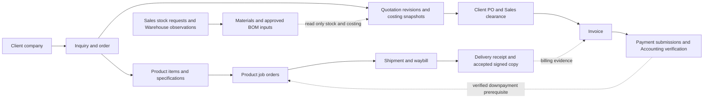

# ENTER-FLOW V2 Phase 2 Task 001 database architecture review

Date: 2026-11-21, Asia/Singapore. Decision: **review the correction plan before implementation; no database changes authorized or performed.**

The relational model covers the established inquiry, quotation, PO, payment, JO, inventory and delivery workflow reasonably well. Its main problems are inconsistent interpretation of inventory provenance and units, incomplete manufacturing snapshots, financial queries that do not respect relationship cardinality, and migration procedures that cannot safely establish the deployed state under the current protection rules. Reducing the table count would not resolve these problems.

This is a comprehensive **source architecture review**, with a prioritized conditional correction plan. **The current deployed schema and record integrity remain unverified.** No database connection, runtime verification, tests, build, lint, migration, import or Docker command was executed. The user reserves verification for their VS Code terminal. Consequently, no historical count, source definition, or successful Task 002 run is presented as evidence of current operational records. Findings below identify exact source defects; proposed data effects require the fresh evidence in section 9 before an execution plan can be approved.

## 1 Evidence and scope

Root `AGENTS.md` governs this review. Git status was inspected first and was clean. Existing Task 002 reports and protected Task 003 artifacts were not modified. Migration 007, its SQL, history record and checksum were not accessed, searched, hashed or executed. No migration directory discovery or migration framework invocation was performed.

The Phase 1 authority available in the checkout is [WAREHOUSE_INVENTORY_PHASE_1_REPORT.md](WAREHOUSE_INVENTORY_PHASE_1_REPORT.md). It records the earlier reading of the original 28-page handoff, including unknown stock, manual counts, approved BOM and price requirements. The original PDF was not independently reviewed here; its historically recorded path is outside this checkout. Additional rules absent from the recorded handoff require the authoritative material or an owner decision, rather than assumptions.

Other references: [business handoff](BUSINESS_MODULE_DEVELOPMENT_HANDOFF.md), [resumption handoff](PHASE_1_RESUMPTION_HANDOFF_2026-11-18.md), [testing restrictions and entry points](TESTING.md), [Sales restoration](SALES_QUOTATION_PHASE_1_RESTORATION_REPORT.md), [Sales follow-up](SALES_QUOTATION_PHASE_1_FOLLOWUP_REPORT.md), [earlier database review](ENTER_FLOW_V2_LAYER_1_DATABASE_REPOSITORY_REVIEW_2026-11-19.md), and [migration safety hold](../database/TEAM_MIGRATIONS.md). Historical verdicts are not current acceptance evidence.

Direct source inspection covered the explicitly named original definitions `001_identity_catalog.sql`, `002_orders_quotations.sql`, `003_operations_billing.sql`, `004_attachments_audit.sql`, the source-aware material definition `008_inventory_material_master.sql`, the reference seed, application pool/runtime configuration, migration runner implementation, import implementation, relevant service SQL, routes, permissions, inventory adapters and consuming components. SQL files were read as text only. No import module or database singleton was executed.

The [source dictionary appendix](PHASE_2_TASK_001_SCHEMA_SOURCE_APPENDIX_2026-11-21.md) records the inspected column declarations, keys, checks and relationships. It is a static review reference, **not a deployed schema export, test schema, Task 003 artifact, or executable migration**. Session columns and client-account uniqueness are separately marked where their complete DDL was not established by the inspected definitions.

Evidence labels:

- **D — confirmed source defect:** the cited code/DDL establishes the problem. Whether affected records currently exist is a separate question.
- **R — recommendation or structural risk:** a missing safeguard or ambiguous design; no corrupt record or runtime failure is claimed.
- **G — evidence or business decision gap:** dependent implementation must wait.

## 2 Architecture and complete known table inventory

Express services contain parameterized SQL and own their transactions directly; there is no separate repository package. This is not itself a defect. MySQL stores business relationships and snapshots; private object storage stores file content; React Real Mode consumes authenticated projections. Browser Demo stores are not an operational ledger.

The original four definitions contain 70 table declarations. Source-aware inventory adds `material_import_review`; application code requires `user_sessions`; the migration core defines `_enterflow_migration_history`. These are **73 distinct known table names across the inspected sources**, not a statement that the current database has 73 tables. A deployed inventory may reveal additional objects; no conclusion about any held migration's contents is inferred.

In the following table, **active** means a production application source path references the table; it does not prove traffic or existing records. **Planned/history** means the inspected schema supplies a purpose but no completed writer was established in this review. Neither classification authorizes removal.

| Table | Purpose and relationship | Current source use and disposition |
| --- | --- | --- |
| `schema_migrations` | Original version markers | Legacy infrastructure; preserve. Do not query its contents for this review. |
| `_enterflow_migration_history` | Runner state and integrity ledger | Active infrastructure; distinct from legacy markers. Contents excluded. |
| `roles` | Nine role identities | Active authentication/account validation; retain all nine. |
| `modules` | UI module identifiers | Reference/visibility metadata; not endpoint authorization. |
| `role_modules` | Role-to-module junction | Visibility matrix; retain separately from API action permissions. |
| `payment_terms` | Term codes and days after receipt | Active orders, quotations, invoices; preserve existing terms. |
| `clients` | Company identity, contacts, account settings | Active client ownership root; separate from login credentials. |
| `users` | Employee/client credentials, role and company link | Active authentication/Admin/actor FKs. Client-account uniqueness requires deployed evidence. |
| `client_applications` | Pending and decided registration applications | Active registration/Admin decisions; preserve rejected applications. |
| `user_sessions` | Hashed session token, activity, expiry and revocation | Active login/authentication; complete deployed definition pending. |
| `filter_types` | Product type and template group | Active specification and BOM classification. |
| `product_specifications` | Client-owned dimensions and product descriptions | Active inquiry/JO/finished-good source; JO snapshot problem D06. |
| `material_categories` | Raw-material classifications | Active inventory lookup; unclassified source rows can be NULL after 008. |
| `units` | Internal unit codes | Active FK; disagrees with some free-text source units, D04. |
| `materials` | Material identity, price provenance, stock and threshold | Active reads and Warehouse/Admin maintenance; D01–D05. |
| `material_import_review` | Source-row ambiguity and resolution queue | Import support, not a duplicate material catalog; retain unresolved/excluded rows. |
| `bom_templates` | Reusable recipe and costing defaults | Active quotation/availability reads; approval/selection risk R02. |
| `bom_template_lines` | Per-template material consumption and waste | Active quote/stock inputs; no BOM population authorized. |
| `files` | Private object metadata and lifecycle | Active document/sketch paths; D11–D12. |
| `order_stages` | Commercial order stage lookup | Active order pipeline; not production or payment state. |
| `delivery_methods` | Delivery/pickup method lookup | Active commercial/shipment projections. |
| `orders` | Inquiry identity retained through commercial workflow | Active ownership/workflow root; archival preserves history. |
| `order_items` | Ordered product lines and client-owned specifications | Active inquiry/quotation/JO relationships; minimum quantity check retained. |
| `quotation_references` | Quote number ownership by one order | Active revisions; prevents cross-order reuse without forbidding revisions. |
| `quotations` | Revision headers and financial/delivery snapshot | Active draft/send/client decision prerequisites; D09 and R01. |
| `quotation_lines` | Client-facing line description, quantity and selling price | Active; one row per line number, not guaranteed one per order item. |
| `quotation_costing` | Internal per-product labor/markup/VAT inputs | Active; unique quotation/item pair and composite JO source key. |
| `quotation_bom_lines` | Material name/unit/price/consumption at quote time | Active historical snapshot; must never refresh from current prices. |
| `quotation_discounts` | Ordered quote discount entries | Active quotation writer/readers; separate from per-product cost inputs. |
| `quotation_addons` | Packaging/shipping entries | Read support and planned richer writer; retain historical entries. |
| `purchase_orders` | Accepted quotation, client reference and staff clearance | Active metadata/document paths; reference scope issue D10. |
| `order_requests` | Revision, cancellation and urgent request history | Active request/cancellation paths; retain shared lifecycle. |
| `document_sequences` | Counter per document type/year | Active inquiry numbering; JO writer does not reuse it, R05. |
| `production_stages` | Stage positions 0–8 | Active JO history/read projections; completion cursor 9 is a sentinel. |
| `replacement_requests` | Defect/replacement request lifecycle | Planned/history; policy incomplete, not redundant orders. |
| `job_orders` | Product-specific manufacturing children | Active creation/monitoring; D06 and R03. |
| `job_bom_lines` | Frozen manufacturing recipe | Planned snapshot destination; current JO writer does not populate it, D06. |
| `production_events` | Stage, pause/revert and completion events | Active readers; transition writers need approved policy. |
| `material_movements` | Quantity ledger with per-operation idempotency | Defined ledger; active stock writers bypass it, D05. |
| `material_changes` | Structured catalog field history | Planned/history; current maintenance uses generic audit instead. |
| `finished_goods` | Client-owned finished item and balance | Active inventory/availability reads; unknown-state risk R04. |
| `finished_good_movements` | Finished item count history linked to client/JO | Planned/history; distinct entity from raw movements. |
| `finished_good_order_items` | Explicit historical finished-item/order-item association | Planned/history; not a reservation or stock allocation. |
| `stock_requests` | Sales-to-Warehouse request header | Active creation/queue/status; retains order identity. |
| `stock_request_lines` | Required material and request-time balance snapshot | Active; NULL stock/shortage preserves unknown observations. |
| `stock_responses` | Warehouse reply history | Active response append; latest response is a projection. |
| `stock_response_lines` | Observed stock/shortage per request line | Active; composite FKs prevent mismatched request lines. |
| `quotation_stock_responses` | Quote revision tied to precise Warehouse response | Planned/history link; retain even if current paths do not populate it. |
| `shipments` | One delivery/pickup record per JO | Active Warehouse/Logistics/client reads; transition policies incomplete. |
| `waybills` | Printed waybill and QR identifier | Active handoff reads; not a signed delivery acceptance. |
| `shipment_events` | Shipment status/history events | History structure; separate from production events. |
| `delivery_receipts` | Generated DR and send/handoff events | Active handoff/client/Sales reads. |
| `signed_delivery_receipts` | Staged/discarded/accepted uploaded copy | Active read support; one accepted copy per DR is enforced in source. |
| `invoices` | One invoice per order, financial terms and billing dates | Active issue/Accounting/client reads; one-per-order is existing cardinality. |
| `invoice_delivery_receipts` | Same-order accepted evidence for billing cycle | Planned/history relation; receipt selection policy still required. |
| `payments` | Single submission/verification ledger | Active proof/review/revenue; D07–D09. |
| `payment_instructions` | Instructions actually sent for an order | Read/history support; separate from receipts and mutable settings. |
| `company_settings` | Singleton company, default driver/bank/letterhead | Settings/history support; retain pending approved settings writer. |
| `company_payment_methods` | Multiple configurable payment methods | Planned/settings support; overlaps legacy defaults, R06. |
| `notifications` | Message content and optional order/client scope | Active scoped notification writers/readers. |
| `notification_roles` | Intended role audience | Active notification writes; distinct from actual delivered users. |
| `notification_recipients` | Per-user delivered/read/dismissed state | Active client/Sales scoped reads; preserve recipient isolation. |
| `order_files` | Inquiry/supporting document association | Typed FK; active document retrieval associations. |
| `specification_files` | Product sketch/image association | Active Engineer Sketch paths; retain client ownership checks. |
| `quotation_files` | Generated/signed quotation association | Active document reads; future writers must preserve issued revision. |
| `purchase_order_files` | Client PO document association | Active upload/read; many files per PO allowed. |
| `job_order_files` | JO sketch/signed quote/generated document association | Read/planned support; do not replace with untyped attachment IDs. |
| `payment_files` | Proof and receipt association | Active upload/read; many files per payment allowed, D07. |
| `invoice_files` | Issued invoice file association | Read/planned support; no duplicate invoice financial ledger. |
| `waybill_files` | Generated waybill association | Read/planned support; not file metadata duplication. |
| `delivery_receipt_files` | Generated DR file association | Read/planned support; signed copies use their lifecycle table. |
| `replacement_request_files` | Defect proof association | Planned/history; preserve pending replacement policy. |
| `audit_events` | Security, changes and currently some domain decisions | Active critical source; R03 and audit retention requirements below. |

### Relationships and cardinality

Client → orders → order items is one-to-many at each step. Items and specifications carry the same client through composite FKs. Quotations are many revisions per order, with a globally owned quote reference and unique revision pairs. Quote lines and costings carry the same order; BOM lines belong to a costing. An order has at most one PO and one invoice in the inspected source, but can have many payments and JOs. Each JO has at most one shipment; each shipment at most one waybill and one generated DR. A DR can have multiple staged/discarded signed copies but one accepted slot. One invoice can cite several same-order accepted signed copies.

These existing cardinalities support product-specific manufacturing and consolidated order billing. They do **not** authorize partial invoicing, split shipment per JO, extra POs, replacement quantities or stock allocation. Those require business decisions before changing uniqueness constraints.



The dotted stock edge is informational: quotation reads, quotation saves and JO creation must not reserve or deduct stock. The Warehouse update edge records an explicit count, not receipt of purchased materials.

## 3 Column types and normalization assessment

The appendix preserves exact declarations rather than implying the old dictionary is current. The common conventions are sound: unsigned BIGINT identifiers, relational child collections, decimal quantities/costs, DATE for document/business dates, millisecond DATETIME for events, nullable fields for absent events, and restrictive FKs. `database.js` keeps BIGINT and DECIMAL results as strings. Naming is generally consistent snake_case in SQL with camelCase API aliases; `reference` is a business number and `id` is an internal identifier. Renaming established fields would create unnecessary API/UI work.

Important exceptions and risks:

| Area | Assessment and required treatment |
| --- | --- |
| `materials` after 008 | Nullable quantity, threshold and category are deliberate. `quantity_status`/`threshold_status` distinguish unknown, sample and verified. Reference prices and approved costing prices are distinct; legacy `unit_price` must not become an implicit fallback. D01/D02/D04 address inconsistencies. |
| Money | `DECIMAL(15,4)` for prices/consumption inputs and `DECIMAL(15,2)` for payable totals are appropriate. Application binary arithmetic undermines that precision, D09. No conversion of DB money columns to FLOAT is proposed. |
| Product dimensions | VARCHAR dimensions preserve original text, units and tolerances. Converting them en masse to numeric fields would discard meaning. Current height-based recipe inference is R02, not approval for a unit conversion. |
| Defaults | Original material/finished-good zero defaults cannot express an unrecorded balance. Material 008 addresses representation but its transition is defective. Unknown is never a verified zero; finished goods require separate investigation. |
| Booleans | BOOLEAN is represented through TINYINT-style fields and existing service validation. Additional database 0/1 checks are optional hardening pending existing values; not proof of incorrect records. |
| Status enums and lookups | They constrain vocabulary, not legal transitions or actor authority. `job_orders.current_stage_cursor=9` means completed beyond the 0–8 stage lookup; absence of a stage label there is not an orphan. Do not merge commercial, manufacturing, shipment and financial status. |
| Nullable composite relationships | A NULL optional ID can legitimately leave a relationship absent, such as pre-invoice payments. Mandatory relationships must keep every FK carrier NOT NULL. Extra checks should address an established invariant, not prohibit legitimate staged states. |
| Collation | Original text keys use `utf8mb4_unicode_ci`; material source codes use `utf8mb4_bin`; token/idempotency/storage identifiers need exact comparison. Agree code case semantics before normalizing/deduplicating. No blanket collation conversion. |
| Source metadata | Material source digest/page/row is a separate uniqueness identity from optional item code. NULL item codes permit legitimate uncoded review records. `review_reasons` JSON is a reason collection, not an array of business FKs. |
| Audit JSON in TEXT | Generic old/new values are appropriate audit payloads. SQL extracts domain decisions/JO lineage from them, creating stronger dependencies than generic history should have, R03. Do not retrospectively rewrite historical payloads. |

Normalization is mostly appropriate. Users versus clients, application history versus accounts, recipes versus quotation snapshots versus JO snapshots, generated versus signed DRs, and message content versus recipient state have different ownership or lifecycles. None is a confirmed duplicate table. Typed attachment junctions preserve actual parent FKs and avoid a polymorphic attachment table with unenforceable parent IDs.

Repeated `client_id`/`order_id` columns are intentional ownership carriers. Removing them can weaken cross-client protection. The actual update anomaly is changing material units without reinterpreting stock, price and recipe quantities (D04). The insertion anomaly is enforcing provenance before existing balances are classified (D01). Potential deletion anomalies are controlled by restrictive FKs and archival; replacing them with cascades would destroy historical evidence. Issued document/material/specification snapshots are intentional duplication and must remain immutable.

## 4 Confirmed defects and correction proposals

Priorities: **P0** blocks safe data interpretation or migration planning; **P1** affects financial correctness, manufacturing history or operational integrity; **P2** concerns a bounded workflow correction. These are review priorities, not proof of current production incidents.

### D01 P0 Material provenance migration cannot safely transition existing records

**Affected:** `materials.quantity_on_hand`, `reorder_threshold`, their status columns, `ck_material_stock_provenance`; [008 source](../database/migrations/008_inventory_material_master.sql:6).

The ALTER adds both statuses with default `unknown` and immediately adds a CHECK requiring each non-NULL balance/threshold to have `provisional_sample` or `verified` status. Existing pre-008 values are NOT NULL, so an ordinary nonempty pre-008 table violates the new check during ALTER, before later UPDATEs can execute. MySQL rejects enforced checks that existing rows violate. This is a source-determined transition defect; no failed execution is claimed. [MySQL ALTER TABLE](https://dev.mysql.com/doc/refman/8.4/en/alter-table.html).

The subsequent blanket UPDATEs also replace every zero quantity/threshold with NULL. They do not distinguish a default zero from an explicitly counted zero. Even after correcting ordering, that would erase valid zero knowledge if any exists. It conflicts with the recorded requirement to preserve verified zeros.

**Correction:** first inspect actual deployed columns and aggregate/row evidence. If unapplied, design a staged expansion, evidence-based classification and final constraint validation. If applied, do not edit its historical SQL or rerun it; prepare a separately approved forward correction only for demonstrated remaining defects. Keep verified zeros, positive counts and unknowns distinct. Do not classify all existing positives as verified merely to satisfy a check.

**Affected records and dependencies:** all existing materials at transition; inventory maintenance, source importer, Stock Requests, Sales costing and inventory adapters. Exact records/counts pending section 9. **Migration/rollback:** not execution-ready; preserve before-images and provenance evidence, stop on ambiguity, rehearse on a separately approved copy, preserve existing migration integrity. Restoring NOT NULL/default zero is invalid while unknowns exist. An SQL transaction rollback does not undo an already completed DDL statement; MySQL atomic DDL is per statement, not an entire migration file. [MySQL atomic DDL](https://dev.mysql.com/doc/refman/8.4/en/atomic-ddl.html).

### D02 P0 Provisional sample balances become operational stock

**Affected:** `materials.quantity_status`, `threshold_status`, `stock_request_lines.stock_at_request`; [source importer](../database/material-master-source-import.mjs:198), [Sales availability](../backend/src/services/sales-orders.service.js:562), [Stock Request creation](../backend/src/services/stock-requests.service.js:28).

The importer writes hardcoded quantity 10 and threshold 2 with `provisional_sample` statuses. They are sample data, not physical-count evidence. The Warehouse UI labels samples, but Sales availability selects only `quantity_on_hand`, and Stock Request creation snapshots that number without its status. A sample 10 can consequently produce operational `available` or shortage results. No claim is made that any particular current row contains these values.

**Correction:** make every operational stock consumer require a verified count; preserve unknown/sample provenance in responses and snapshots. Stop future operational import plans from inventing counts/thresholds. Review existing samples individually before any conversion to NULL or a verified count; do not substitute zero. Keep reference prices separate from approved costing.

**Affected functionality:** read-only Sales stock checks and Sales/Warehouse request history; `Inventory.tsx`, `RealQuotationPreparation.tsx`, `RealSalesStockRequests.tsx`, inventory adapter. **Migration/rollback:** consumer correction may need no DDL. New snapshot provenance columns, if selected, require additive reviewed DDL and an explicit historical unknown state, never fabricated backfills. Preserve original values in any approved repair evidence. Reverting code must not make samples operational again.

### D03 P1 Order availability compares shared stock repeatedly without totaling demand

**Affected:** relationships from `order_items` through `bom_template_lines` to `materials`; [stockAvailability](../backend/src/services/sales-orders.service.js:553).

Each product/material requirement is assessed independently against the entire balance. The final overall status is based on those assessments. For two products each needing 6 units of the same material with 10 verified units available, both can be labelled available although the order needs 12. This example explains the algorithm; it is not an executed test. Equivalent repeated finished-good matches need the same review.

**Correction:** aggregate same-unit, same-material demand across the order before computing its overall availability, retaining per-product detail. Do not reserve/deduct stock. Waste inclusion remains a separate owner decision because pricing includes waste while current stock checks omit it.

**Affected records and dependencies:** multi-item inquiries sharing materials; Sales stock endpoint, quotation preparation display and request selection. **Migration/rollback:** initially a service/projection correction, no DDL or historical rewriting required. Preserve the response contract or add a compatible order-level assessment. Reverting the fix restores the false availability risk; keep unavailable presentation if safe compatibility cannot be maintained.

### D04 P1 Material units can silently contradict their balance and approved price

**Affected:** `materials.unit_code`, `source_unit`, `quantity_on_hand`, `approved_costing_price`, BOM quantities; [unit mapping](../backend/src/services/inventory.service.js:20), [unit update](../backend/src/services/inventory.service.js:223), [import mapping](../database/material-master-source-import.mjs:27).

Unsupported printable units map internally to `pcs`, while the actual source text is stored separately. Inventory and quotation costing use `COALESCE(source_unit,unit_code)`; Sales availability reads the internal unit lookup instead. The same material can be displayed as one unit in costing and `pcs` in availability. Maintenance can also change the unit while leaving numeric stock, thresholds, approved price and BOM quantities intact. A unit FK therefore does not ensure dimensional correctness.

**Correction:** establish one approved operational stock/pricing unit and keep source text as provenance. Reject operational use of unmapped units; do not invent kg/metre/roll conversions. Prevent silent reinterpretation of established counts, approval prices or recipe consumption when unit metadata changes. Any restriction change needs approval under AGENTS.md; this review applies none.

**Affected records and dependencies:** source units outside the internal set; any material with changed units and dependent BOMs/snapshots; Warehouse maintenance and Sales costing/stock APIs. **Migration/rollback:** start with evidence and compatible projections; additive unit mapping/conversion metadata only if approved. Preserve original unit and numeric before-images. Do not rewrite issued snapshots or reverse units without reversing the corresponding approved conversion.

### D05 P1 Inventory balance writes bypass the defined quantity ledger

**Affected:** `materials`, `material_movements`, `material_changes`, `audit_events`; [maintenance update](../backend/src/services/inventory.service.js:238), [Warehouse response update](../backend/src/services/stock-requests.service.js:105).

Both active count writers update the material balance and generic audit in a transaction, but neither appends `material_movements`. Source inspection found no production service writer for that ledger. Therefore it is unsafe to describe it as a complete movement trail or reconstruct stock from it. Generic audit does preserve evidence; this finding does not claim unaudited writes. Stock Request audit records new counts but lacks the prior material balances required for before/delta/after reconciliation.

The existing movement columns require non-NULL before/delta/after values. They cannot faithfully represent the first recorded count when the previous balance was unknown. Substituting zero would invent a starting balance.

**Correction:** approve which existing audit view/history is authoritative, then make a count and its structured evidence atomic. If `material_movements` remains the ledger, define a first-observation representation before connecting the writers. Catalog changes can keep generic audit until a structured `material_changes` contract is approved. Preserve both historical streams; do not fabricate missing movements from guessed old balances.

**Dependencies:** Warehouse/Admin material PATCH, Stock Request process, history presentation and future stock reconciliation. **Migration/rollback:** possible additive observation support or reviewed nullability/check adjustment, dependent on real records. Use stable operation identity for retries. Roll back code without deleting accepted observations; reconciliations require approved compensating records, not rewritten history.

### D06 P1 JO creation does not establish the documented manufacturing snapshots

**Affected:** `job_orders.specification_id`, `costing_id`, `job_bom_lines`, `product_specifications`; [JO insert](../backend/src/services/sales-orders.service.js:395), [production reader](../backend/src/services/production-job-orders.service.js:25).

The original schema comment requires a JO-specific specification row. `createJobOrders` instead passes the inquiry item's specification ID directly, and inserts no `job_bom_lines`. The reader follows that shared specification and exposes BOM counts elsewhere. This leaves no independent JO specification/BOM snapshot even when accepted quote costing contains material snapshots. No current production specification mutation or live history corruption is asserted.

**Correction:** copy the approved issued specification and accepted quotation BOM to JO-owned snapshots within JO creation's existing transaction. Copy known snapshots only; do not populate from current master recipes or invent BOMs. Confirm whether absence of accepted costing must block issuance before changing an existing restriction. Retain the no-reservation/no-deduction behavior.

**Affected functionality:** Sales create-JO, Production/Operations monitoring, client JO documents and future material operations. **Migration/rollback:** the existing tables can support new-row copies without DDL. Existing JOs need a separate reconciliation identifying what contemporaneous evidence survives; never backfill an allegedly historical snapshot from today's specification. Retain copied rows after code rollback and preserve parent FKs; do not delete issued JOs.

### D07 P1 Payment proof cardinality can multiply financial eligibility

**Affected:** `payments` → `payment_files` one-to-many; [JO prerequisite aggregate](../backend/src/services/sales-orders.service.js:378), [Accounting projections](../backend/src/services/accounting.service.js:120).

JO eligibility sums `p.verified_amount` after joining every `payment_files` row and does not filter file purpose or availability. The junction PK is `(payment_id,file_id)`, so a proof plus receipt, or multiple proof links, repeats a payment in the sum. Accounting lists likewise repeat payment rows and detail chooses the first returned file. Normal current upload paths create one link, but the schema explicitly permits more. This is a confirmed cardinality error, not evidence that current payments were overcounted.

**Correction:** sum payments once and use `EXISTS` for qualifying proof evidence. Use explicit proof purpose and existing availability/ownership requirements. Return a deliberate file collection or deterministically select the contractually relevant proof in Accounting. Do not use `SUM(DISTINCT amount)`, which incorrectly merges different equal-value payments.

**Affected functionality:** create-JO downpayment gate, Accounting payment list/detail/queue and payment-proof UI. **Migration/rollback:** no schema change required to correct queries; preserve all files and payments. Add a unique proof constraint only if one-proof policy is approved and existing links are reconciled. Reverting queries would reintroduce the risk; do not delete duplicate-looking history as a rollback.

### D08 P1 Payment idempotency keys identify attempts rather than client submissions

**Affected:** `payments.idempotency_key`; [proof submission](../backend/src/services/document-workflows.service.js:71).

The unique key includes `Date.now()`. Retrying the same submission at a later millisecond gets a different key and can create another payment/proof. Two requests in one millisecond can collide without checking whether their payloads match. Review locks only the selected payment; distinct duplicate rows can each be verified. This can inflate verified revenue independently of D07. It is not proof that all equal payments are duplicates.

**Correction:** bind a stable client submission key to actor/order/invoice and a canonical payload/file digest, return the original result on a matching retry, and reject conflicting reuse. Reuse the established Engineer Sketch submission approach where appropriate. Agree the resubmission-after-rejection behavior; do not forbid legitimate separate payments by amount alone.

**Affected functionality:** payment upload/review, Client proof UI and Accounting/revenue consumers. **Migration/rollback:** assess existing key capacity and whether an additive receipt field/table is necessary; a new table is not automatically required. Existing suspected duplicate submissions need individual review, not automatic deletion or unverification. Preserve issued receipt/audit evidence and replay identity across rollback.

### D09 P1 Decimal storage is undermined by binary financial calculations

**Affected:** quotation costing/totals/downpayment and payment comparisons; [quoteRound and calculation](../backend/src/services/sales-orders.service.js:611), [payment amount comparison](../backend/src/services/document-workflows.service.js:70).

The pool preserves decimal strings, but quotation calculation repeatedly converts to `Number`, multiplies/reduces and rounds with `toFixed`. Payment checks use numeric epsilon comparisons. This is not decimal-safe arithmetic and can produce boundary-rounding differences or lose precision at allowed column magnitudes. Actual affected amounts remain unmeasured.

**Correction:** use explicit decimal arithmetic or scaled integers with documented scales and rounding points. Preserve the existing formulas, VAT/markup/discount behavior and mandatory exactly 20% or 50% downpayment. Do not recalculate issued documents in place. API values and identifiers must preserve their string contracts.

**Dependencies:** Sales quote writer/validation, invoice and PO eligibility, Client proof uploads and Accounting verification. **Migration/rollback:** no money-type change is proposed. Compare historical values read-only before any separately approved repair. Version a calculation policy only if the reviewed compatibility design needs it; a rollback must continue reading the previously issued exact values.

### D10 P2 Client PO numbers are stored in the globally unique internal reference

**Affected:** `purchase_orders.reference`, `client_reference`, `uq_po_reference`; [submission](../backend/src/services/client-portal.service.js:345), [document upload](../backend/src/services/document-workflows.service.js:45).

Both paths use the client-supplied reference for the globally unique `reference`; the upload path can even fall back to a common filename. Two unrelated customers using the same PO number/filename will conflict despite separate orders. A separate `client_reference` field already exists. This demonstrates an internal-versus-external identity mismatch; whether customer reference uniqueness is intended globally still requires owner confirmation.

**Correction:** confirm existing numbering policy, then generate the internal reference through the established numbering mechanism and retain the customer's number unchanged in `client_reference`. Do not relax global internal uniqueness just to accommodate filenames.

**Affected functionality:** Client PO metadata/upload, Sales PO browser and linked document display. **Migration/rollback:** usually a new-record writer correction with no DDL; do not renumber historical POs or broken external references automatically. Preserve both identifiers through code rollback; migration needed only if an approved identity mapping requires extra fields.

### D11 P1 External document uploads can outlive rolled-back database metadata

**Affected:** `files`, PO/payment file links and storage object lifecycle; [uploadObject](../backend/src/services/document-workflows.service.js:12).

The PO/payment path uploads to object storage inside a SQL transaction. A later failed link/audit/commit acknowledgement can leave an object after SQL rollback. Its `failed` update also occurs in that same transaction and can disappear. The unique temporary `(bucket,'pending')` metadata identity is a shared contention point across otherwise unrelated uploads. The Engineer Sketch service already has a more durable upload journal, generation-aware cleanup and submission reconciliation.

**Correction:** adapt that established lifecycle to PO/payment uploads: unique planned object identity, durable attempt evidence, generation-bound completion and reconciliation of ambiguous commits. Never delete an object on an assumed rollback until fresh evidence establishes ownership and commit outcome. No new bucket or live upload is part of this task.

**Affected functionality:** Client PO/proof uploads and secure retrieval. **Migration/rollback:** prefer existing `files` and audit infrastructure if sufficient; extra receipt metadata only after review. Retain journals and object generations through rollback. Cleanup or data repair needs explicit approval and should not remove accepted historical files.

### D12 P1 PO and payment retrieval ignores stored object bucket and generation

**Affected:** `files.bucket`, `object_path`, `object_generation`; [retrieveFile](../backend/src/services/document-workflows.service.js:89), [storage adapter](../backend/src/storage/document-storage.js:76).

The retrieval query selects only `object_path` and calls `documents.get({objectKey})`, although file metadata records bucket and generation and the adapter can accept both. If configured buckets change, or an object has multiple versions, the service cannot reliably retrieve the recorded historical object. This is a source-confirmed omission; no bucket migration or replacement object is claimed.

**Correction:** pass the persisted bucket and generation through authorized retrieval, preserving ownership checks. Validate supported object identity and reconcile old NULL generations without inventing a generation. Consider the stored digest where present; do not claim all historical files have one.

**Affected functionality:** Sales/Client PO files, Accounting/Client payment proofs. **Migration/rollback:** no DDL initially required. Legacy metadata repair requires object evidence and separate approval. Keep old bucket/generation mappings during deployment rollback; changing a global bucket is not a history migration.

## 5 Recommendations and unresolved design decisions

These items are not confirmed deployed data defects and must not be bundled into automatic schema cleanup.

| ID and priority | Structural concern | Proposed treatment, data effects and rollback |
| --- | --- | --- |
| R01 P1 | `ck_quote_amounts` permits percentages 0–100 and any downpayment within total; API requires exactly 20/50 and matching amount. | Inspect actual CHECKs and legacy revisions. Consider an additive invariant for newly eligible/sent documents with the agreed exact rounding rule; preserve historical drafts. No blanket historical UPDATE and no execution-ready ALTER until exceptions are reviewed. Keep existing API guards. |
| R02 P1 | BOM templates have no explicit approval/version/applicability key; selection chooses the first matching template by ID after a height label inferred with `parseFloat`. Stock uses internal unit labels, costing source units, and stock ignores waste. | Obtain approved recipe/version selection, dimensions/units and waste policy. Then prefer explicit mappings/approval metadata over first-ID selection. Preserve old quote/JO snapshots. No duplicate-template removal, automatic recipe import, inferred unit conversion, or new BOM data. |
| R03 P1 | Quote acceptance, PO decisions, JO accepted-quote/PO lineage and some submission receipts live in generic audit TEXT/JSON. JO's optional costing FK does provide partial typed lineage. | Retain existing audits as operationally required. Consider typed decision/lineage records or additive parent IDs with same-order FKs. Backfill only validated unambiguous source evidence; ambiguous rows stay flagged. Keep compatibility reads until reconciled; never delete historical audits after backfill. |
| R04 P1 | Original `finished_goods.quantity_on_hand`/`buffer_minimum` are NOT NULL default zero with no provenance. | Inspect actual definitions and evidence before any change. If unknown balances exist, approve NULL/provenance support and audit all consumers. Do not assume every zero is false or every item needs a raw-material policy. Rollback cannot force unknown to zero. |
| R05 P2 | JO numbering scans and locks all references for a year, choosing a free sequence, while the existing counter table is used for inquiries. | Prefer a per-type/year counter under the existing transaction if numbering policy allows it. Reconcile existing prefixes and counter high-water mark first; preserve all issued numbers. No claim that duplicate numbers can bypass the existing unique key. |
| R06 P2 | Company default bank columns overlap multiple method details; application/company contacts also overlap account identity fields. | Define field ownership and synchronization only when implementing settings/account workflows. Application copies are historical evidence. Never merge authentication identity into company contact fields or drop bank defaults on appearance alone. Reversible API mapping first. |
| R07 P2 | Some lifecycle pairs lack CHECKs: PO received/cleared actor/time, quotation sent actor/time, archive metadata, shipment/DR timestamps. Stock-response status/shortage relation is service-enforced. | Profile state combinations, then add only invariant row checks consistent with legitimate pending/history states. Cross-row prerequisites and actor permissions stay in transactional services. Do not invent dispatch/replacement/clearing rules. Rollback removes only an approved added constraint, preserving records. |
| R08 P2 | Approval/source-review metadata can describe a resolution without a full explicit actor/time history; generic audit and actor FKs may supply only part. | Decide material cost approval and source-review workflow before adding resolution checks/history. Verify actor role in services; an FK to users cannot enforce RBAC. Preserve unresolved/uncoded rows and source evidence. |
| R09 P2 | `quotation_lines` allows several lines for one order item, while JO creation joins on order item and assumes one effective product line. | Profile actual rows and confirm whether split lines are supported. Correct aggregation/mapping in the reader/writer first; add uniqueness only if the established contract forbids multiple lines. Preserve valid issued document layouts. |

## 6 Workflow and nine role alignment

| Role | Database support and current boundary | Consequence for Phase 2 |
| --- | --- | --- |
| Client | Company-owned inquiries/items, quotation decisions, PO/proof submission, scoped documents and notification recipients. | Preserve server-derived `clientId`, safe projections and internal costing confidentiality. D08/D10–D12 affect existing actions. |
| Sales | Inquiry/quote history, approved costing reads, client PO decision, invoice issue, verified-payment prerequisite and JO creation. | D02–D04/D06–D10 affect one continuous workflow; correct prerequisites without broadening permissions. |
| Accounting | Invoice/payment ledger, payment proof review and signed-delivery evidence structures. | D07–D09/D12 affect amounts and evidence. Receipt/reminder/balance-payment policy remains unapproved where incomplete. |
| Production | JO specification and event history, stage lookup and recipe snapshot destination. | D06 must be resolved before relying on immutable manufacturing basis. A schema status column does not authorize stage mutation. |
| Warehouse | Material balances/provenance, manual count maintenance, Stock Request responses and shipment reads. | D01/D02/D04/D05 concern observed facts. Manual count must not become procurement receiving or automatic consumption. |
| Logistics | Shipments, printed waybills, generated DR handoff and shipment history. | Preserve handoff joins requiring printed waybill and DR sent to Logistics. Dispatch/POD/QR mutation policies need decisions, not speculative tables. |
| Operations | Read projections over JOs, inventory, deliveries and rejection history. | Fix underlying provenance/snapshots; do not fabricate progress, bottlenecks or warehouse quantities to fill dashboards. |
| Owner | Directory and approved cross-module read/report sources. | Reports must count verified payments once, retain date semantics and avoid join fan-out. Unapproved KPI definitions remain unavailable. |
| Admin | Account lifecycle, roles, applications, sessions and audited inventory maintenance. | Preserve exact route role/action checks, account-type constraints and active-account safeguards. Module visibility is not authorization. |

The schema's `role_modules` matrix, backend `permissions.js`, route role restrictions and service actor checks serve different purposes. An Admin permission entry does not override a Sales-only route. No synchronization that grants extra actions is proposed.

The intended commercial chain is supported by same-order keys and transactions. The dangerous boundaries are semantic: unverified stock treated as fact, a payment multiplied by its attachments, or a JO appearing issued without frozen manufacturing details. These require targeted corrections, not a replacement schema or frontend redesign.

## 7 Indexes and query structure

The source already includes business reference uniqueness, composite ownership keys, queue indexes and history indexes. FK-supporting indexes should be inspected before adding duplicates. No index is proposed for execution without deployed metadata, row distributions and operator-provided query evidence.

| Query pattern | Existing support and structural concern | Conditional candidate |
| --- | --- | --- |
| Audit latest decision/JO trace | `ix_audit_subject(subject_type,subject_identifier,occurred_at)` supplies a useful prefix; repeated correlated JSON subqueries add work. | Prefer one typed/joined decision projection (R03); consider action/date/id index only after plans and selectivity. |
| Payment invoice sums | `ix_payment_order(order_id,verification_status)` supports order reads; invoice FK may supply an invoice index. | Inspect whether `(invoice_id,verification_status)` helps real invoice sums. Fix D07 cardinality before indexing. |
| Inventory active/name listing | Original `(category_code,name)` does not directly match `active` plus `ORDER BY name,id`. | Consider `(active,name,id)` if demonstrated volume/plan warrants it; source-aware indexes may differ. |
| BOM selection | FK index on filter type can narrow candidates; size is also filtered. | `(filter_type_code,size_label,...)` only after approved deterministic selection, R02. |
| Shipment lists | `(status,estimated_delivery_date)` differs from `ORDER BY updated_at DESC,id DESC`, including optional order filter. | Assess `(status,updated_at,id)` or order-scoped variant against actual plans, not all variants automatically. |
| Sales/Production search | `LOCATE` and casted ID substring searches scan candidate strings; ordinary B-tree additions do not solve arbitrary substring search. | Preserve existing search semantics; first bound/scope/paginate. FULLTEXT or prefix changes require separate UX/business agreement. |
| User notifications | PK `(notification_id,user_id)` plus `(user_id,dismissed_at,read_at)` supports recipient scoping. | Verify list ordering and actual plan before adding anything. |
| JO numbering | Annual range scan locks grow with issued JOs. | Reuse counter mechanism, R05, rather than indexing around the scan indefinitely. |

Index migration plans must state metadata-lock exposure, table size, online-operation support and a rollback that drops only the newly approved index. No performance incident or unused index is established without plans/usage evidence. `EXPLAIN ANALYZE` executes the statement and is not authorized here.

## 8 Migration safety and deployment readiness

The current migration CLI is local-only and is **not** a safe read-only architecture-inspection command. Source inspection shows that it connects before core preflight, discovers/hashes active files and reads the runner history with `SELECT *`. Filtering protected fields afterwards cannot undo their retrieval. Do not use `db:status`, baseline verification, migrate, seed, a broad migration test, or a schema dump including ledger data to collect this review's missing evidence. This is an implementation finding from reading the runner, not an inspection of the actual history table.

The implementation now has a named exception for inventory migration 008, while the historical migration guide describes all migrations from 007 onward as deferred. This is confirmed documentation/source drift. It does not authorize executing 008, reopening the held migration, changing checksums, accepting deferred history, or replaying original DDL. Correct current procedural documentation in a separately approved bounded task once the allowed path is settled.

Separate legacy markers and runner history are intentional compatibility evidence, not duplicate business data. Never delete, merge, baseline or repair them automatically. Determine actual application shape through narrowly scoped permitted metadata; protected ledger contents remain outside this task.

Before any approved DDL: identify the actual target, exact before-state and allowed operator; review existing records and incompatible states; establish backup and restoration authority; design explicit preconditions and postconditions; rehearse on a separately approved isolated copy; plan maintenance/locking; capture exact row before-images for approved DML; stop after partial failure or ambiguous commit. Preserve unknowns, historical documents, actor links and migration integrity. A corrective migration must not modify protected Task 003 artifacts or reuse Task 002 infrastructure without separate approval.

Future Firebase Hosting/Cloud Run/Cloud SQL/private GCS architecture remains feasible. Source supports parameterized MySQL, verified TLS options, string BIGINT/DECIMAL transport and process-external file storage. Readiness is not established: the migration/import CLIs remain local-only; pool limits must be budgeted across instance count; MySQL session time zone must match UTC-labelled projections (normal runtime allows other `DB_TIMEZONE` values and does not enforce SQL session UTC as integration runtime does); deployed SQL mode/collation/constraints must be evidenced; private bucket generations must survive retrieval and recovery; backups, restoration, secrets, retention and least-privilege grants need the intended deployment's own review. No provisioning, credential change or deployment is proposed for execution.

## 9 Operator evidence required to complete the current database review

This is the outstanding acceptance gate. Source review establishes D01–D12 but cannot identify current affected record IDs, exact live counts, additional tables, actual constraint enforcement, object drift or operational query costs. The reported 158 materials and the 71 MAIN catalog records remain separate scopes. Neither is a current count or a reimport instruction.

The user may execute the following **proposed read-only investigation SQL after confirming the intended target and approved read-only connection**. These are not tests, migrations or Task 002/003 commands; none was executed by Codex. Use an existing authorized SQL client, supply credentials through its protected mechanism, and retain only redacted metadata/aggregate evidence. No login/API call is a substitute: authentication can write sessions/activity.

### Metadata queries

```sql
SELECT DATABASE() AS database_name, VERSION() AS mysql_version,
       @@session.time_zone AS session_time_zone,
       @@session.sql_mode AS session_sql_mode,
       @@lower_case_table_names AS lower_case_table_names;

SELECT TABLE_NAME, TABLE_TYPE, ENGINE, TABLE_COLLATION
FROM information_schema.TABLES
WHERE TABLE_SCHEMA = DATABASE()
ORDER BY TABLE_NAME;

SELECT TABLE_NAME, ORDINAL_POSITION, COLUMN_NAME, COLUMN_TYPE,
       IS_NULLABLE, COLUMN_DEFAULT, EXTRA, CHARACTER_SET_NAME,
       COLLATION_NAME, GENERATION_EXPRESSION
FROM information_schema.COLUMNS
WHERE TABLE_SCHEMA = DATABASE()
  AND TABLE_NAME NOT IN ('schema_migrations','_enterflow_migration_history')
ORDER BY TABLE_NAME, ORDINAL_POSITION;

SELECT TABLE_NAME, INDEX_NAME, NON_UNIQUE, SEQ_IN_INDEX,
       COLUMN_NAME, SUB_PART, INDEX_TYPE, COLLATION
FROM information_schema.STATISTICS
WHERE TABLE_SCHEMA = DATABASE()
  AND TABLE_NAME NOT IN ('schema_migrations','_enterflow_migration_history')
ORDER BY TABLE_NAME, INDEX_NAME, SEQ_IN_INDEX;

SELECT k.TABLE_NAME, k.CONSTRAINT_NAME, k.ORDINAL_POSITION,
       k.COLUMN_NAME, k.REFERENCED_TABLE_SCHEMA,
       k.REFERENCED_TABLE_NAME, k.REFERENCED_COLUMN_NAME,
       r.UPDATE_RULE, r.DELETE_RULE
FROM information_schema.KEY_COLUMN_USAGE k
JOIN information_schema.REFERENTIAL_CONSTRAINTS r
  ON r.CONSTRAINT_SCHEMA=k.CONSTRAINT_SCHEMA
 AND r.TABLE_NAME=k.TABLE_NAME AND r.CONSTRAINT_NAME=k.CONSTRAINT_NAME
WHERE k.TABLE_SCHEMA=DATABASE()
  AND k.TABLE_NAME NOT IN ('schema_migrations','_enterflow_migration_history')
ORDER BY k.TABLE_NAME, k.CONSTRAINT_NAME, k.ORDINAL_POSITION;

SELECT t.TABLE_NAME, t.CONSTRAINT_NAME, t.ENFORCED, c.CHECK_CLAUSE
FROM information_schema.TABLE_CONSTRAINTS t
JOIN information_schema.CHECK_CONSTRAINTS c
  ON c.CONSTRAINT_SCHEMA=t.CONSTRAINT_SCHEMA
 AND c.CONSTRAINT_NAME=t.CONSTRAINT_NAME
WHERE t.CONSTRAINT_SCHEMA=DATABASE() AND t.CONSTRAINT_TYPE='CHECK'
  AND t.TABLE_NAME NOT IN ('schema_migrations','_enterflow_migration_history')
ORDER BY t.TABLE_NAME, t.CONSTRAINT_NAME;
```

Table-name metadata can identify infrastructure objects; **neither migration ledger's rows or checksums are requested**. Do not export users, hashes, tokens, private object paths, customer documents, complete audit payloads or credential files. Any object whose definition might cross a protected boundary must be reviewed separately rather than included in a blanket dump. Additional table names require scoped follow-up before declaring the inventory complete.

### Record profiles after confirming columns exist

Run only queries compatible with the returned metadata; do not fix a failed query by migrating. The following examples assume source-aware material columns exist:

```sql
SELECT quantity_status, threshold_status, COUNT(*) AS record_count,
       SUM(quantity_on_hand IS NULL) AS unknown_quantities,
       SUM(quantity_on_hand=0) AS recorded_zero_quantities,
       SUM(approved_costing_price IS NOT NULL) AS approved_price_count
FROM materials GROUP BY quantity_status, threshold_status;

SELECT COALESCE(source_unit,unit_code) AS displayed_unit,
       unit_code, COUNT(*) AS record_count
FROM materials GROUP BY COALESCE(source_unit,unit_code),unit_code;

SELECT payment_type, verification_status, COUNT(*) AS record_count,
       SUM(submitted_amount) AS submitted_total,
       SUM(verified_amount) AS verified_total
FROM payments GROUP BY payment_type,verification_status;

SELECT COUNT(*) AS payments_with_multiple_links
FROM (SELECT payment_id FROM payment_files
      GROUP BY payment_id HAVING COUNT(*) > 1) AS linked;

SELECT COUNT(*) AS jobs_sharing_inquiry_specification
FROM job_orders jo JOIN order_items oi ON oi.id=jo.order_item_id
WHERE jo.specification_id=oi.specification_id;

SELECT COUNT(*) AS jobs_without_bom_snapshot
FROM job_orders jo
WHERE NOT EXISTS (SELECT 1 FROM job_bom_lines b WHERE b.job_order_id=jo.id);
```

Other required profiles, to be specified against that actual metadata: per-business-table counts; missing/duplicate keys and nullable FK carriers; same-client/same-order anti-joins for every composite relationship; enforced-versus-documented CHECKs; exact 20/50 eligibility and amount consistency; invoice/accepted-quote consistency; material source identity duplicates; price approval actor/time completeness; NULL/sample/verified mismatches; incomplete source-review resolutions; accepted signed DR state and invoice evidence; count-to-ledger coverage; same-item multiple quote lines; application decision metadata; account-role/client consistency and unique client account; session token uniqueness/expiry indexes without reading tokens; audit evidence existence without retrieving secrets. Duplicate-looking payments must be investigated by existing operation identity, not amounts alone. Approximate `information_schema.TABLES.TABLE_ROWS` values must not be substituted for exact record counts or evidence that a table is unused.

Record IDs needed for a specific correction should stay in controlled local evidence and be reported as counts/redacted identifiers. Query plans should use `EXPLAIN` for the actual parameterized read shapes on an approved target, without running APIs or `EXPLAIN ANALYZE`. Slow-query evidence requires separate authorization if it exposes private query text. These profiles establish affected populations before selecting migration/backfill parameters.

## 10 Prioritized Phase 2 correction plan

The identifiers below are proposed Phase 2 work packages, not authorization for an earlier Phase 1 Task 003 or any implementation. Each package must have one measurable outcome and its own approved scope. No next task starts automatically.

| Order | Proposed work package | Outcome and dependencies | Acceptance evidence to be run by user |
| --- | --- | --- | --- |
| 1 P0 | P2 A Current architecture evidence reconciliation | Complete section 9; reconcile every deployed table/column/constraint with the source dictionary; quantify D01–D12/R01–R09 populations; preserve protected exclusions. No writes. | Redacted metadata and record-profile results, exact source/deployed differences and unresolved exceptions. Finalize affected-record and rollback plan before schema approval. |
| 2 P0 | P2 B Operational stock provenance | D02: samples/unknowns never produce operational availability; remove invented counts from future operational import plans. Depends on A; data repair remains separate. | Unknown, verified-zero, verified-positive and sample cases through Sales and Stock Requests; reads leave balances unchanged. |
| 3 P1 | P2 C Payment aggregation cardinality | D07: financial eligibility counts each verified payment once and requires correct evidence; preserve multiple files. Depends on A. | Two equal payments both count; multiple files on one payment do not multiply it; receipt-only/unavailable proof does not establish proof eligibility. |
| 4 P1 | P2 D Payment submission replay identity | D08: stable same-submission retry and conflict handling, with approved rejected-proof resubmission policy. Depends on A and Client adapter contract. | Matching retry returns the original payment; differing payload with same key conflicts; concurrent same-key requests persist once; distinct legitimate submissions remain distinct. |
| 5 P1 | P2 E Exact financial arithmetic | D09 and reviewed R01: decimal-safe existing formulas and exact 20/50 amounts. No historical repricing. Depends on A and rounding compatibility decision. | Boundary rounding, maximum supported precision, VAT/discount/markup cases, invoice/proof/JO amount agreement, immutable historical reads. |
| 6 P1 | P2 F Units and whole-order stock assessment | D03/D04: consistent approved operational unit and aggregated demand. Depends on A/B and any required owner unit/waste decision. | Shared-material multi-item shortage, unmapped units unavailable, count/price not silently reinterpreted, no stock writes on quote/availability checks. |
| 7 P1 | P2 G Manufacturing snapshots | D06: freeze exact known accepted specification/BOM when issuing a JO. Depends on A and approved source completeness policy; no new BOM population. | Issued JO reads remain stable after an authorized master change in an isolated scenario; exact copied BOM; zero reservation/deduction; old ambiguous JOs remain explicitly unresolved. |
| 8 P1 | P2 H Structured count evidence | D05: atomic count and approved first-observation/ledger representation. Depends on A/B and approved history contract. | Unknown-to-known count, known-to-known adjustment, explicit zero, rollback on evidence failure and idempotent retry; prior history retained. |
| 9 P1 | P2 I Document identity and recovery | D11/D12: durable upload outcome and bucket/generation-bound retrieval. Depends on A and approved storage test setup; no provisioning implied. | External upload plus SQL failure leaves reconcilable evidence; ambiguous commit retained; recorded generation retrieved; cross-owner denial remains. |
| 10 P2 | P2 J PO reference ownership | D10: internal and customer reference namespaces separated under approved numbering. Depends on A and owner confirmation. | Two customers may supply the same external number while internal references remain unique; historical references and links preserved. |
| Conditional | P2 K Schema safeguards and migration procedure | D01 and selected R items only after actual state is known. Separate reviewed corrective DDL/DML plan, never edit applied history. | User-approved isolated migration rehearsal, pre/post integrity checks, preservation/rollback evidence and protected-boundary compliance. |
| Later optional | P2 L Measured indexing and typed lineage | Selected section 7 indexes/R03/R05, only when justified; avoid a broad repository refactor. | Actual plans and consistent results, no join inflation, existing role/UI contracts preserved; index rollback documented. |

D01 must be resolved **before any inventory schema execution**, even if no schema work is chosen immediately. Completing consumer corrections does not authorize imports, historical repair or applying 008.

### Proposed focused verification commands after approved implementation

Codex did not run these. The existing database mock import hook was read as a documented isolation mechanism; its current implementation and test transitive imports must be rechecked by the operator before execution. Unit/HTTP doubles do not prove live persistence. Commands deliberately exclude Task 002, Task 003, migration tests and `*.mysql.integration.js` entry points.

```powershell
# P2 B/F/H, after their respective approved changes
node --import ./backend/test/support/mock-database.js --test backend/src/services/inventory.service.test.js backend/src/services/stock-requests.service.test.js backend/src/services/sales-orders.service.test.js
node --test src/app/store/inventoryModel.test.mjs src/app/api/stockRequests.test.mjs

# P2 C/D/E/G/J, after their respective approved changes
node --import ./backend/test/support/mock-database.js --test backend/src/services/document-workflows.service.test.js backend/src/services/accounting.service.test.js backend/src/services/sales-job-delivery.service.test.js backend/src/services/sales-orders.service.test.js backend/src/services/production-job-orders.service.test.js

# P2 I, after its approved changes
node --import ./backend/test/support/mock-database.js --test backend/src/services/document-workflows.service.test.js backend/src/services/engineer-sketch.service.test.js backend/src/storage/document-storage.test.js
```

New meaningful regression cases are needed for the listed acceptance scenarios; existing passing tests alone would not establish them. These are candidate focused commands, not a full regression gate. After scope selection, approve a broader milestone regression set from `docs/TESTING.md`. Genuine authenticated API-to-MySQL persistence/read-back must use a separately approved isolated target with the user's explicit write/verification authorization; this review supplies no runtime command that bypasses those prerequisites.

## 11 Database Change Report and review decision

**Tables reviewed:** all 73 known names in section 2, at the evidence depth stated there; exact declaration review for the original 70 and `material_import_review` plus 008 material changes, session use via application SQL, runner history structure via implementation only. Actual deployed metadata and all live records were not inspected. No ledger rows were retrieved.

**Schema/data changes proposed:** conditional D01–D12 corrections and R01–R09 safeguards as specified, with affected services, record populations still to establish, migration dependencies and rollback treatment. No runnable correction DDL, seed, import or repair was introduced.

**Schema/data changes performed:** none. **Migrations created/applied:** none. **Connections, tests, builds, lint and runtime verification:** none. **Credentials, grants, Docker and cloud resources:** unchanged. **Migration 007 and its history/checksum:** untouched and uninspected. **Protected Task 003 artifacts and completed Task 002 infrastructure:** unchanged; no reruns or teardown.

**Changed files:** this review and its static source dictionary appendix only. No application, frontend, SQL definition, runner, migration ledger or historical report was edited. Original uncommitted work was preserved; initial Git status was clean.

**Acceptance:** the source review and prioritized proposal are ready for review. Complete current-database acceptance remains pending operator metadata/record evidence. Approval should select a bounded work package, its business decisions and exact data effects; it must not be interpreted as blanket migration, BOM, price, inventory repair, RBAC or deployment approval. Stop here for review; no implementation task has started.
